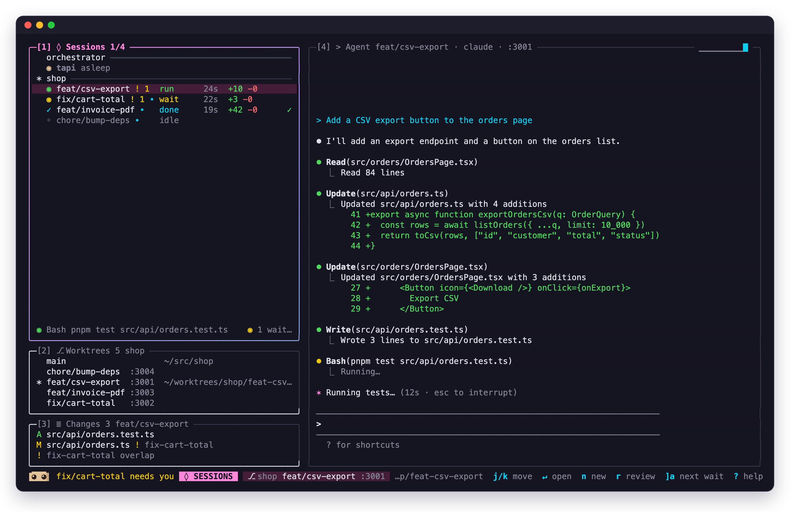
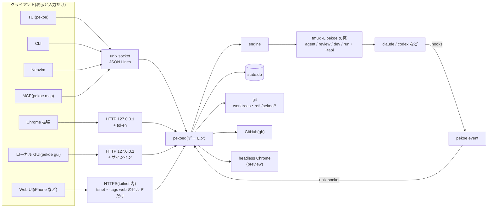

<p align="center"></p>

<p align="center"><a href="README.md">English</a> | 日本語</p>

# pekoe

A cozy home for your coding agents. — with tapi, your little companion

[](LICENSE)
[](https://github.com/sakamosu/pekoe/releases/latest)
[](https://github.com/sakamosu/pekoe/actions/workflows/govulncheck.yml)

pekoe は、ターミナルの中で複数のコーディングエージェントを worktree ごとに並行して動かすためのツールです。worktree の用意、どのエージェントが待っているかの把握、差分のレビュー、PR の作成までを pekoe が引き受けます。Claude Code の使い方は変わりません(エージェントはそのまま tmux の中で動き、pekoe は hooks で状態を受け取ります)。

- 1 タスク = 1 worktree = 1 エージェントです。`pekoe new` は worktree を作り、設定ファイルのコピー・setup・ポートの割り当てまで済ませてから claude(または codex)を起動します
- TUI でセッションを一覧し、入力待ち・許可待ち・レビュー待ちのセッションへ順に移動できます。最下行のマスコット tapi が全体の状態を表します
- 統括役の tapi に話しかければ、tapi がセッションを作って任せ、報告を待ち、人の判断が要るものだけを受信箱に上げます
- 変更は hunk 単位でレビューし、コメントを 1 通にまとめてエージェントに返せます(Neovim か組み込みのレビュー画面)
- Chrome 拡張でページの要素を選び、指示と一緒に送れます。dev server のスクリーンショットは TUI の中に表示できます
- iPhone から Tailscale 経由で(任意のビルド)、この Mac のブラウザからはローカル GUI で、許可待ちに答えたりメッセージを送ったりできます

<p align="center"></p>

> [!WARNING]
> pekoe はコーディングエージェントを動かすツールです。エージェントはあなたのユーザー権限でコマンドを実行し、ファイルを読み書きします。`pekoe hooks install` は `~/.claude/settings.json` を書き換えます(バックアップを残します。`pekoe hooks uninstall` で pekoe の分だけ外せます)。エージェントに pekoe 自体を使わせる場合は、先に[エージェントに pekoe を使わせるときの権限](#エージェントに-pekoe-を使わせるときの権限)を読んでください。脆弱性の報告については [SECURITY.md](SECURITY.md) をご覧ください。

## 状況と動作環境

- **作者が毎日の開発で使っています。** 設定・API・コマンドはバージョン間で変わることがあります(変更はリリースノートに書きます)
- **MIT ライセンスです**([ライセンス](#ライセンス))。リリースのダウンロード(curl の場合)にも `pekoe update` にも、GitHub のアカウントは要りません
- **macOS で開発と動作確認をしています**(ターミナルは Ghostty)。Linux 向けのビルドも配布していますが、動作を確認できていない部分があります。macOS を前提にしているのは、`[worktree] clone` の APFS クローン(ほかでは通常のコピー)、`make install-launchd` と launchd の pekoed の `pekoe daemon restart`、TUI 内プレビューの headless Chrome の既定のパス(`PEKOE_CHROME` で変更可)、`b` の `open -a "Google Chrome"`、`pekoe adopt` の `lsof` です
- **主な対象は Claude Code です**(hooks で状態を受け取ります)。codex・opencode なども `[agents.*]` で使えますが、状態は画面から推測するだけです
- **必要なもの:** tmux 3.3+、git、動かすエージェント。Linux では、pekoe 自身の sandbox に bubblewrap(`bwrap`)、Claude Code の sandbox に bubblewrap と socat が必要です。ソースからインストールする場合は Go 1.27.4+ も必要です(`make` は `GOTOOLCHAIN=local` で手元の Go だけを使います)。任意: gh(issue・land・PR ビュー・PR レビュー)、Neovim 0.10+(レビュー面)、Chrome(拡張・TUI 内プレビュー)、Tailscale(Web UI)
- **ターミナル層は tmux です。** libghostty-vt を使った自前の mux([docs/design.md](docs/design.md) のフェーズ 5)は未着手で、作らない可能性もあります。右ペインを文字として描き直すので、Kitty graphics のパススルーはできません(TUI 内プレビューの画像は pekoe 自身が描きます)

## 構成



処理の中心はすべて pekoed にあり、TUI・CLI・Neovim・Chrome 拡張・MCP・ローカル GUI・Web UI は同じ API を使う表示層です。pekoed を止めてもエージェントは tmux の中で動き続け、次に起動した pekoed が拾い直します。

## ドキュメント

使い方の詳細:

| | |
| --- | --- |
| [docs/install.md](docs/install.md) | インストールと更新の詳細(Homebrew・リリースの検証と署名・`pekoe update` の挙動・スキルのインストール) |
| [docs/commands.md](docs/commands.md) | 各コマンドの詳しい挙動と制限 |
| [docs/tui.md](docs/tui.md) | TUI のキー・tapi chat とダッシュボード・チュートリアル・TIPS・レビューの詳細 |
| [docs/agent-permissions.md](docs/agent-permissions.md) | エージェントに pekoe を使わせるときの権限(sandbox の設定・自分の設定との組み合わせ・許可リスト・hooks の sandbox・pekoed の git) |
| [docs/config.md](docs/config.md) | 設定の全項目(注釈付きの `config.toml`・リポジトリの設定・`dev` / `dev_stop`・モデルの固定) |
| [nvim/README.md](nvim/README.md) / [extension/README.md](extension/README.md) | Neovim プラグイン / Chrome 拡張 |

設計:

| | |
| --- | --- |
| [docs/design.md](docs/design.md) | 設計書(状態モデル・worktree フロー・ターミナル層・レビュー・CLI とキー) |
| [docs/api.md](docs/api.md) | pekoed の API(unix socket・HTTP・HTTPS・MCP) |
| [docs/web.md](docs/web.md) | iPhone 用 Web UI の構成・設定・脅威モデル |
| [docs/gui.md](docs/gui.md) / [docs/gui-design.md](docs/gui-design.md) | ローカル GUI(`pekoe gui`)の認証・脅威モデル・段階 / 見た目の原則 |
| [docs/mascot.md](docs/mascot.md) | マスコット tapi の形・状態・表情 |
| [docs/tapi-chat.md](docs/tapi-chat.md) / [docs/orchestration.md](docs/orchestration.md) | tapi chat の設計 / 統括役(tapi)を中心にした「セッションを人が管理しない」使い方の設計 |
| [docs/voice.md](docs/voice.md) | pekoe voice(状態の変化を tapi が音声で知らせる・返事の読み上げ・backend の約束事) |
| [docs/project-layer.md](docs/project-layer.md) | セッションの上にプロジェクトの層を作るかどうかの設計記録(作らないと決めた) |
| [docs/ui-guidelines.md](docs/ui-guidelines.md) / [docs/ambiguous-width.md](docs/ambiguous-width.md) | TUI のデザイン原則 / 曖昧幅の文字の扱い |

開発者向けには、[CONTRIBUTING.md](CONTRIBUTING.md)(テスト・隔離環境・リリースの手順。英語)と [docs/verification.md](docs/verification.md)(設計書・デザイン原則・モックと実装の対応表)があります。docs/ の文書は日本語です(`.en.md` が付いたものは英語版)。

## インストール

必要なものは[状況と動作環境](#状況と動作環境)をご覧ください。ソースからインストールする場合:

```sh
make install            # ~/.local/bin/pekoe (+ pekoed), nvim/ と extension/ を ~/.local/share/pekoe に link
make install WEB=1      # iPhone 用 Web UI も入れる(-tags web、Tailscale の tsnet をリンク)
pekoe hooks install     # ~/.claude/settings.json に hooks を追加(書く前に確認し、バックアップを残す)
pekoe skills install    # 任意: pekoe のスキルを ~/.claude/skills にリンク(書く前に確認する)
make install-launchd    # 任意: ログイン時に pekoed を起動
```

hooks は `SessionStart` `UserPromptSubmit` `Notification` `Stop` `PreToolUse` `PostToolUse` `SessionEnd` で `pekoe event` を呼ぶだけで、プロジェクト側の `.claude/` には触れません(`pekoe hooks status` で確認)。インストールし直したあとは `pekoe daemon restart` で pekoed を新しいバイナリに切り替えます(エージェントは動き続けます)。

### Homebrew で

macOS と Linux(arm64 / amd64)では、tap [sakamosu/homebrew-tap](https://github.com/sakamosu/homebrew-tap) から既定のビルド(Web UI なし)を入れられます。tmux と git も依存として入ります:

```sh
brew install sakamosu/tap/pekoe
pekoe hooks install
brew upgrade pekoe      # 更新(pekoe update は Homebrew で入れたものを断る)。そのあと pekoe daemon restart
```

Web UI が要るなら、リリースの `_web` のアーカイブか `make install WEB=1` を使います。cask の中身・quarantine 属性・launchd は [docs/install.md](docs/install.md#homebrew-で) にあります。

### リリースから(ビルド済みバイナリ)

GitHub Release に darwin / linux × arm64 / amd64 のビルドを置いています。`pekoe_<ver>_<os>_<arch>.tar.gz` が既定のビルド、`…_web.tar.gz` が Web UI 入りのビルドです。`gh` か、トークンなしの curl で取得します:

```sh
ver=$(gh release view -R sakamosu/pekoe --json tagName -q .tagName | sed 's/^v//')   # 最新の版(特定の版なら ver=<version>)
gh release download "v$ver" -R sakamosu/pekoe -p "pekoe_${ver}_darwin_arm64.tar.gz" -p checksums.txt   # darwin_arm64 は手元の <os>_<arch> に
# gh がなければ curl で:
#   ver=$(curl -fsSL https://api.github.com/repos/sakamosu/pekoe/releases/latest | sed -n 's/.*"tag_name": *"v\([^"]*\)".*/\1/p')
#   base="https://github.com/sakamosu/pekoe/releases/download/v$ver"
#   curl -fL -O "$base/pekoe_${ver}_darwin_arm64.tar.gz" -O "$base/checksums.txt"
shasum -a 256 --ignore-missing -c checksums.txt
gh attestation verify "pekoe_${ver}_darwin_arm64.tar.gz" -R sakamosu/pekoe \
  --signer-workflow sakamosu/pekoe/.github/workflows/release.yml --source-ref "refs/tags/v$ver"   # release.yml がこのタグからビルドしたか(v0.1.0〜v0.3.0 には来歴がない)
mkdir -p ~/.local/opt ~/.local/bin
tar -xzf "pekoe_${ver}_darwin_arm64.tar.gz" -C ~/.local/opt
ln -sfn ~/.local/opt/"pekoe_${ver}_darwin_arm64" ~/.local/opt/pekoe
ln -sf ~/.local/opt/pekoe/bin/pekoe ~/.local/bin/pekoe
ln -sf ~/.local/opt/pekoe/bin/pekoed ~/.local/bin/pekoed
pekoe version
```

Web UI 入りなら、アーカイブ名と展開先のディレクトリ名の末尾に `_web` を付けます。`checksums.txt` で分かるのは壊れていないことだけで、本物かどうかは `gh attestation verify`(ビルド来歴)で確かめます。v0.5.0 以降の macOS 向けバイナリは Developer ID で署名・公証済みです。来歴・署名の詳細、アーカイブの中身、launchd での起動は [docs/install.md](docs/install.md#リリースからビルド済みバイナリ) にあります。

### 更新

```sh
pekoe update --check    # 新しいリリースがあるか見るだけ(誰でも使える)
pekoe update            # 最新のリリースに入れ替える
pekoe update --version vX.Y.Z --force   # 特定の版に(古くなるときは --force)
pekoe update --allow-unverified         # 来歴を確かめられなくても続ける
```

`pekoe update` は今の pekoe と同じ OS・アーキテクチャ・ビルド(`_web` かどうか)のアーカイブを選び、SHA-256 とビルド来歴を確かめてから、pekoe・pekoed・nvim プラグイン・Chrome 拡張だけを入れ替えます(`state.db` などには触れません。失敗したら元に戻します)。v0.4.0 以降で来歴を確かめられなければ止まります。Homebrew などで入れたもの・書き込めない場所のものは断ります。入れ替えは人間だけの操作です。終わると `pekoe daemon restart` するかを尋ねます。詳しくは [docs/install.md](docs/install.md#更新)。

## クイックスタート

```sh
cd ~/src/app
pekoe init                                            # ~/.config/pekoe/repos/<repo-id>.toml を下書きし、main セッションを起動
pekoe new feat/csv --prompt "CSV エクスポートを追加"   # worktree → copy → setup → port → claude 起動
pekoe new feat/invoice --from gh#128                  # issue 本文を初期プロンプトに
pekoe                                                 # TUI
```

`pekoe init` は、lockfile・`.envrc`・git の無視ファイルから setup や copy を推測し(`test` は実行できると分かったときだけ書き、そうでなければ理由を添えてコメントアウトします)、コピーする無視ファイルを選んでもらってから書き込みます。書き込んだら、リポジトリ本体のチェックアウトでエージェント(main セッション)を起動します(`--no-open` で起動しない)。手で起動したエージェントは `pekoe adopt` で、既存の worktree は `pekoe open` で取り込めます([詳しく](docs/commands.md#pekoe-init-が下書きするもの))。

## コマンド

よく使うものと、エージェントが使うもの。各コマンドの細かな挙動・制限は [docs/commands.md](docs/commands.md) にあります。

| コマンド | すること |
| --- | --- |
| `pekoe` | TUI を開きます(デーモンが動いていなければ起動します) |
| `pekoe init [<dir>] [--yes] [--overwrite] [--print] [--no-open]` | リポジトリの設定を検出して下書きし、本体のチェックアウトに main セッションがなければ起動します |
| `pekoe new <branch> [--repo R] [--from gh#N] [--agent codex] [--model M] [--effort E] [--base REF] [--after SLUG]... [--hold] [--prompt TEXT] [--request ID]` | worktree とセッションを作ります。`--base` がなければ origin の base を fetch し、手元が遅れていれば `origin/<base>` から始めます。`--after` は前のセッションを記録し、`--hold` を付けるとそれが landed になるまで `queued` で待ちます。`--model` / `--effort` はこのセッションだけの上書きです |
| `pekoe open [<worktree>] [--resume\|--new] [--agent NAME]` | 既存の worktree でエージェントを起動します(過去の Claude Code セッションを resume するか選べます) |
| `pekoe adopt [<path>] [--yes]` | pekoe の外で動いているエージェントを止め、同じセッションを pekoe の中で resume します |
| `pekoe ls [--all\|--repo R]` | セッションの一覧と状態を表示します |
| `pekoe issues [<N>] [--repo R] [--all\|--label L] [--refresh]` | GitHub の open issue(既定は自分が担当のもの)を、セッションの状態を添えて表示します。`<N>` は本文とコメント |
| `pekoe conflicts [--repo R]` | 衝突予報: 同じファイルを変更しているセッションの組と、衝突するか(`git merge-tree`) |
| `pekoe send <slug> <text> [--no-enter]` | pty に文字を送ります(既定で Enter を付けます。`-` で stdin) |
| `pekoe review [<slug> \| gh#N [--repo R]]` | レビュー面を開きます(引数なしなら次のレビュー待ち、`gh#N` ならほかの人の PR) |
| `pekoe land <slug>` | rebase → test → push → `gh pr create`。マージを検出すると teardown と worktree の削除をします。エージェントも実行できます(マージは人が決めます) |
| `pekoe cleanup [--all\|--repo R] [--stale 72h]` / `pekoe cleanup --rm <slug>… \| --rm --landed [--force] [--yes]` | 片付けの候補(landed・マージ済み・長く止まっているセッション)を、未コミットのファイルや push していないコミットの数と一緒に表示し、`--rm` で削除します。自動では何も消しません |
| `pekoe rm <slug> [--force] [--yes]` | teardown を実行してから worktree を削除します(pekoe が `~/worktrees` 配下に作ったものだけ) |
| `pekoe repo forget <名前\|repo-id\|パス> [--config] [--yes]` | もう使わないリポジトリを pekoe の記録から外します(`--config` で `repos/<repo-id>.toml` も削除) |
| `pekoe report <summary> --status done\|blocked\|progress\|review [--evidence E]... [--verdict pending\|pass\|fail --reviewed-sha SHA]` | セッションのエージェントが作業の結果や独立レビューの合否を記録します |
| `pekoe reports [<slug>] [--limit N]` | 報告を新しい順に表示します |
| `pekoe wait [--mine] [--slug S,…] [--on KINDS] [--since CURSOR] [--timeout 30m]` | セッションに何か(報告・`started`・`done`・`waiting`・`failed`・`pr`・`ci`・`landed`・`inbox` など)が起きるまで待ちます。返った `cursor` を次の `--since` に渡せば取りこぼしません |
| `pekoe ask-human <question> [--option O]... [--recommend N] [--decided N] [--kind decision\|approve\|login\|fyi] [--about SLUG] [--context TEXT\|-] [--link URL]... [--wait [--timeout 30m]]` / `pekoe ask-human --wait <id>` | エージェントが人に判断・承認・手作業を頼みます(判断の受信箱)。pekoed はセッションの事実(ブランチ・差分・PR・CI など)を添えます |
| `pekoe inbox [<id>] [--all] [--mine]` / `pekoe inbox answer <id> [<n>] [--note …] [--rev N]` / `pekoe inbox dismiss\|withdraw <id> [--note …]` | 受信箱の一覧・詳細・回答。答えられるのは人だけです。land した PR にマージしてよい根拠がそろうと、pekoed がマージの項目を作り、`merge` と答えると pekoed がマージします([docs/commands.md](docs/commands.md) に条件) |
| `pekoe ledger [<id>] [--all]` / `pekoe ledger done\|drop\|close\|link <id> …` / `pekoe ledger keep [<id>]` / `pekoe ledger reopen\|rm <id>` | tapi chat への依頼の記録。tapi がセッションを結び付けて閉じ、雑談は自動で `chat` として閉じます |
| `pekoe stats [--days N] [--repo R] [--json]` | マージした PR の数と使ったトークンを、日付とリポジトリごとに表示します(既定は直近 7 日) |
| `pekoe dev <slug>` / `pekoe dev --log [<slug>] [--lines N]` | `dev` をそのセッションのポートで起動・停止します / dev hook のログの末尾 |
| `pekoe undo <slug> [n]` | 最後(または n 番目)のプロンプトによる変更を取り消します |
| `pekoe answer <slug> allow\|deny\|always` | 許可待ちに答えます |
| `pekoe attach <slug> [agent\|review\|dev]` | tmux の窓に直接 attach します(デバッグ用) |
| `pekoe hooks install\|uninstall\|status [--yes]` | Claude Code の hooks を追加 / 削除 / 確認します |
| `pekoe skills install\|uninstall\|status [--yes]` | pekoe の Claude Code スキルをリンク / 解除 / 確認します([Claude Code スキル](#claude-code-スキル)) |
| `pekoe ext` | Chrome 拡張に入力する port と token を表示します |
| `pekoe web` | Web UI の状態・URL・初回のログイン URL を表示します |
| `pekoe gui [--no-open\|--status\|--revoke\|--stop]` | ローカル GUI を一度きりのサインインのリンクで開きます([この Mac のブラウザから](#この-mac-のブラウザからローカル-gui)) |
| `pekoe mcp` | エージェント用の MCP サーバー(stdio)です |
| `pekoe daemon start\|stop\|restart\|status` | デーモンを操作します。エージェントは tmux の中で動き続け、開いている TUI はつなぎ直します |
| `pekoe daemon stop --kill-agents [--yes]` | tmux サーバーも止めます。**既定のソケットに使うと、すべてのエージェントが止まります**(隔離環境の片付け用) |
| `pekoe tapi [status\|reset [--yes]]` | tapi chat の状態 / 終了して会話を忘れさせます(依頼と受信箱は残ります) |
| `pekoe tip [<id>] [--list] [--doc PATH]` | pekoe の機能を 1 つ紹介します([TIPS](#tips)) |
| `pekoe config edit\|check\|show\|path` | `config.toml` を `$EDITOR` で開いて閉じたら検査する / 検査する / 既定値込みで表示する / 場所を表示する |
| `pekoe voice [on\|off\|mute [--for 30m]\|unmute\|stop\|backends\|log [-n 50]]` | 状態が変わったら tapi が喋ります(macOS だけ。[docs/voice.md](docs/voice.md))。サブコマンドなしは状態です |
| `pekoe voice mode <slug> read\|narrate\|mute\|auto` | 1 つのセッションの喋り方を決めます(`auto` で既定に戻す) |
| `pekoe voice test "<文>" [--voice tapi\|reader] [--lang ja\|en]` | 文をそのまま鳴らし、backend と待ち時間を表示します |
| `pekoe update [--check] [--version vX.Y.Z] [--no-web] [--force] [--allow-unverified] [--yes]` | GitHub の最新リリースに入れ替えます([更新](#更新)) |
| `pekoe version` | バージョンを表示します |

- `R` には、repo-id、短い名前(`~/worktrees/<name>` の name)、パスのどれでも指定できます。slug を取るコマンドは `<repo>/<slug>` でも指定できます
- `--json` を付けると機械可読な形式で出力します(サブコマンドの前後どちらにも書けます)。`--help` / `-h` は使い方を表示するだけです。`-` で始まる文字列を位置引数にするときは `--` の後に書きます
- `pekoe event <Hook>` は hooks から呼ばれる内部用のコマンドです
- エージェントが token なしで使えるのは、`ls`・`new`・`send`・`land`・`report`・`reports`・`wait`・`ask-human`・`inbox`(一覧と自分の問いの `withdraw`)・`ledger`(tapi chat だけ)・`stats`・`conflicts`・`cleanup`(一覧)・自分のセッションの `dev`・landed のセッションの `rm` だけで、それぞれに制限があります。それ以外は人間だけの操作です([エージェントに pekoe を使わせるときの権限](#エージェントに-pekoe-を使わせるときの権限))
- セッションが消えるとき、pekoed はその窓がバックグラウンドに残したプロセスも止めます(見分け方と止めないものは [docs/commands.md](docs/commands.md))

## TUI

左に番号付きのパネル([1] Sessions、[2] Worktrees ⇄ Browser ⇄ Issues、[3] Changes ⇄ Picks)、右に [4] Agent(エージェントの画面そのもの。preview・dev・run・PR の窓にも切り替わります)、最下行に powerline のステータスとキーヒントが並びます。100 列未満では左の列がタブ 1 枚になります。セッションはリポジトリごとにまとめて表示し、その上に常に tapi の行([tapi chat](#tapi-chat))があります。

最下行の左端にいるマスコット tapi は、全セッションのうち最も優先度の高い状態を顔で表し、隣の 1 行で誰が何をしているかを伝えます:

| 顔 | 状態 | 意味 |
| --- | --- | --- |
| `⨯ ⨯` | error | エージェントの異常終了・コマンドの失敗 |
| `◕ ◕` | wait | 入力・許可を待っている |
| `◉ ◉` | work | 出力中・コマンド実行中 |
| `^ ^` | done | ターンが終わり、まだ見ていない |
| `∙ ∙` | idle | プロンプトで待機中 |
| `- -` | sleep | 全セッションが 3 分以上 idle |

見ていないセッションが wait / error になるとトーストが出ます。PR のマージ・CI の失敗・レビューにも一度だけ反応します([docs/mascot.md](docs/mascot.md))。

| キー | 動作 |
| --- | --- |
| `j` `k` / `↵` | セッションか tapi の行を選ぶ / 右ペインに入って入力する(`^q` 以外のキーはすべてエージェントに届きます) |
| `^q` / `^q` `h` `l` | 入力をやめて Sessions に戻る(`[keys] prefix` で変更可)/ 左のパネル・右ペインにフォーカスする |
| `i` / `h` `Esc` | Agent パネルで入力を始める / 左に戻る |
| `^q` `z` / `^q` `<` `>` `=` | 右ペインを全幅にする(トグル)/ 左ペインを狭める・広げる・既定に戻す |
| `^q` `,` / `^q` `o` / `^q` `m` | `config.toml` を編集する / tapi のダッシュボードへ移る / 音声をミュートする(トグル)。どれも入力中でも使えます |
| `n` | 新しい worktree とセッションを作る |
| `t` / `T` | tapi chat を開いて話しかける / tapi chat をリセットする(確認あり) |
| `w` | リポジトリを選ぶ |
| `]a` `[a` / `]r` | 次の待ちセッション(PR の動き・tapi の許可待ちも含む)へ / 元の場所に戻る / 次のレビュー待ちへ |
| `r` / `p` | レビュー面を開く / PR ビューを開く(checks・レビュー・スレッド。`space` で選び `s` でエージェントに送る) |
| `v` | preview 窓(dev server のスクリーンショット。`m` でモバイル幅、`c` で before/after)→ dev 窓 → agent の順に切り替える |
| `b` `l` `d` | ポートを Chrome で開く / land(衝突予報付きの確認あり)/ dev server |
| `!` | その worktree でコマンドを 1 回実行する(run 窓。終わったら `y` で結果をエージェントに伝える) |
| `u` `R` | 最後のプロンプトを undo する / エージェントを再起動する(resume) |
| `s` `i` `↵` | エラーカード(dev server やブラウザのエラー)を送る / 無視する / 詳細を見る |
| `x` `D` | セッションを終了する(worktree は残す)/ worktree を削除する(確認あり) |
| `/` `?` `:` | 絞り込み / キー一覧(選んで Enter で実行)/ コマンド(`new` `send` `land` `rm` `dev` `undo` `restart` `review` `inbox` `voice` `cleanup` `config` `ext` `tutorial` `q`) |
| `:voice` / `:cleanup` | 音声が喋ったことの記録 / 片付けの一覧(`space` で選び `D` で削除) |
| `H` / `.` | チュートリアルをもう一度見る / 次の tip(空き表示に tip が出ている間) |
| `1`–`4` `Tab` `[` `]` | パネルの移動 / サブタブの切り替え |
| `q` | 終了 |

- 許可待ちになると、どのセッションでも tapi chat でも、Permission モーダルが最前面に出ます(`y` 許可・`n` 拒否・`A` 常に許可・`g` そのセッションへ・`esc` 後で)。文字を入力している間は割り込みません
- 受信箱にエージェントが答えを待つ新しい問いが届くと、手が止まったときに答える画面が前に出ます(`]a` で後からも答えられます)
- [2] Issues では `n` で issue からセッションを作れます。[2] Browser は Chrome の localhost のタブをセッションと結び付けます。Chrome から要素が届くと Agent ペインにカードが出ます
- 同じファイルを変更しているセッションには、一覧に警告のアイコンと相手の数が付きます

各キーの細かな挙動・パススルーする端末の機能は [docs/tui.md](docs/tui.md)、すべてのキーは [docs/design.md](docs/design.md#cli-コマンドとキーバインド) にあります。

### tapi chat

どのパネルからでも `t` を押すと、[4] がマスコット tapi との会話(tapi chat)に切り替わり、そのまま入力できます。tapi は**統括役**です。頼まれた変更を自分では書かず、`pekoe new` でセッションを作って任せ、`pekoe wait` で報告を待ち、結果を 1 通にまとめて返します。人に上げるのは、判断と承認が必要なもの(受信箱)だけです。単発の調査や、複数のリポジトリにまたがる質問には tapi 自身が答えます。tapi を使わずに、セッションを作って直接入力する使い方もこれまでどおりできます。

- `^q` で閉じます。会話は残り、もう一度 `t` で続きから始められます。`Esc` はエージェントに届きます(Claude Code の中断)
- エージェントは初めて開いたときに起動します。稼働ディレクトリは `~/.local/share/pekoe/tapi/` で、pekoed が役割を書いた `CLAUDE.md` を置きます。pekoe が知っているリポジトリと `~/worktrees` を読めますが、書き込めません
- Sessions の一番上の tapi の行を選んでいる間、[4] は**ダッシュボード**になります。人の対応が必要なもの、受信箱、セッションごとの工程表(`impl → review → PR → CI → merge` と、マージに足りない条件)、依頼、今日と直近 7 日の数(`pekoe stats`)を、モデルのトークンを使わずに 1 画面にまとめます。`↵` で受信箱に答え、`o` で報告の evidence(スクリーンショット・ログ・PR)を開きます。どこからでも `^q` `o` で入れます
- tapi が許可待ち・質問待ちになると、セッションの wait と同じように知らせます(トースト → 最下行の点滅 → OS の通知。`[orchestrator] notify = "quiet"` で控えめに)
- tapi に打った文は依頼(`pekoe ledger`)として記録され、済んだら閉じられます。`T`(または `pekoe tapi reset`)で会話を忘れさせても、依頼と受信箱は残ります
- Web UI(iPhone)の tapi タブからも話しかけられます。エージェントは `[tapi] agent` で変えられます

詳しくは [docs/tui.md](docs/tui.md#tapi-chat)・[docs/tapi-chat.md](docs/tapi-chat.md)・[docs/orchestration.md](docs/orchestration.md)。

### チュートリアル

TUI を初めて起動すると、画面をひととおり案内するツアーが始まります。前半は「tapi に頼む」(tapi の行・tapi chat・ダッシュボード・受信箱)、後半は「自分で直接動かす」(Sessions・エージェント・新規セッション・Changes とレビュー・PR view と land・キー一覧)です。`↵` / `→` で進み、`←` で戻り、`esc` で終了します。カードは英語と日本語があり(ロケールで選び、`tab` で切り替え)、ツアーは TUI の中だけのサンプルで、pekoed には何も作りません。`H` か `:tutorial` でもう一度見られます([docs/tui.md](docs/tui.md#チュートリアル))。

### TIPS

pekoe は、機能を「こう使うと便利」という形で 1 つずつ紹介します。表示されるのは、[4] の空き表示(`.` で次へ)と、tapi chat の最初のあいさつです。tapi に「tip ちょうだい」と頼めば次の 1 つを、「もっと詳しく」と聞けば tip が指す docs を読んで説明します(`pekoe tip`・`pekoe tip --doc`)。見せた tip は `~/.local/share/pekoe/tips.json` に記録し、一巡するまで同じものは出しません。`[tips] enable = false` で止まります。一覧は `pekoe tip --list` です。TIPS の文面だけは日本語です。

## レビュー

- `done` になったセッションはレビュー待ちに入り、Stop hook で `test` が自動で実行されます(コマンドが見つからなければ失敗ではなく `test could not run` と表示します)
- 承認は hunk 単位です(パスと変更内容のハッシュで識別するので、行番号がずれても承認は残ります)
- `S`(nvim では `:PekoeSend`)で未送信のコメントを 1 通にまとめて送り、レビュー地点 `refs/pekoe/<slug>/review-<n>` を記録します。次のレビューではそこからの差分だけが出ます
- 各 hunk には「どのプロンプトから生まれたか」(`← prompt #3: …`)が出ます。`?` で hunk の意図をエージェントに尋ねられます
- `pekoe review gh#123` で、ほかの人の PR も同じ画面でレビューできます(コメントは GitHub review として送ります)
- `[review] gatekeeper` に読み取り専用のエージェントのコマンドを書くと、リスクのある箇所の一覧が Comments パネルと nvim の `:PekoeRisks` に出ます

## 連携

### Neovim

lazy.nvim に `{ dir = "~/.local/share/pekoe/nvim" }` を追加します(リリースから入れた場合は `~/.local/opt/pekoe/share/pekoe/nvim`)。pekoe が起動する nvim には自動で読み込まれます。レビュー面(`:PekoeReview` `:PekoeSend`)のほか、選択範囲を送る `<leader>bs`、選択範囲から新しいセッションを作る `<leader>bn`、許可待ちのフロート(`<leader>ba`)などがあります。詳しくは [nvim/README.md](nvim/README.md)。

### Chrome 拡張

`chrome://extensions` → デベロッパーモード → 「パッケージ化されていない拡張機能を読み込む」で入れ、`pekoe ext` が表示する port と token をオプションに入力します。⌘⇧E(macOS 以外は Ctrl+Shift+E)で要素を選び、指示と切り抜いたスクリーンショットを送ります。localhost のページのエラーと開いているタブの情報も pekoed に届きます。詳しくは [extension/README.md](extension/README.md)。

### MCP

`claude mcp add pekoe -- pekoe mcp` で登録します。ツールは `open_in_editor(path, line, note?)`(nvim がその行に移動してメモを表示します)と `session_list()` です。

### Claude Code スキル

[skills/](skills/) にある 4 つです。どれも、tapi chat と main のチェックアウトのエージェントの両方で使えます([docs/orchestration.md](docs/orchestration.md))。

| スキル | 使う側 | 中身 |
| --- | --- | --- |
| [pekoe](skills/pekoe/SKILL.md) | main・tapi | 変更の依頼を `pekoe new` で別の worktree・別のエージェントに任せ、追加の指示も `pekoe send` で送る(ハブの基本) |
| [pekoe-orchestrate](skills/pekoe-orchestrate/SKILL.md) | tapi・ハブ | 依頼の分け方、プロンプトのテンプレート、`pekoe wait` での待ち方、人に上げる基準、人への報告の形 |
| [pekoe-work](skills/pekoe-work/SKILL.md) | 作業セッション | 計画 → 実装 → テスト → 独立レビュー → `pekoe land` → `pekoe report` |
| [pekoe-review](skills/pekoe-review/SKILL.md) | 独立レビュー | 作者でないエージェントが差分を読み、合否を SHA 付きで `pekoe report --status review` に残す |

`pekoe skills install` は、バイナリに同梱したスキルの文をデータディレクトリに書き出し、`~/.claude/skills/<name>` からリンクします(書く前に確認します。pekoe を更新すると pekoed の起動時に書き出し直します)。手で張ったリンクの扱い・`status` / `uninstall` は [docs/install.md](docs/install.md#claude-code-スキルのインストール) にあります。

### エージェントに pekoe を使わせるときの権限

エージェントはあなたと同じユーザーで動くので、pekoed のソケットに接続できます。そこで pekoed は、`human-token` を付けない呼び出しには、エージェントに必要なもの(ハブの `ls`・`new`・`send`・`wait` など、作業セッションの `report`・`ask-human`・自分の `dev`、`land`、landed の `rm`)だけを許し、許可待ちへの回答・受信箱への回答・設定の書き込み・デーモンの停止などは人間だけの操作にしています。token は `~/.local/share/pekoe/human-token`(0600)にあり、TUI・CLI・Neovim が読んで付けます。エージェントには渡しません。

同じユーザーのエージェントはファイルを読めてしまうので、次のもので token と秘密を守ります:

1. **Claude Code のエージェントは、pekoe が設定を渡す Claude Code の sandbox の中で動きます(既定)。** pekoe は起動のたびに `--settings <データディレクトリ>/agent-settings/<slug>.json` を付け、token・`state.db`・pekoe の設定などを読めないように、リポジトリの `.git/config`・`.git/hooks` を書けないようにします(tapi chat はリポジトリにも書けません)。sandbox が使えなければ Claude Code は起動しません。対象は claude だけで、`[agents.claude] sandbox = false` で外せます。既定では worktree の外への書き込みと、許可していないドメインへの接続が通らなくなるので、必要なものだけを `~/.claude/settings.json` の `allowWrite` / `allowedDomains` で緩めます
2. **`Bash(pekoe *)` のように、pekoe を丸ごと許可しないでください。** 許可リストに入れるなら、ハブと作業セッションが使うコマンドだけに絞ります。`answer`・`init`・`rm`・`daemon`・`event` は入れないでください
3. **worktree から来るコマンドは、pekoe 自身の sandbox で動かします。** `[hooks]`(test・setup・dev・teardown)・`[review] gatekeeper`・land のテストは、macOS では `sandbox-exec`、Linux では `bwrap` の中で動き、token や設定を読むこと・あとで sandbox の外で実行されるファイルに書くことを禁じます(`[sandbox] enable = false` で外せます)。本体の `.git/hooks`・`.git/config` の変化は受信箱に知らせます
4. **pekoed 自身の git は、エージェントが git の設定に書いたものを実行しません**(fsmonitor・フック・credential helper などはあなた自身の設定か既定値で上書きします)

渡す設定の中身、自分の設定との組み合わせ方、緩め方の例(Go・npm・`gh`)、許可リストの例、確かめ方は [docs/agent-permissions.md](docs/agent-permissions.md) にあります。メソッドごとの分類は [docs/api.md](docs/api.md) の「人間だけの操作」「hooks の sandbox」「pekoed が動かす git」です。Web UI・ローカル GUI・Chrome 拡張は、ソケットを通らない人間用の入口で、それぞれの認証で使います。

### iPhone から(Web UI)

`make install WEB=1` のビルドでだけ使えます。pekoed に Tailscale の tsnet を組み込み、pekoed 自身が tailnet の 1 台(`https://pekoe.<tailnet>.ts.net/`)として HTTPS で待ち受けます。画面は Now(人が見るべきもの・依頼の進み)・Sessions・tapi の 3 つのタブで、できるのは、許可待ちへの allow / deny(`always` は出しません)、`send`(写真・スクショを 4 枚まで)、質問に答えるキーパッド、エージェントの画面の表示、受信箱への回答、工程表の表示、tapi への話しかけ(`allow_devices` を設定しているときだけ)に限られます。localhost にポートは開けず、接続のたびに Tailscale の WhoIs で `allow_users` と照合します。

1. tailnet で MagicDNS と HTTPS を有効にし、`[web]` を書いて pekoed を再起動します
2. `pekoe web` が表示するログイン URL を開いて、tailnet に参加します(`TS_AUTHKEY` でも構いません)
3. `pekoe web` の URL を iPhone の Safari で開き、ホーム画面に追加します

証明書のホスト名は Certificate Transparency ログに載ります。設計と脅威モデルは [docs/web.md](docs/web.md) にあります。

### この Mac のブラウザから(ローカル GUI)

`pekoe gui` は、Web UI と同じ API とデスクトップ向けの画面を、この Mac 自身のブラウザに `127.0.0.1` でだけ配ります(どのビルドでも使えます。打つまでは何も待ち受けません)。Web UI との違いは、tapi への send に `allow_devices` も確認シートも要らないことと、許可待ちに `always` で答えられることです。サインインは一度きりのトークン(1 回・60 秒)で、コマンドラインにも Cookie にも載せません。新しいタブや pekoed の再起動のあと、`[gui] session_ttl` の間操作しなかったとき、サインインから 24 時間たったときは、もう一度 `pekoe gui` を打ちます。`[gui] enable = false` で断ります。

**エージェントに操作させないブラウザ(プロファイル)で開いてください。** そのタブを操作できるもの(Claude in Chrome・Playwright など)は、あなたとして許可待ちに答えられます。認証と脅威モデルは [docs/gui.md](docs/gui.md) にあります。

### 音声の backend(VOICEVOX)

`pekoe voice` は、そのままでは macOS の `say` で喋ります。ほかの音声合成は、外部の **backend**(1 文を WAV ファイルにする実行ファイル)としてつなげます。pekoe が動かすのは `[voice.backends]` に絶対パスで書いた backend だけで、`PATH` からは探しません。

例: [pekoe-voice-voicevox](https://github.com/sakamosu/pekoe-voice-voicevox)(日本語だけ。まだ公開していないので、リンクと下の手順は公開されたら使えます)は、ローカルの VOICEVOX のエンジン(`127.0.0.1:50021`)を通して [VOICEVOX](https://voicevox.hiroshiba.jp/) の声で喋ります。ビルドして、エージェントが書けない場所に置きます:

```sh
git clone https://github.com/sakamosu/pekoe-voice-voicevox.git
cd pekoe-voice-voicevox
go build -o pekoe-voice-voicevox .
install -m 755 pekoe-voice-voicevox /opt/homebrew/bin/
```

```toml
[voice]
enable = true               # 無効の間はどの backend も動かない
backend = "voicevox"
fallback = "say"            # VOICEVOX のエンジンが動いていない間に使う

[voice.backends]
voicevox = "/opt/homebrew/bin/pekoe-voice-voicevox"   # 置いた場所の絶対パス
```

使えているかは `pekoe voice backends`、鳴らしてみるのは `pekoe voice test "テストだよ"` です。VOICEVOX の声はキャラクターごとに利用規約があります。作った音声を公開するときは、そのキャラクターの規約どおりにクレジットを書いてください。

backend を書きたい人へ: 約束事(v1)は [docs/voice.md の 10](docs/voice.md#10-speech-backend-の約束事-v1) です。このリポジトリの clone で `PEKOE_VOICE_CONTRACT=/絶対パス/your-backend go test ./internal/voice/backend -run TestContractExternal -v` を回すと、約束事どおりかを確かめられます(同梱の `say` も同じテストを通しています)。

## 設定

設定は 2 つのファイルです。すべての項目と注釈は [docs/config.md](docs/config.md) にあります。

`~/.config/pekoe/repos/<repo-id>.toml`(リポジトリごと。repo-id は origin の URL を正規化したもので、clone し直しても同じ設定が効きます。`pekoe init` で下書きできます):

```toml
agent = "claude"                  # 既定のエージェント

[worktree]
copy  = [".env*", ".envrc"]
clone = ["node_modules"]          # APFS クローン(cp -c)
base  = "main"                    # 既定: origin の HEAD か main

[hooks]
setup    = ["mise install", "pnpm install --offline", "createdb app_{{slug}}"]
dev      = "pnpm dev --port {{port}}"
dev_stop = "docker compose down"  # dev を止めるときと、dev が自分で終わったとき
test     = "pnpm test"
teardown = ["dropdb app_{{slug}}"]

[env]
PORT = "{{port}}"
DATABASE_URL = "postgres:///app_{{slug}}"

[review]
gatekeeper = "claude -p '危ない箇所を path:line: text で挙げて'"   # diff を stdin で受ける

[merge]
method = "merge"                  # 受信箱で merge と答えたときのマージの方法: merge | squash | rebase
```

変数は `{{slug}}` `{{branch}}` `{{port}}` `{{path}}` `{{repo}}` です。必要なときは pekoe が引用符で囲むので、**`{{…}}` を自分で引用符で囲まないでください**。setup は順に実行し、失敗したらそこで止めます。

`~/.config/pekoe/config.toml`(全体の設定。`pekoe config edit` か TUI の `^q ,` で開き、`pekoe config show` で既定値込みの値を確認できます)。よく変えるもの:

```toml
[keys]
prefix = "ctrl+q"           # 入力から抜けるキー
[theme]
icons = "nerd"              # nerd | unicode | ascii
[agents.claude]
model   = "claude-opus-5-5" # 起動のたびに --model で渡す(設定しておくのがおすすめ。下記)
effort  = "medium"          # --effort で渡す: low | medium | high | xhigh | max
[orchestrator]
max_running = 0             # 同時に作業させるセッションの上限(0 は上限なし)
[voice]
enable = false              # 状態が変わったら tapi が喋る(macOS だけ)
```

節は、`[http]`(Chrome 拡張のポート)・`[ports]`・`[keys]`・`[review]`・`[picks]`・`[web]`・`[gui]`・`[theme]`・`[mascot]`・`[agents.*]`・`[tapi]`・`[orchestrator]`・`[notify]`・`[pr]`・`[cleanup]`・`[tips]`・`[sandbox]`・`[voice]` と、トップレベルの `animate` です。

- 保存した変更は再起動なしで反映されます。例外は `[http] port`・`[web]`・`[sandbox]` で、`pekoe daemon restart` が要ります。誤りは `pekoe config check` で確認できます
- `[agents.<name>]` には `command` `resume` `prompt` `allow` `always` `deny` `hooks` `sandbox` `model` `effort` を書けます。別名のエージェント(`[agents.claude-big]`)を定義して、リポジトリの `agent` で選べます
- **`model` は設定しておいてください。** 設定がないと Claude Code の既定(`~/.claude/settings.json` の `"model"`)に従いますが、このファイルはどのセッションで `/model` を打っても書き換わるので、1 つのセッションの切り替えがその後のすべてのセッションに広がります。`pekoe new --model` で 1 つのセッションだけ上書きできます

## データの置き場(リポジトリを汚さない)

| データ | 置き場 |
| --- | --- |
| 設定 | `~/.config/pekoe/` |
| 状態 DB・socket・ログ・picks | `~/.local/share/pekoe/` |
| TUI のペイン幅・ズーム | `~/.local/share/pekoe/layout.json`(`^q` `<` `>` `=` `z` で書き換わります) |
| 見せた tip の記録 | `~/.local/share/pekoe/tips.json`(一巡すると、空からやり直します) |
| チュートリアルを見た記録 | `~/.local/share/pekoe/tutorial.json`(削除すると、次の起動でまた表示されます) |
| tapi chat の稼働ディレクトリ | `~/.local/share/pekoe/tapi/`(会話の記録は、Claude Code の `~/.claude/projects/` 側にあります。`pekoe tapi reset` で消えます) |
| 人間用トークン(許可待ちへの回答などに必要です。エージェントには読ませません) | `~/.local/share/pekoe/human-token` |
| pekoe が各エージェントに渡す Claude Code の設定(sandbox) | `~/.local/share/pekoe/agent-settings/<slug>.json` |
| スキルの文(`pekoe skills install`) | `~/.local/share/pekoe/skills/` |
| 喋ったことの記録・音声のキャッシュ | `~/.local/share/pekoe/voice.log`・`voice/cache/`(`[voice]` が有効なときだけ) |
| Web UI の tsnet ノードの鍵 | `~/.local/share/pekoe/tsnet/`(`[web]` が有効なときだけ) |
| プロンプト単位のスナップショット / レビュー地点 | `refs/pekoe/<slug>/prompt-<n>` / `review-<n>`(push されず、`git log` にも出ません) |
| worktree | `~/worktrees/<repo>/<slug>`(pekoe が削除するのは、この配下だけです) |

`$XDG_CONFIG_HOME`・`$XDG_DATA_HOME` があれば、`~/.config/pekoe`・`~/.local/share/pekoe` の代わりに `$XDG_CONFIG_HOME/pekoe`・`$XDG_DATA_HOME/pekoe` を使います。`$PEKOE_HOME` があれば、設定は `$PEKOE_HOME/config`、データは `$PEKOE_HOME/share`、worktree は `$PEKOE_HOME/worktrees` に置きます。`$PEKOE_WORKTREES` があれば、worktree はその下に置きます(下の `scripts/sandbox.sh` は、これらを使って隔離しています)。

## 開発

```sh
make test               # go vet + go test(既定と -tags web の両方)+ nvim のヘッドレステスト
scripts/sandbox.sh      # 今のソースで隔離した pekoed を立ててサブシェルへ。抜けると片付く
```

本物の pekoed や tmux サーバーに触れずに試せます。詳しくは、[CONTRIBUTING.md](CONTRIBUTING.md)(英語)をご覧ください。

## ライセンス

- コード(Go・Neovim プラグイン・Chrome 拡張・Web UI・スクリプト)は [MIT](LICENSE) です
- ロゴ画像 `docs/images/pekoe-logo.webp` は ChatGPT(AI)で生成したもので、MIT の対象外です
- リリースのバイナリには、依存ライブラリ(と Go の標準ライブラリ)を静的リンクしています。それらの著作権表示とライセンス文は、アーカイブの `THIRD_PARTY_LICENSES` にまとめてあります(既定のビルドと Web UI 入りのビルドでは依存が違うので、中身も違います)

## 貢献

PR は受け付けていません。バグ報告や要望は、[issue](https://github.com/sakamosu/pekoe/issues) にお寄せください。脆弱性は、[SECURITY.md](SECURITY.md) の手順に従って、非公開で報告してください。
