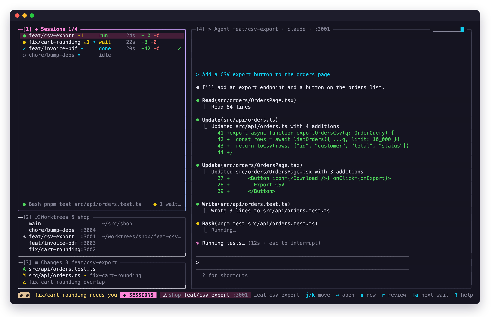
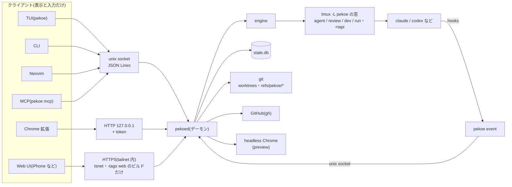

<p align="center"></p>

<p align="center"><a href="README.md">English</a> | 日本語</p>

# pekoe

A cozy home for your coding agents. — with tapi, your little companion

[](LICENSE)
[](https://github.com/sakamosu/pekoe/releases/latest)
[](https://github.com/sakamosu/pekoe/actions/workflows/govulncheck.yml)

ターミナルの中で、複数のコーディングエージェントを worktree ごとに並行して走らせるためのツール。worktree の用意、どのエージェントが待っているかの把握、差分のレビュー、PR までを pekoe が引き受ける。Claude Code の使い方は変えない(エージェントはそのまま tmux の中で動き、状態は hooks で受け取る)。

- 1 タスク = 1 worktree = 1 エージェント。`pekoe new` で worktree を切り、設定ファイルのコピー・setup・ポート割り当てまで済ませてから claude(や codex)を起動する
- TUI でセッションを一覧し、待ち・許可待ち・レビュー待ちに順に飛ぶ。最下行のマスコット tapi が全体の状態を表す
- 変更は hunk 単位でレビューして、コメントを 1 通にまとめてエージェントに返す(Neovim か組み込み)
- Chrome 拡張で画面の要素を選んで指示と一緒に送る。dev server のスクショは TUI の中に出せる
- iPhone から Tailscale 経由で許可待ちに答えたり一言送ったりできる(任意のビルド)

<p align="center"></p>

> [!WARNING]
> pekoe はコーディングエージェントを動かすツールで、エージェントはあなたのユーザー権限でコマンドを実行し、ファイルを読み書きする。`pekoe hooks install` は `~/.claude/settings.json` を書き換える(バックアップを残す。`pekoe hooks uninstall` で pekoe の分だけ外せる)。エージェントに pekoe 自体を使わせるなら、先に[エージェントに pekoe を使わせるときの権限](#エージェントに-pekoe-を使わせるときの権限)を読む。脆弱性の報告は [SECURITY.md](SECURITY.md) へ。

## 状況と動作環境

- **個人のツール。** 作者が毎日使うために作っていて、設定・API・コマンドはまだ変わりうる(互換は約束しない)
- **まだ公開していない。** MIT で公開する準備中で、リポジトリは今は private。公開するまでは、リリースを落とすのにも `pekoe update` にも、リポジトリを読める GitHub アカウントが要る([リリースから](#リリースからビルド済みバイナリ))
- **macOS で開発・確認している**(ターミナルは Ghostty)。Linux 向けのビルドも配っているが、確かめていない部分がある。macOS 前提の箇所:
  - `[worktree] clone` の APFS クローン(`cp -c`)。ほかのファイルシステムでは普通のコピーになる
  - `make install-launchd` と、launchd で動いている pekoed の `pekoe daemon restart`(`launchctl`)
  - TUI 内プレビューの headless Chrome の既定のパス `/Applications/Google Chrome.app`(`PEKOE_CHROME` で変えられる)
  - TUI の `b`(ポートを Chrome で開く)は `open -a "Google Chrome"`
  - `pekoe adopt` はプロセスの cwd を `lsof` で調べる
- **主な対象は Claude Code**(hooks で状態を受け取る)。codex・opencode なども `[agents.*]` で使えるが、状態は画面から推し量るだけ
- **必要なもの:** tmux 3.3+、git。ソースから入れるなら Go 1.27.3+(`make` は `GOTOOLCHAIN=local` で手元の Go だけを使う)。任意: gh(issue・land・PR ビュー・PR レビュー)、Neovim 0.10+(レビュー面)、Chrome(拡張・TUI 内プレビュー)、Tailscale(Web UI)
- **ターミナル層は tmux。** libghostty-vt の自前 mux([docs/design.md](docs/design.md) のフェーズ 5)は未着手で、やらない選択もある。Kitty graphics のパススルーは、右ペインを文字として描き直す tmux エンジンでは通せない(TUI 内プレビューの画像は pekoe 自身が Kitty graphics で描く)

## 構成



賢さはすべて pekoed にあり、TUI・CLI・Neovim・Chrome 拡張・MCP・Web UI は同じ API を叩く表示層。pekoed を止めてもエージェントは tmux の中で動き続け、次に起動したときに拾い直す。

## ドキュメント

| | |
| --- | --- |
| [docs/design.md](docs/design.md) | 設計書(状態モデル・worktree フロー・ターミナル層・レビュー・CLI とキー) |
| [docs/api.md](docs/api.md) | pekoed の API(unix socket・HTTP・HTTPS・MCP) |
| [docs/web.md](docs/web.md) | iPhone 用 Web UI の構成・設定・脅威モデル |
| [docs/mascot.md](docs/mascot.md) | マスコット tapi の形・状態・表情 |
| [docs/tapi-chat.md](docs/tapi-chat.md) | tapi chat(TUI の `t` で話しかける統括役のエージェント)の設計 |
| [docs/orchestration.md](docs/orchestration.md) | 統括役(tapi)を中心にした「セッションを人が管理しない」使い方の設計(設計中) |
| [docs/ui-guidelines.md](docs/ui-guidelines.md) | TUI のデザイン原則(配色トークン・レイアウト・アイコン) |
| [nvim/README.md](nvim/README.md) / [extension/README.md](extension/README.md) | Neovim プラグイン / Chrome 拡張 |

開発者向け: [CONTRIBUTING.md](CONTRIBUTING.md)(テスト・隔離環境・リリースの切り方。英語)、[docs/verification.md](docs/verification.md)(設計書・デザイン原則・モックと実装の対応表)

## インストール

必要なものは[状況と動作環境](#状況と動作環境)。ソースから:

```sh
make install            # ~/.local/bin/pekoe (+ pekoed), nvim/ と extension/ を ~/.local/share/pekoe に link
make install WEB=1      # iPhone 用 Web UI も入れる(-tags web、Tailscale の tsnet をリンク)
pekoe hooks install     # ~/.claude/settings.json に hooks を追加(書く前に確認し、バックアップを残す)
pekoe skills install    # 任意: pekoe のスキルを ~/.claude/skills にリンク(書く前に確認する)
make install-launchd    # 任意: ログイン時に pekoed を起動
```

### リリースから(ビルド済みバイナリ)

GitHub Release に darwin / linux × arm64 / amd64 のビルドを置いている。`pekoe_<ver>_<os>_<arch>.tar.gz` が既定ビルド(Web UI なし)、`pekoe_<ver>_<os>_<arch>_web.tar.gz` が Web UI 入り(`-tags web`。[docs/web.md](docs/web.md))で、中の配置は同じ。リポジトリはまだ公開していない(公開準備中)ので、今はリポジトリを読める GitHub アカウントが要る: `gh auth login` してから `gh` で落とす(Web UI 入りなら名前の `.tar.gz` の前に `_web` を足す)。公開後は、トークンなしで `gh` でも curl でも落とせる:

```sh
ver=$(gh release view -R sakamosu/pekoe --json tagName -q .tagName | sed 's/^v//')   # 最新の版(特定の版なら ver=<version>)
gh release download "v$ver" -R sakamosu/pekoe -p "pekoe_${ver}_darwin_arm64.tar.gz" -p checksums.txt   # darwin_arm64 は手元の <os>_<arch> に
# gh がなければ curl で(公開後だけ。private のあいだはこの URL は 404 になる):
#   ver=$(curl -fsSL https://api.github.com/repos/sakamosu/pekoe/releases/latest | sed -n 's/.*"tag_name": *"v\([^"]*\)".*/\1/p')
#   base="https://github.com/sakamosu/pekoe/releases/download/v$ver"
#   curl -fL -O "$base/pekoe_${ver}_darwin_arm64.tar.gz" -O "$base/checksums.txt"
shasum -a 256 --ignore-missing -c checksums.txt
gh attestation verify "pekoe_${ver}_darwin_arm64.tar.gz" -R sakamosu/pekoe   # このリポジトリのワークフローがビルドしたか(来歴があるのは公開後のリリースだけ)
mkdir -p ~/.local/opt ~/.local/bin
tar -xzf "pekoe_${ver}_darwin_arm64.tar.gz" -C ~/.local/opt
ln -sfn ~/.local/opt/"pekoe_${ver}_darwin_arm64" ~/.local/opt/pekoe
ln -sf ~/.local/opt/pekoe/bin/pekoe ~/.local/bin/pekoe
ln -sf ~/.local/opt/pekoe/bin/pekoed ~/.local/bin/pekoed
pekoe version
```

`checksums.txt` は同じ Release に置いてあるので、アーカイブが壊れていないかしか分からない。`gh attestation verify` は、アーカイブがこのリポジトリの `release.yml` でビルドされたこと(GitHub Actions が Sigstore で署名したビルド来歴)を確かめる。来歴が付くのは、リポジトリが公開されているときに `release.yml` が作るリリースだけ(private のリポジトリでは来歴に GitHub Enterprise Cloud が要るので、`release.yml` は付けない)。リポジトリはまだ private なので、今あるリリースには来歴がなく、`gh attestation verify` が通らない。公開後に作るリリースからは付く。

アーカイブの中は `bin/pekoe`、`bin/pekoed`(→ pekoe)、`share/pekoe/nvim/`、`share/pekoe/extension/`、`contrib/launchd/` と、`README.md`・`README.ja.md`・`LICENSE`・`THIRD_PARTY_LICENSES`(依存ライブラリのライセンス。[ライセンス](#ライセンス))。`bin/pekoe` は実体の位置から `../share/pekoe/nvim` を探すので、上のようにシンボリックリンクで PATH に置けば nvim プラグインもそのまま見つかる。launchd で起動するなら `sed -e "s|PEKOE_BIN|$HOME/.local/bin/pekoe|" -e "s|HOME|$HOME|g" ~/.local/opt/pekoe/contrib/launchd/dev.pekoe.pekoed.plist > ~/Library/LaunchAgents/dev.pekoe.pekoed.plist` のあと `launchctl bootstrap gui/$(id -u) ~/Library/LaunchAgents/dev.pekoe.pekoed.plist`。

既定のビルドには Tailscale のコードを一切含めない。入れ直したあとは `pekoe daemon restart` で pekoed を新しいバイナリに替える(エージェントは tmux の中で動き続ける。launchd で動かしているときは launchd から起動し直す)。

### 更新

```sh
pekoe update --check    # 新しいリリースがあるか見るだけ(誰でも使える)
pekoe update            # 最新のリリースに入れ替える
pekoe update --version vX.Y.Z --force   # 特定の版に(古くなるときは --force)
```

`pekoe update` は GitHub の最新リリース(`releases/latest`。draft と prerelease は除く)を取り、今の pekoe と同じ OS・アーキテクチャ・ビルド(Web UI 入りなら `_web` のアーカイブ)を選ぶ。

- 今の版が最新以上なら何もしない。`make install` の版(`git describe` の `0.1.0-59-g3761d74`)は「0.1.0 より 59 コミット先」として比べる。`dev` など比べられない版のときは確認する
- `checksums.txt` の SHA-256 と照らし、合わなければ何も入れ替えない。来歴(attestation)があるリリースなら `gh attestation verify` でも確かめる(リポジトリが private のあいだに作ったリリース、つまり今あるリリースはすべて来歴がないので、警告だけ出す)
- 入れ替えるのは、今動いている pekoe の実体(シンボリックリンクをたどった先)、隣の `pekoed`、`<prefix>/share/pekoe/nvim` と `extension` だけ。`~/.local/share/pekoe` の他のもの(`state.db` など)には触らない。バイナリは隣に書いてから rename し、途中で失敗したら入れ替えた分を戻す
- `make install` で入れたときの `nvim` / `extension` はリポジトリへのリンクなので、リンクをリリースの中身のディレクトリに置き換える(リポジトリには書き込まない。確認を出す。`make install` し直せばリンクに戻る)
- Web UI 入りの pekoe で、リリースに `_web` のアーカイブがないときは断る(`--no-web` で既定のビルドを入れるか、`make install WEB=1` でソースから入れる)
- 書き込めない場所や Homebrew などのパッケージマネージャーが入れたものは断る
- 終わると新旧の版を出し、pekoed が動いていれば `pekoe daemon restart` するか聞く。Chrome 拡張を入れ替えたら `chrome://extensions` で再読み込みする
- GitHub のトークンが見つかれば付けて呼ぶ: `$GITHUB_TOKEN` / `$GH_TOKEN`、なければ `gh auth token`。リポジトリが private のあいだ(まだ公開していない)は、リポジトリを読めるトークンが要る。ないと GitHub が HTTP 404 を返し、`pekoe update` は `gh auth login` するよう案内する。公開後はトークンは要らなくなり、付けると GitHub API のレート制限が緩くなるだけ(トークンなしは 1 時間に 60 回まで。超えたらしばらく待つか `gh auth login` する)
- 入れ替えは人間だけの操作。エージェントのセッションの中(`$PEKOE_SESSION` がある)や `human-token` を読めないところからは `only a person can do this` で断る。`--check` は誰でも使える

hooks は `SessionStart` `UserPromptSubmit` `Notification` `Stop` `PreToolUse` `PostToolUse` `SessionEnd` で `pekoe event` を呼ぶだけ。プロジェクト側の `.claude/` は触らない。`pekoe hooks status` で確認、`pekoe hooks uninstall` で pekoe の分だけ外す。

## クイックスタート

```sh
cd ~/src/app
pekoe init                                            # ~/.config/pekoe/repos/<repo-id>.toml を下書き
pekoe new feat/csv --prompt "CSV エクスポートを追加"   # worktree → copy → setup → port → claude 起動
pekoe new feat/invoice --from gh#128                  # issue 本文を初期プロンプトに
pekoe                                                 # TUI
```

`pekoe init` は lockfile・`.envrc`・git の無視ファイルから setup や copy を推測し、コピーする無視ファイルを番号で選ばせてから書く。手で始めたエージェントは `pekoe adopt` で、既存の worktree は `pekoe open` で取り込める。

## コマンド

| コマンド | すること |
| --- | --- |
| `pekoe` | TUI(デーモンがなければ起動) |
| `pekoe init [<dir>] [--yes] [--overwrite] [--print]` | リポジトリの設定を検出して下書き。`--print` は書かずに出すだけ |
| `pekoe new <branch> [--repo R] [--from gh#N] [--agent codex] [--base REF] [--after SLUG]... [--prompt TEXT] [--request ID]` | worktree + セッション作成。setup の進み具合を出し、エージェントが起動したら戻る。`--after` はこのセッションがどれの後かを記録する(複数可。今あるセッションだけで、自分自身・循環は断る)。記録して表示するだけ([1] の行に `after feat-a`、フッターにそれぞれの状態、`pekoe --json ls` の `after`)で、起動は止めない。`--request` は tapi chat が台帳の依頼とセッションを結ぶ(tapi と人だけ) |
| `pekoe open [<worktree>] [--resume\|--new] [--agent NAME]` | 既存 worktree で起動。過去の Claude Code セッションを resume するか選ぶ(`--resume` で resume、`--new` で新規) |
| `pekoe adopt [<path>] [--yes]` | pekoe の外で動いているエージェントを止め、同じセッションを pekoe の中で resume する |
| `pekoe ls [--all\|--repo R]` | セッション一覧と状態。リポジトリの中ではそのリポジトリだけ、外では全部 |
| `pekoe issues [--repo R] [--all\|--label L] [--refresh]` | GitHub の open issue(既定は自分担当)。セッションがあれば状態とブランチを添える |
| `pekoe issues <N> [--repo R]` | issue の本文とコメント |
| `pekoe conflicts [--repo R]` | 衝突予報。同じファイルを触っているセッションのペアと、衝突するか(`git merge-tree`) |
| `pekoe send <slug> <text> [--no-enter]` | pty に文字を送る(既定で Enter を足す。`-` で stdin) |
| `pekoe review [<slug> \| gh#N [--repo R]]` | レビュー面。引数なしなら次のレビュー待ち。`gh#N` で人の PR |
| `pekoe land <slug>` | rebase → test → push → `gh pr create`。マージ検出後に teardown と worktree 削除。エージェントも呼べる(マージは人間が決める) |
| `pekoe rm <slug> [--force] [--yes]` | teardown → worktree 削除(`~/worktrees` 配下のみ。外のものはセッションを忘れるだけ)。エージェントは landed のセッションを一覧から消すときだけ使える |
| `pekoe report <summary> --status done\|blocked\|progress\|review [--evidence E]...` | セッションのエージェントが作業の結果を残す(`-` で stdin)。どのセッションの報告かは pekoed が呼び出したプロセスから決める(`$PEKOE_SESSION` の名乗りは食い違いを出すだけ)。証拠のパスや URL は文字列として残すだけで pekoed は読まない |
| `pekoe reports [<slug>] [--limit N]` | 報告を新しい順に(エージェントが書いた文は区切りで囲んで出す)。最新のものは `pekoe --json ls` の `report` にも出る |
| `pekoe wait [--mine] [--slug S,…] [--on KINDS] [--since CURSOR] [--timeout 30m]` | セッションに何か起きるまで待つ(報告・`done`・`waiting`・`idle`・`failed`・`pr`・`landed`・`removed`)。`--mine` は自分が `pekoe new` で作ったセッションだけ。返った `cursor` を次の `--since` に渡すと取りこぼさない。pekoed を再起動すると `reset` が返るので `pekoe --json ls` から読み直す。報告なしで done になったものは `(no report)` と出る |
| `pekoe ask-human <question> [--option O]... [--recommend N] [--kind decision\|approve\|login\|fyi] [--about SLUG] [--context -] [--wait]` | エージェントが人に判断・承認・手作業を頼む(判断の受信箱)。pekoed が問いの元のセッションの事実(ブランチ・HEAD・差分・PR・CI・衝突)を自分で付ける。答えは `--wait`(や `pekoe wait --on inbox`)で待っていれば返り値で、待っていなければ手が空いたときに入力欄に `[pekoe inbox #N] 答え: …` と届く(許可ダイアログが出ている間は届けない) |
| `pekoe inbox [<id>] [--all]` / `pekoe inbox answer <id> [<n>] [--note …]` | 受信箱の一覧と 1 件の詳しい表示(エージェントの文は区切りで囲み、事実の後に出す)。答える(`answer`)・答えずに閉じる(`dismiss`)のは人だけ。TUI では項目が来るとトーストが出て、`]a` で答える画面に回れる。エージェントが答えを待つ問い(`fyi` と自分で出したもの以外)は、セッションの wait と同じく最下行に残り(`✉ feat-x asks · ]a`)、2 分で OS の通知になる(`[orchestrator] notify = "quiet"` ならメッセージ行だけ) |
| `pekoe ledger [--all]` / `pekoe ledger done\|drop\|close\|link <id> …` / `pekoe ledger reopen\|rm <id>` | 依頼の台帳。tapi chat に打った文は pekoed が open で記録し、tapi が `--request` でセッションと結び、`done --evidence <PR>`・`drop --note <理由>`・`close --as chat`(依頼ではなかった)で閉じる。`pekoe tapi reset` でも消えない。開き直す(`reopen`)・消す(`rm`)のは人だけ |
| `pekoe dev <slug>` | `dev` をそのセッションのポートで起動 / 停止 |
| `pekoe undo <slug> [n]` | 最後(か n 番目)のプロンプトの変更を取り消す |
| `pekoe answer <slug> allow\|deny\|always` | 許可待ちに答える |
| `pekoe attach <slug> [agent\|review\|dev]` | tmux の窓に直接 attach(デバッグ用) |
| `pekoe hooks install\|uninstall\|status [--yes]` | Claude Code の hooks を足す / 外す / 確認 |
| `pekoe skills install\|uninstall\|status [--yes]` | pekoe の Claude Code スキルを `~/.claude/skills` にリンクする / 外す / 確認([Claude Code スキル](#claude-code-スキル)) |
| `pekoe ext` | Chrome 拡張に入れる port と token |
| `pekoe web` | Web UI の状態・URL・初回のログイン URL |
| `pekoe mcp` | エージェント用 MCP サーバ(stdio) |
| `pekoe daemon start\|stop\|restart\|status` | デーモン操作。`stop` はプロセスが終わるまで待つ。`restart` は止まるのを待ってから起動し直し、前後のバージョンを出す(`make install` の後に。動いていなければ起動するだけ)。エージェントは tmux の中で動き続ける |
| `pekoe daemon stop --kill-agents [--yes]` | tmux サーバー(`$PEKOE_TMUX_SOCKET`)も止める。**既定のソケット `pekoe` に使うと全エージェントが止まる**。隔離環境の片付け用 |
| `pekoe tapi [reset [--yes]]` | tapi chat の状態(台帳と受信箱の残りの件数も)/ 終了して会話を忘れる(TUI の `T` と同じ。台帳と受信箱は残る) |
| `pekoe tip [<id>] [--list] [--doc PATH]` | pekoe の機能を 1 つ紹介する(まだ見せていない tip。[TIPS](#tips))。`<id>` はその tip、`--list` は一覧、`--doc` は tip が指す docs を出す(バイナリに同梱) |
| `pekoe update [--check] [--version vX.Y.Z] [--no-web] [--force] [--yes]` | GitHub の最新リリースに入れ替える([更新](#更新))。`--check` は新しい版があるか見るだけ。人間だけの操作 |
| `pekoe version` | バージョン |

- `R` は repo-id、短い名前(`~/worktrees/<name>` の name)、パスのどれでもよい。slug を取るコマンドは `<repo>/<slug>` でも指定できる
- `--json` で機械可読に出す(`init` `new` `open` `ls` `issues` `conflicts` `report` `reports` `wait` `inbox` `ledger` `land` `dev` `ext` `web` `tapi` `tip` `daemon status` `update --check`)。サブコマンドの前後どちらにも書ける
- `--help` / `-h` は使い方を出すだけで何もしない(終了コード 0)。知らないフラグや値のない `--repo` はエラー(終了コード 2)。`-` で始まる文字列を位置引数にするときは `--` の後に書く(例: `pekoe send <slug> -- --verbose を外して`)
- `pekoe event <Hook>` は hooks から呼ばれる内部用。失敗しても常に終了コード 0
- pekoed につなぐコマンドのうち、エージェントが token なしで使えるのは `ls`・`new`・`send`・`land`・landed のセッションの `rm`・`report`・`reports`・`wait`(と hooks 用の `event`)だけで、`report` は自分のセッションの分だけ(pekoe の窓の外から呼ぶと断られる)、`new` は pekoe が既に知っているリポジトリ(セッションがある・あった、または `repos/<id>.toml` がある)でだけ(新しいリポジトリで最初のセッションを作るのは人間だけの操作)、`land` は origin のあるリポジトリでだけ、`rm` は worktree が消えた landed のセッションに `--force` なしでだけ使える(origin がないと land はその場で base を fast-forward する)。ほか(`answer`・`dev`・`init`・`open`・`review`・ほかの状態の `rm`・`issues`・`conflicts`・`daemon` など)と `update`(`--check` 以外)は人間だけの操作で、`human-token` を読める端末からしか通らない(エージェントからは断られる。[エージェントに pekoe を使わせるときの権限](#エージェントに-pekoe-を使わせるときの権限))。`send` は誰でも使えるが、相手に許可ダイアログが出ている間は断る(人間の `send` も、Enter つきなら打つ前と Enter の直前に確かめる)

## TUI

左に番号付きパネル([1] Sessions、[2] Worktrees ⇄ Browser ⇄ Issues、[3] Changes ⇄ Picks)、右に [4] Agent(エージェントの画面そのもの。preview・dev・run・PR の窓に切り替わる)、最下行に powerline のステータスとキーヒント。100 列未満では左列がタブ 1 枚になる。セッションはリポジトリごとの見出し(名前と罫線)でまとめる。その上には常に `orchestrator ━━━` の見出しと tapi の行([tapi chat](#tapi-chat))。行はクリックでも選べる。

セッションの状態はアイコンと色で出す(配色は [docs/ui-guidelines.md](docs/ui-guidelines.md) のトークン)。最下行左端のマスコット tapi は全セッションの最優先の状態を顔で表し、隣の 1 行で誰が何をしているかを言う:

| 顔 | 状態 | 意味 |
| --- | --- | --- |
| `⨯ ⨯` | error | エージェントの異常終了・コマンド失敗 |
| `◕ ◕` | wait | 入力・許可を待っている |
| `● ●` | work | 出力中・コマンド実行中 |
| `^ ^` | done | ターンが終わり、まだ見ていない |
| `• •` | idle | プロンプトで待機 |
| `- -` | sleep | 全セッションが 3 分以上 idle |

見ていないセッションが wait / error になるとトーストが出る。PR のマージ・CI の失敗・レビューにも一度だけ反応する(詳細は [docs/mascot.md](docs/mascot.md))。

| キー | 動作 |
| --- | --- |
| `j` `k` / `↵` | セッションか tapi の行を選ぶ(端で折り返す。`g` で一番上の tapi の行へ)/ 右ペインに入って入力(`^q` 以外のキーはすべてエージェントへ)。tapi の行の `↵` は tapi chat を開く |
| `^q` | 入力から抜けて Sessions に戻る(`[keys] prefix` で変更可)。左のパネルをクリックしても抜けられる |
| `i` / `h` `Esc` | Agent パネルで入力を始める / 左に戻る |
| `^q` `z` | 右ペイン(4)を全幅にして左ペインを隠す / もう一度で戻す。入力中に押せば入力に戻る |
| `^q` `<` `>` / `^q` `=` | 左ペインを 4 列ずつ狭める・広げる / 既定(40%)に戻す。幅とズームは `~/.local/share/pekoe/layout.json` に残り、再起動後の TUI と CLI から起動するエージェントの幅も同じになる。100 列未満(縦並び)では効かない |
| `n` | 新しい worktree + セッション |
| `t` / `T` | tapi chat を開いて話しかける([tapi chat](#tapi-chat))/ tapi chat をリセット(確認あり) |
| `w` | リポジトリを選ぶ |
| `]a` `[a` | 次の待ちセッション(PR に動きがあったものも。tapi が許可待ち・質問待ちならそれも。待ちの長い順)/ 元の場所に戻る |
| `]r` | 次のレビュー待ち |
| `r` | レビュー面(右ペインが nvim に入れ替わる。エージェントは裏で動き続ける) |
| `p` | PR ビュー(checks・レビュー・スレッド。`space` で選んで `s` でエージェントに送る) |
| `v` | preview 窓(dev server のスクショを TUI 内に表示。`m` モバイル幅・`c` before/after)→ dev 窓 → agent |
| `b` `l` `d` | ポートを Chrome で開く / land(衝突予報つきの確認)/ dev server |
| `!` | その worktree でコマンドを 1 回実行(run 窓)。エージェントの画面の `! <cmd>` やコードを初期値に入れる。確認やパスワードにもそのまま答えられ、終わったら `↵` で agent に戻り、`y` で結果(終了コード、Ctrl-C なら中断)をエージェントに伝える。`x` は聞かずに閉じる |
| `u` `R` | 最後のプロンプトを undo / エージェント再起動(resume) |
| `s` `i` `↵` | エラーカード(dev server やブラウザのエラーを pekoed が見つけて出す)を送る / 無視 / 詳細。カードがある間、入力は `a` |
| `x` `D` | セッション終了(worktree は残す)/ worktree 削除(確認あり) |
| `/` `?` `:` | 絞り込み / キー一覧(選んで Enter で実行)/ コマンド(`new` `send` `land` `rm` `dev` `undo` `review` `ext` `tutorial` `q`) |
| `H` | チュートリアルをもう一度(`:tutorial` でも。[チュートリアル](#チュートリアル)) |
| `.` | 次の tip(4 の空き表示に tip が出ている間だけ。[TIPS](#tips)) |
| `1`–`4` `Tab` `[` `]` | パネル移動 / サブタブ切替 |
| `q` | 終了 |

- 許可待ちになったセッションを選ぶと Permission モーダルが出る(`y` 許可・`n` 拒否・`A` 常に許可・`g` そのセッションへ・`esc` 後で)
- [2] Issues では `f` で自分担当 → 全 open → ラベル指定を切り替え、`n` で issue からセッションを作る
- [2] Browser は Chrome で開いている localhost のタブをポートでセッションに結びつける。`E` でコンソールのエラーを送る
- Chrome から要素が届くと Agent ペインにカードが出る(`↵` 送信・`^s` 別セッション・`^n` 新セッション・`esc` 破棄)。指示つきのピックは、ページのポートを持つセッションにそのまま送る(`[picks] auto_send`)
- 同じファイルを触っているセッションには一覧に `⚠N` が付く
- エージェントへのパススルーは OSC 52(クリップボード)・OSC 8(リンク)・OSC 9/99/777(通知)・マウス(SGR)・Kitty keyboard protocol(Shift+Enter などが届く。`PEKOE_KITTY=0` で無効)

すべてのキーは [docs/design.md](docs/design.md#cli-コマンドとキーバインド) にある。

### tapi chat

どのパネルからでも `t` を押すと、[4] がマスコット tapi との会話(tapi chat)に切り替わり、そのまま入力できる。tapi は**統括役**: 頼んだ変更は自分では書かず、`pekoe new` でセッションを作って任せ、`pekoe wait` で報告を待ち、結果を 1 通にまとめて返す。人に上げるのは判断と承認(受信箱)だけ。特定のセッションに属さない単発の調査や質問、リポジトリ横断の調査(「抱えているリポジトリの dependabot アラートは?」)には自分で答える。main セッションが作業中でも気軽に話せる。tapi を使わず、TUI でセッションを作って直接打ち込む使い方も今までどおりできる。

- `^q`(prefix)で閉じる。会話は残り、もう一度 `t` で続きから。`Esc` はエージェントに届く(Claude Code の中断)。`^q` `z` / `^q` `<` `>` `=` はエージェントのときと同じく効き、そのまま tapi chat の入力に戻る(ズーム中に開けば全幅で、pty の大きさもペインに合わせる)
- 初めて開いたときにエージェントが起動する(pekoed の起動時には起動しない)。稼働ディレクトリは `~/.local/share/pekoe/tapi/` で、pekoed が役割と使うコマンドを書いた `CLAUDE.md` を置く。初回は Claude Code のフォルダ信頼の確認が出る
- Claude Code なら pekoe が知っているリポジトリと `~/worktrees` を `--add-dir` で渡すので、横断で読むたびに許可を求められない(リポジトリの増減は次の起動から)
- Sessions の一番上は tapi の行で、状態アイコン・`tapi`・その状態になってからの時間・最後の返事の 1 行を出す(例: `◉ tapi  wait 2m  Start a session for #198?`)。`orchestrator` の見出しの下、リポジトリの見出しより上に常にあり、`/` の絞り込み中も残る。`j` `k`(か `g`)で選んで `↵` で tapi chat が開く。セッション向けのキー(`/` `x` `D` `l` `r` `p` `d` `!` `v` など)はこの行では効かず、ボトムバーには `↵ open tapi` `T reset tapi` が出る
- tapi の顔はタイトルに出て、考え中・許可待ちで表情が変わる。閉じている間に許可待ち・質問待ちになると、セッションの wait と同じに知らせる: トースト、最下行の声 `tapi needs you · t`(30 秒で点滅)、ターミナルにフォーカスが無ければ 2 分で OS の通知。`[orchestrator] notify = "quiet"` で前の知らせ方(最下行の `chat waits · t` だけ。セッションの wait より弱い)に戻る
- tapi に打った文は依頼の台帳(`pekoe ledger`)に記録され、tapi が任せたセッションと結んで、済んだら閉じる(雑談は「依頼ではなかった」で閉じる)
- tapi はリポジトリと `~/worktrees` を読めるが書けない(Bash でも Edit / Write でも。下の「エージェントに pekoe を使わせるときの権限」)。書けるのは稼働ディレクトリだけ
- `T`(または `pekoe tapi reset`)で終了し、Claude Code の会話の記録も消す。台帳と受信箱は pekoed に残り、次に開いた tapi はそれを読んで続きから始める。Web UI には出ない
- エージェントは `[tapi] agent` で変えられる([設定](#設定))

### チュートリアル

TUI を初めて起動すると、画面を一巡するツアーが始まる。Sessions・状態の列・エージェント・新規セッションのダイアログ・Changes とレビュー・PR view・land・Issues・tapi chat・キー一覧を 1 つずつフォーカスし、横に tapi が説明するカードを出す。ほかの部分は暗くなる。`↵` / `→` / `l` / `space` で次、`←` / `h` / `backspace` で戻る、`esc` / `q` でやめる。カードの文面は英語と日本語があり、`LC_ALL` → `LC_MESSAGES` → `LANG` の最初に設定されたものが `ja` で始まれば日本語、それ以外は英語で始まる。ツアー中に `tab` で切り替えられ(今のステップのまま)、選んだ言語は次から使う。中身は TUI の中だけのサンプルのセッションで、pekoed には何も作らず、ツアー中のキーはエージェントに届かない。終わると自分のセッションに戻る(ツアー中の変化も反映される)。見た(やめた)ことと、切り替えて選んだ言語は `~/.local/share/pekoe/tutorial.json` に記録し、`H` か `:tutorial` でもう一度見られる。

### TIPS

pekoe の機能を「こう使うと便利」と 1 つずつ紹介する。出るのは 2 か所:

- [4] の空き表示(セッションを選んでいないとき、worktree の作成中)。tapi の顔とキャプションの下に `tip` の見出しと 1 行の説明、詳しい説明を出す。`.` で次の tip。高さや幅が足りなければ詳しい説明から省き、それでも入らなければ出さない
- tapi chat の最初の返事のあいさつ。「なんか tip ちょうだい」と頼めば次の 1 つ、「もっと詳しく」と聞けば tip が指す docs を読んで説明する(tapi は `pekoe tip` と `pekoe tip --doc` を使う)

見せた tip は `~/.local/share/pekoe/tips.json` に記録し、全部を一巡するまで同じものは出さない(TUI と tapi chat で共通)。`[tips] enable = false` で両方とも止まる。一覧は `pekoe tip --list`、中身は `internal/tips/tips.toml`。TIPS の文面だけは日本語(チュートリアルのカードは英語と日本語、ほかの表示は英語)。

## レビュー

- `done` になったセッションはレビュー待ちに入り、Stop hook で `test` が自動で走る
- 承認は hunk 単位(パス + 変更内容のハッシュで識別するので行番号がずれても残る)
- `S`(nvim では `:PekoeSend`)で未送信コメントを 1 通にまとめて送り、レビュー地点 `refs/pekoe/<slug>/review-<n>` を記録。次のレビューはそこからの差分だけ
- 各 hunk には「どのプロンプトから生まれたか」(`← prompt #3: …`)が付く
- `?` で hunk の意図をエージェントに聞くと、返事が Stop hook で切り出されて表示される
- `pekoe review gh#123` で人の PR も同じ画面で。コメントは `gh api` で GitHub review に送られる
- `[review] gatekeeper` に読み取り専用エージェントのコマンドを書くと、危ない箇所の一覧が Comments パネルと nvim の `:PekoeRisks`(quickfix)に出る

## 連携

### Neovim

[nvim/README.md](nvim/README.md)。`{ dir = "~/.local/share/pekoe/nvim" }` を lazy.nvim に足す(`make install` が置くリンク。リリースを上の手順で入れたなら `~/.local/opt/pekoe/share/pekoe/nvim`)。pekoe が起動する nvim には自動で読み込まれる。レビュー面(`:PekoeReview` `:PekoeSend`)のほか、選択範囲を送る `<leader>bs`、選択から新セッションの `<leader>bn`、許可待ちのフロート(フォーカスは奪わず、`<leader>ba` で入って画面を見て答える)、`:PekoeSessions` `:PekoeNew` `:PekoeAnswer` `:PekoeFollow` `:PekoeFixDiagnostics` `:PekoeRisks`。

### Chrome 拡張

[extension/README.md](extension/README.md)。`chrome://extensions` → デベロッパーモード → パッケージ化されていない拡張機能を読み込む → `pekoe ext` の port と token をオプションに入れる。⌘⇧E(macOS 以外は Ctrl+Shift+E)で要素を選び、指示と切り抜きスクショを送る。localhost のページのエラーと開いているタブも pekoed に届く。

### MCP

`claude mcp add pekoe -- pekoe mcp` で登録する。ツールは `open_in_editor(path, line, note?)`(nvim がその行に飛びメモを出す)と `session_list()`。

### Claude Code スキル

[skills/](skills/) の 4 つ。どれも tapi chat と main のチェックアウトのエージェントの両方で使える([docs/orchestration.md](docs/orchestration.md))。

| スキル | 使う側 | 中身 |
| --- | --- | --- |
| [pekoe](skills/pekoe/SKILL.md) | main・tapi | 変更依頼を `pekoe new` で別 worktree・別エージェントに任せ、追加の指示も main から `pekoe send` で送る(ハブの基本) |
| [pekoe-orchestrate](skills/pekoe-orchestrate/SKILL.md) | tapi・ハブ | 依頼の分け方、プロンプトのテンプレート、`pekoe wait` での待ち方、人に上げる基準、人への報告の形 |
| [pekoe-work](skills/pekoe-work/SKILL.md) | 作業セッション | 計画 → 実装 → テスト → 独立レビュー → `pekoe land` → `pekoe report` |
| [pekoe-review](skills/pekoe-review/SKILL.md) | 独立レビュー | 作者でないエージェントが差分を読み、合否を SHA つきで `pekoe report --status review` に残す |

`pekoe skills install` で入れる。スキルの文はバイナリに同梱されていて、データディレクトリ(`~/.local/share/pekoe/skills/`)に書き出し、`~/.claude/skills/<name>`(`$CLAUDE_CONFIG_DIR` があれば `$CLAUDE_CONFIG_DIR/skills/<name>`)からシンボリックリンクを張る。書く前に何をするかを出して確認する(`--yes` で省く)。作業セッションはどのリポジトリの worktree でも動くので、ユーザーの `~/.claude/skills` に置けばどこでも読める。

- 文は入れた pekoe の版のもの(リポジトリの checkout ではない)。新しい pekoe にすると(`pekoe update`、`make install`)、pekoed が起動するときに書き出し直す。すぐに替えたいときは `pekoe skills install`
- 前に手で張ったリンク(`ln -s "$PWD/skills/pekoe" ~/.claude/skills/pekoe`)があれば、置き換えてよいか聞く(リンクを張り替えるだけで、指していた先には触らない)。同じ先を指すリンクならそのまま。リンクでないディレクトリやファイルがあれば触らずに飛ばし、退避してからもう一度実行するよう出す(Claude Code は `~/.claude/skills` の下をすべてスキルとして読むので、その中には退避しない)
- `pekoe skills status` で状態(入っている・文が古い・別の先へのリンク・ディレクトリがある・入っていない)、`pekoe skills uninstall` で pekoe が張ったリンクと書き出した文を消す(手で張ったリンクは残す)
- pekoe のスキル自体を直しながら試すときは、手で `ln -s "$PWD/skills/<name>" ~/.claude/skills/<name>` を張ってよい。`pekoe skills install` はそれを置き換える前に聞く
- Claude Code のエージェントは、書き出した文を Edit ツールで書き換えられない(pekoe が渡す sandbox の設定で塞ぐ。下)

### エージェントに pekoe を使わせるときの権限

エージェントは同じユーザーで動くので、pekoed のソケットにつなげる。pekoed はエージェントの sandbox の外で動くので、`human-token` を付けない呼び出しに許すのはエージェントに要るものだけにしている: hooks の `pekoe event`、ハブ(スキル)の `pekoe ls`・`pekoe new`・`pekoe send`(相手の入力欄にだけ、許可ダイアログが出ていないときだけ)・`pekoe land`(origin のあるリポジトリだけ)・`pekoe rm`(landed のセッションだけ。下)・`pekoe wait`・`pekoe reports`・`pekoe inbox`(一覧)、tapi chat の `pekoe ledger`(一覧と閉じる・結ぶ。tapi の窓からだけ)、作業セッションの `pekoe report`(自分のセッションの分だけ)、エージェントの `pekoe ask-human`(人への問い。答えるのは人だけ)、MCP サーバーの `session_list`・`open_in_editor`。それ以外(許可待ちへの回答、生キー、tapi chat への入力、設定の下書きと書き込み、`dev` や run 窓・レビュー面でのコマンド実行、他のセッションの画面・差分・エラーの抜粋を見ること、デーモンの停止など)はすべて token が要る。token なしの `rm` が消せるのは landed のセッションだけ。PR のマージを検知した時点で pekoed が teardown と worktree の削除を済ませているので、残っているのは pekoe の記録だけで、コードは base のブランチにある。ほかの状態のセッションの `rm` は worktree と未コミットの変更を消すので人間だけの操作のまま。`rm --force` と、worktree が残っている(削除に失敗した)landed のセッションも同じ。token は `~/.local/share/pekoe/human-token`(`$PEKOE_HOME` があれば `$PEKOE_HOME/share/human-token`、0600)にあり、TUI・CLI・Neovim が読んで付ける。エージェントのペインの環境には token もそのパスも渡さない。メソッドごとの分類は [docs/api.md](docs/api.md) の「人間だけの操作」。

ただし同じユーザーのエージェントはファイルを読めてしまう。そこで次の 2 つで守る。

1. **Claude Code のエージェントは、pekoe が渡す Claude Code の sandbox の中で動く(既定)。** pekoe は Claude Code を起動するたびに(新規・`open`・再起動・デーモン再起動後の再開、tapi chat も。`[agents.*]` の `command` が `claude` で始まるものすべて)`--settings <データディレクトリ>/agent-settings/<slug>.json` を付ける。中身は次のとおりで、パスは `$PEKOE_HOME`・`$XDG_DATA_HOME`・`$XDG_CONFIG_HOME`・`[web] state_dir` を反映した実際の値:
   - `sandbox.enabled: true`・`allowUnsandboxedCommands: false`(`dangerouslyDisableSandbox` での再実行を許さない)・`failIfUnavailable: true`(sandbox が使えなければ Claude Code は起動しない)・`filesystem.disabled: false`
   - `filesystem.denyRead`: `human-token`・`http-token`・`state.db`(と `-wal`・`-shm`。プロンプト・レビューのコメント・報告・送信の記録が入っている。エージェントは pekoed の API を通してだけ読む)・tsnet の state・pekoe の設定ディレクトリ(`~/.config/pekoe`)。Bash のコマンドとその子プロセスに OS レベルで効く
   - `permissions.deny`: 同じパスへの `Read(...)` と `Edit(...)`(sandbox の外で動く Read / Edit ツールの分)、`agent-settings` 自身と書き出したスキルの文(`skills/`)への `Edit(...)`
   - `filesystem.denyWrite` と `Edit(...)`: リポジトリの `.git/config`・`.git/config.worktree`・`.git/hooks`(commit はできる。自分で動かす git が従う設定は書けない)
   - tapi chat だけ: `filesystem.denyWrite` と `Edit(...)` に、`--add-dir` で読ませている各リポジトリと `~/worktrees`(シンボリックリンクを解いたものも)。統括役は自分で作業せずセッションに任せるので、Bash でも Edit / Write でも書けない。稼働ディレクトリ(`tapi/`)は書ける。`[agents.<tapi の agent>] sandbox = false` にするとこれも外れる
   - `network.allowUnixSockets`: pekoed のソケット(`pekoe ls`・`new`・`send` のため)。hooks は sandbox の外で動くので `pekoe event` はもともと影響を受けない

   **claude だけ。** codex・opencode などほかのエージェントには何も渡さない。使うなら、そのエージェント自身の sandbox で同じパスを読めなくしておく。`config.toml` の `[agents.claude] sandbox = false` で外せる(`[agents.claude-ask]` のような別名の定義ごと)。

   **自分の設定との合わせ方**(Claude Code の [sandbox](https://code.claude.com/docs/en/sandboxing) と [settings](https://code.claude.com/docs/en/settings) の仕様。版で変わりうる):
   - `--settings` は `~/.claude/settings.json` やリポジトリの `.claude/settings.json` より強い(managed settings だけがその上)。`~/.claude/settings.json` に `"enabled": false` があっても pekoe のセッションでは sandbox は切れない
   - `denyRead`・`allowWrite`・`allowedDomains`・`permissions.deny` のような配列は足し合わせ。自分の設定の分が pekoe の分に加わる
   - `allowUnsandboxedCommands: false` を `--settings` で渡すので sandbox は「admin-required」になり、緩める設定は `--settings`・`~/.claude/settings.json`・managed settings からだけ効く。リポジトリの `.claude/settings.json` / `.claude/settings.local.json` の `allowWrite`・`allowedDomains`・`excludedCommands` などは無視される(エージェントが書けるため)
   - 逆に `~/.claude/settings.json` の `excludedCommands` は効き、そこに挙げたコマンドは sandbox の外で動いてトークンを読める。ファイルを読めるコマンド(`gh`・`cat`・`python` など)を入れない。`filesystem.allowRead` で上のパスを開け直さない

   **既定で通らなくなるもの**: cwd(worktree)・一時ディレクトリ・`--add-dir` の外への書き込み(Go のビルドキャッシュ、npm / pnpm のキャッシュなど)と、許したドメイン以外へのネットワーク(最初は空。auto モードでは断られ、手動の許可モードでは聞かれる)。`git commit` はできる(worktree の本体の `.git` には書ける)。緩めるなら `~/.claude/settings.json` に `allowWrite` / `allowedDomains` などだけを書く。`"enabled"` を書かなければ pekoe の外の Claude Code には効かない(sandbox が無効のままなので)。例(pekoe 自身の開発に要るもの: Go のキャッシュとモジュール、`gh`。npm は使うときだけ):

   ```json
   {
     "sandbox": {
       "enableWeakerNetworkIsolation": true,
       "filesystem": {
         "allowWrite": ["~/Library/Caches/go-build", "~/go/pkg/mod", "~/.npm", "~/Library/pnpm/store"]
       },
       "network": {
         "allowedDomains": ["proxy.golang.org", "sum.golang.org", "github.com", "api.github.com", "registry.npmjs.org"]
       }
     }
   }
   ```

   パスは `go env GOCACHE GOMODCACHE`・`npm config get cache`・`pnpm store path` で確かめる(Linux なら `~/.cache/go-build` など)。`gh` は macOS の sandbox の中では TLS の検証に失敗する(`x509: OSStatus -26276`)が、`enableWeakerNetworkIsolation: true` と `api.github.com` を許せば動く(確かめた)。`gh` を `excludedCommands` に入れて sandbox の外で動かさない(`gh api --input <ファイル>` でトークンを外へ送れてしまう)。緩めずに使うなら、issue は人間が TUI で扱い(tapi chat の `gh` を使う集計も同じ)、`pekoe land` がエージェントにとっての push の手段になる(pekoed が自分の sandbox でテストしてから push と PR 作成をする)。`github.com` / `api.github.com` を許せば、エージェントは自分で `git push` と `gh pr create` ができる。land をエージェントに開いているのはそのためで、歯止めは人間がマージすること。

   `--permission-mode bypassPermissions` で使うと、許していないドメインへの接続も確認なしに通る(Claude Code の仕様)ので、ネットワークの制限は実質効かない。ファイルの制限(トークンを読めない)は残る。Linux では Claude Code の sandbox に bubblewrap と socat が要り、無いと `failIfUnavailable` で Claude Code が起動しない(エージェントの窓に終了の理由が出る)。

   入れ直したら、エージェントに `cat ~/.local/share/pekoe/human-token` と `pekoe answer no-such-session deny` を試させて、前者が `Operation not permitted` で読めず、後者が `only a person can do this` で断られる(`no such session` ではない)ことを確かめる。

2. **`Bash(pekoe *)` のように pekoe を丸ごと許可しない。** ハブ(pekoe・pekoe-orchestrate スキル)が使うのは `ls`・`new`・`send`・`wait`・`reports`・`inbox`(tapi は `ledger` も)、作業セッション(pekoe-work・pekoe-review スキル)が使うのは `report`・`ask-human` なので、許可リストに入れるならそこだけに絞る。`pekoe inbox answer` と `pekoe ledger reopen` / `rm` は人だけの操作で、許可リストに入れても断られる。`pekoe event`(hooks 用)、`answer`、`dev`、`init`、`rm`、`daemon` は入れない。`land` は token なしでも通るが、許可リストに入れなければ push のたびに Claude Code が確認する。`rm` も同じで、landed のセッションはエージェントが消せるが、Claude Code が先に確認する

   ```json
   {
     "permissions": {
       "allow": [
         "Bash(pekoe ls)", "Bash(pekoe --json ls)", "Bash(pekoe --json new *)", "Bash(pekoe send *)",
         "Bash(pekoe report *)", "Bash(pekoe --json reports *)", "Bash(pekoe --json wait *)",
         "Bash(pekoe --json ask-human *)", "Bash(pekoe --json inbox)", "Bash(pekoe --json inbox *)",
         "Bash(pekoe --json ledger)", "Bash(pekoe ledger *)"
       ]
     }
   }
   ```

**worktree から来るコマンドは pekoe 自身の sandbox で動かす。** pekoed は、エージェントが書き換えられるコードを実行することがある: Stop のたびの `[hooks] test`、`[review] gatekeeper`、`pekoe new` の `setup`、`dev`、rm / land の `teardown`、`land` のテスト。Stop は誰でも報告できるので、そのままだとエージェントが Makefile に `cat ~/.local/share/pekoe/human-token` を混ぜ、エージェントの sandbox の外で pekoed に実行させられる。そこで pekoed はこれらを sandbox で動かす。macOS は `sandbox-exec`(Seatbelt)、Linux は bubblewrap(`bwrap`。ディストリのパッケージで入れる)。基本はすべて許し(ビルド・テスト・開発サーバーは今までどおり動く)、塞ぐのは次だけ: `human-token`・`http-token`・tsnet の state・`config.toml` を読むこと。pekoe のデータと設定のディレクトリ、あとで sandbox の外で実行されるファイル(シェルの起動ファイル、`~/.gitconfig`、`~/.claude/settings.json`、launch agent、`$PATH` のうち書き込めるディレクトリなど)に書くこと。tmux サーバーにつなぐこと。macOS ではアプリを開くことと Apple イベントを送ること。sandbox が使えない環境では動かさない: セッションに `test not run: no sandbox` と出し、門番は理由をリスクの欄に出し、setup・dev・teardown・land は理由を添えて失敗する。`config.toml` の `[sandbox] enable = false` で sandbox なしに戻せる。包まないもの: run 窓(`!`。自分で打つコマンド)とエージェント自身(それぞれの sandbox の役目)。塞ぐ範囲は秘密に絞っているので、ホームのほかの場所には書けてしまう。エージェントの変更を確かめる代わりにはならない。詳しくは [docs/api.md](docs/api.md) の「hooks の sandbox」。

**pekoed 自身の git は、エージェントが git の設定に書いたものを動かさない。** git は設定に書かれたコマンドを動かす(`git status` のたびの `core.fsmonitor`、フック、credential helper、`.gitattributes` が選ぶ filter・merge ドライバ、`gpg.program`、`core.sshCommand` など)。pekoed は worktree で git を頻繁に動かす(diffstat・スナップショット・レビュー・undo・衝突予報・land・rm)。エージェントは worktree の `.git` ファイルを自前の git ディレクトリに向け直せるし、commit できるエージェントはたいていリポジトリの `.git` にも書ける。そこで pekoed(と pekoed が動かす `gh`)は、セッションの worktree では `.git` ファイルが何を言おうとリポジトリが持つその worktree の git ディレクトリを使う(書き換えられていたらそこでは git を動かさず、セッションに `.git changed: git stopped` と出す)。コマンドを名指しする設定は、自分の設定(system / global)か git の既定値で上書きする: fsmonitor なし、フックは一切なし(`land` の push でも pre-push は走らない)、credential helper と署名のプログラムは自分のものだけ、`ext::` の remote なし、`--no-ext-diff --no-textconv`、upload-pack / receive-pack は既定のもの。名前が決まっていないもの(filter・merge ドライバ、git-lfs の設定、ローカルのパスにある remote のフック)のために、git 自体も hooks と同じ sandbox で動かす。sandbox が使えない環境でも git は動かす(git なしでは pekoe が使えない)ので、その最後のものは閉じ込められない。自分で動かす git(シェル、run 窓、レビュー面の nvim の git プラグイン)は worktree を普通の git と同じに読む: 警告が出た worktree で git を使う前に `.git` を確かめること、エージェントに `<repo>/.git/config` や `.git/hooks` を書かせないこと(Claude Code のエージェントには pekoe が `sandbox.filesystem.denyWrite` と `Edit(...)` の deny で渡している。ほかのエージェントは自分で塞ぐ)。詳しくは [docs/api.md](docs/api.md) の「pekoed が動かす git」。

Web UI と Chrome 拡張はソケットを通らない人間の入口なので、それぞれの認証だけで使える。脅威モデルは [docs/web.md](docs/web.md#脅威モデル)。

### iPhone から(Web UI)

`make install WEB=1` のビルドだけ。pekoed に Tailscale の tsnet を埋め込み、pekoed 自身が tailnet の 1 台(`https://pekoe.<tailnet>.ts.net/`)として HTTPS で待ち受ける。できるのはセッション一覧・許可待ちへの allow / deny(確認つき、`always` は出さない)・`send`・エージェント画面の表示(色つき)だけ。localhost にポートは開けず、接続ごとに Tailscale の WhoIs で `allow_users` を確かめる。

1. tailnet で MagicDNS と HTTPS を有効にし、`[web]` を書いて pekoed を再起動
2. `pekoe web` に出るログイン URL を開いて tailnet に参加(`TS_AUTHKEY` でもよい)
3. `pekoe web` の URL を iPhone の Safari で開き、ホーム画面に追加

証明書のホスト名は Certificate Transparency ログに載る。設計・脅威モデルは [docs/web.md](docs/web.md)。

## 設定

`~/.config/pekoe/repos/<repo-id>.toml`(repo-id は origin URL の正規化。clone し直しても同じ設定が当たる。`pekoe init` で下書きできる):

```toml
agent = "claude"                  # 既定のエージェント

[worktree]
copy  = [".env*", ".envrc"]
clone = ["node_modules"]          # APFS クローン(cp -c)
base  = "main"                    # 既定: origin の HEAD か main

[hooks]
setup    = ["mise install", "pnpm install --offline", "createdb app_{{slug}}"]
dev      = "pnpm dev --port {{port}}"
test     = "pnpm test"
teardown = ["dropdb app_{{slug}}"]

[env]
PORT = "{{port}}"
DATABASE_URL = "postgres:///app_{{slug}}"

[review]
gatekeeper = "claude -p '危ない箇所を path:line: text で挙げて'"   # diff を stdin で受ける
```

変数は `{{slug}}` `{{branch}}` `{{port}}` `{{path}}` `{{repo}}`。setup は順に実行し、失敗したら止めて左ペインに赤で出す。`[hooks]` のコマンドに埋めるとき、シェルが特別に扱う文字(空白・`$`・`` ` ``・`;` など)を含む値は単引用符で囲んで 1 語として渡す(`feat/x` のような普通の値はそのまま)。pekoe が必要なときに囲むので、**`{{…}}` を自分で引用符で囲まないこと**(`createdb "app_{{branch}}"` ではなく `createdb app_{{branch}}`。二重引用符の中では単引用符が効かない)。ブランチ名は、シェルが特別に扱う文字(`$` `(` `)` `;` `|` `{` `}` 空白など)を含むものを `pekoe new` が断る。`[env]` の値には引用符を付けない。

`~/.config/pekoe/config.toml`(全体):

```toml
animate = true              # 状態アイコンのアニメーション
[http]
port = 47777                # Chrome 拡張用(127.0.0.1)
[ports]
base = 3001                 # ポート台帳の開始番号
[keys]
prefix = "ctrl+q"           # 入力から抜けるキー
[review]
surface = "nvim"            # nvim | tui
[picks]
auto_send = true            # 指示つきのピックを、ページのポートを持つセッションへすぐ送る
[web]                       # Web UI(make install WEB=1 のビルドのみ、docs/web.md)
enable        = true
allow_users   = ["you@github"]      # Tailscale のログイン名
allow_devices = ["iphone-15"]       # 任意。この端末だけに絞る
hostname      = "pekoe"             # tailnet のマシン名
[theme]
mode  = "auto"              # truecolor | ansi | none | auto
icons = "nerd"              # nerd | unicode | ascii
[theme.colors]              # 役割単位で上書き(docs/ui-guidelines.md のトークン)
primary = "#ff87da"
[mascot]                    # マスコット tapi(docs/mascot.md)
shape   = "auto"            # auto | round(六分ブロック) | block(四分ブロック)
glyphs  = "auto"            # auto(● の幅を測る) | unicode | narrow(● を 🞄 に) | ascii
palette = "dark"            # dark(ミルキーな粒。暗い背景向け) | light(キャラメル色の粒。明るい背景向け)
splash  = true              # 起動時のスプラッシュ
[mascot.colors]             # hi / bd / sh / eye を上書き
bd = "#e4c49a"
[agents.claude]
sandbox = true              # Claude Code に pekoe の sandbox の設定(--settings)を渡す。false で渡さない
[agents.codex]              # Claude Code 以外のエージェント(sandbox の設定は渡さない)
command = "codex"
allow   = "y"
deny    = "n"
[tapi]                      # tapi chat(TUI の t)
agent = "claude"            # [agents.*] の名前。claude 以外は --add-dir なし(cwd だけ)
[orchestrator]              # 統括役としての tapi(docs/orchestration.md)
notify = "escalate"         # tapi の許可待ちと受信箱の問いを、セッションの wait と同じに知らせる(トースト → 点滅 → OS 通知)| "quiet": 最下行・メッセージ行だけ
[tips]                      # TIPS(4 の空き表示と tapi chat のあいさつ)
enable = true               # false で両方とも出さない
[sandbox]                   # worktree から来るコマンド([hooks]・門番)と pekoed の git を sandbox で動かす
enable = true               # false で sandbox なしに動かす(使えない環境では動かさない。git はそれでも動かす)
```

`[agents.<name>]` には `command` `resume` `prompt`(`arg` | `paste`)`allow` `always` `deny` `hooks` `sandbox` を書ける。`sandbox`(既定 `true`)は `command` が `claude` で始まるものにだけ効く([エージェントに pekoe を使わせるときの権限](#エージェントに-pekoe-を使わせるときの権限))。`arg` は最初のプロンプトを `--` の後ろに置いて渡す(`claude -- '<プロンプト>'`)ので、`-` で始まるプロンプトがオプションとして読まれることはない。`--` を受け付けないエージェントには `paste` を使う。Claude Code の許可メニューへの回答は既定で `1`(許可)/ `2`(常に許可)/ `Esc`(拒否)を送る。挙動が変わったら `[agents.claude]` で直せる。

## データの置き場(リポジトリを汚さない)

| データ | 置き場 |
| --- | --- |
| 設定 | `~/.config/pekoe/` |
| 状態 DB・socket・ログ・picks | `~/.local/share/pekoe/` |
| TUI のペイン幅・ズーム | `~/.local/share/pekoe/layout.json`(`^q` `<` `>` `=` `z` で書き換わる) |
| 見せた tip の記録 | `~/.local/share/pekoe/tips.json`(一巡すると空からやり直す) |
| チュートリアルを見た記録 | `~/.local/share/pekoe/tutorial.json`(消すと次の起動でまた出る) |
| tapi chat の稼働ディレクトリ | `~/.local/share/pekoe/tapi/`(会話の記録は Claude Code の `~/.claude/projects/` 側。`pekoe tapi reset` で消える) |
| 人間用トークン(許可待ちへの回答などに要る。エージェントに読ませない) | `~/.local/share/pekoe/human-token` |
| Web UI の tsnet ノードの鍵 | `~/.local/share/pekoe/tsnet/`(`[web]` が有効なときだけ) |
| プロンプト単位スナップショット / レビュー地点 | `refs/pekoe/<slug>/prompt-<n>` / `review-<n>`(push されず `git log` にも出ない) |
| worktree | `~/worktrees/<repo>/<slug>`(pekoe が消すのはこの配下だけ) |

## 開発

```sh
make test               # go vet + go test(既定と -tags web の両方)+ nvim のヘッドレステスト
scripts/sandbox.sh      # 今のソースで隔離した pekoed を立ててサブシェルへ。抜けると片付く
```

本物の pekoed や tmux サーバーには触らずに試せる。詳しくは [CONTRIBUTING.md](CONTRIBUTING.md)(英語)。

## ライセンス

- コード(Go・Neovim プラグイン・Chrome 拡張・Web UI・スクリプト)は [MIT](LICENSE)
- ロゴ画像 `docs/images/pekoe-logo.webp` は ChatGPT(AI)で生成したもので、MIT の対象外
- `docs/mock.html` に同梱しているフォント JetBrains Mono は SIL Open Font License 1.1。ライセンス文はファイル内にある
- リリースのバイナリは依存ライブラリ(と Go の標準ライブラリ)を静的リンクしている。それらの著作権表示とライセンス文は、アーカイブの `THIRD_PARTY_LICENSES` にまとめてある(既定ビルドと Web UI 入りで依存が違うので中身も違う)

## 貢献

PR は受け付けていない。バグ報告・要望は [issue](https://github.com/sakamosu/pekoe/issues) へ。脆弱性は [SECURITY.md](SECURITY.md) の手順で非公開で報告してほしい。
