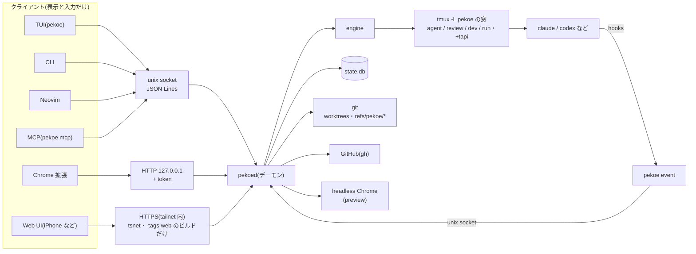

<p align="center"></p>

<p align="center"><a href="README.md">English</a> | 日本語</p>

# pekoe

A cozy home for your coding agents. — with tapi, your little companion

[](LICENSE)
[](https://github.com/sakamosu/pekoe/releases/latest)
[](https://github.com/sakamosu/pekoe/actions/workflows/govulncheck.yml)

pekoe は、ターミナルの中で複数のコーディングエージェントを worktree ごとに並行して動かすためのツールです。worktree の用意、どのエージェントが待っているかの把握、差分のレビュー、PR の作成までを pekoe が引き受けます。Claude Code の使い方は変わりません(エージェントはそのまま tmux の中で動き、pekoe は hooks で状態を受け取ります)。

- 1 タスク = 1 worktree = 1 エージェントです。`pekoe new` は worktree を作り、設定ファイルのコピー・setup・ポートの割り当てまで済ませてから claude(または codex)を起動します
- TUI でセッションを一覧し、入力待ち・許可待ち・レビュー待ちのセッションへ順に移動できます。最下行のマスコット tapi が全体の状態を表します
- 変更は hunk 単位でレビューし、コメントを 1 通にまとめてエージェントに返せます(Neovim か組み込みのレビュー画面)
- Chrome 拡張でページの要素を選び、指示と一緒に送れます。dev server のスクリーンショットは TUI の中に表示できます
- iPhone から Tailscale 経由で、許可待ちに答えたり短いメッセージを送ったりできます(任意のビルド)

<p align="center"></p>

> [!WARNING]
> pekoe はコーディングエージェントを動かすツールです。エージェントはあなたのユーザー権限でコマンドを実行し、ファイルを読み書きします。`pekoe hooks install` は `~/.claude/settings.json` を書き換えます(バックアップを残します。`pekoe hooks uninstall` で pekoe の分だけ外せます)。エージェントに pekoe 自体を使わせる場合は、先に[エージェントに pekoe を使わせるときの権限](#エージェントに-pekoe-を使わせるときの権限)を読んでください。脆弱性の報告については [SECURITY.md](SECURITY.md) をご覧ください。

## 状況と動作環境

- **作者が毎日の開発で使っています。** 設定・API・コマンドはバージョン間で変わることがあります(変更はリリースノートに書きます)
- **MIT ライセンスです**([ライセンス](#ライセンス))。リリースのダウンロード(curl の場合)にも `pekoe update` にも、GitHub のアカウントは要りません([リリースから](#リリースからビルド済みバイナリ))
- **macOS で開発と動作確認をしています**(ターミナルは Ghostty)。Linux 向けのビルドも配布していますが、動作を確認できていない部分があります。macOS を前提にしている箇所は次のとおりです:
  - `[worktree] clone` の APFS クローン(`cp -c`)。ほかのファイルシステムでは通常のコピーになります
  - `make install-launchd` と、launchd で動かしている pekoed の `pekoe daemon restart`(`launchctl`)
  - TUI 内プレビューで使う headless Chrome の既定のパス `/Applications/Google Chrome.app`(`PEKOE_CHROME` で変えられます)
  - TUI の `b`(ポートを Chrome で開く)は `open -a "Google Chrome"` を使います
  - `pekoe adopt` はプロセスの cwd を `lsof` で調べます
- **主な対象は Claude Code です**(hooks で状態を受け取ります)。codex・opencode なども `[agents.*]` で使えますが、状態は画面から推測するだけです
- **必要なもの:** tmux 3.3+、git、動かすエージェント(Claude Code。codex・opencode なども可)。Linux では、pekoe 自身の sandbox に bubblewrap(`bwrap`)、Claude Code の sandbox に bubblewrap と socat が必要です([エージェントに pekoe を使わせるときの権限](#エージェントに-pekoe-を使わせるときの権限))。ソースからインストールする場合は Go 1.27.4+ も必要です(`make` は `GOTOOLCHAIN=local` で手元の Go だけを使います)。任意: gh(issue・land・PR ビュー・PR レビュー)、Neovim 0.10+(レビュー面)、Chrome(拡張・TUI 内プレビュー)、Tailscale(Web UI)
- **ターミナル層は tmux です。** libghostty-vt を使った自前の mux([docs/design.md](docs/design.md) のフェーズ 5)は未着手で、作らない可能性もあります。右ペインを文字として描き直す tmux エンジンでは、Kitty graphics のパススルーはできません(TUI 内プレビューの画像は pekoe 自身が Kitty graphics で描きます)

## 構成



処理の中心はすべて pekoed にあり、TUI・CLI・Neovim・Chrome 拡張・MCP・Web UI は同じ API を使う表示層です。pekoed を止めてもエージェントは tmux の中で動き続け、次に起動した pekoed が拾い直します。

## ドキュメント

| | |
| --- | --- |
| [docs/design.md](docs/design.md) | 設計書(状態モデル・worktree フロー・ターミナル層・レビュー・CLI とキー) |
| [docs/api.md](docs/api.md) | pekoed の API(unix socket・HTTP・HTTPS・MCP) |
| [docs/web.md](docs/web.md) | iPhone 用 Web UI の構成・設定・脅威モデル |
| [docs/mascot.md](docs/mascot.md) | マスコット tapi の形・状態・表情 |
| [docs/tapi-chat.md](docs/tapi-chat.md) | tapi chat(TUI の `t` で話しかける統括役のエージェント)の設計 |
| [docs/orchestration.md](docs/orchestration.md) | 統括役(tapi)を中心にした「セッションを人が管理しない」使い方の設計(大半は実装済み。状態は冒頭) |
| [docs/project-layer.md](docs/project-layer.md) | セッションの上にプロジェクトの層を作るかどうかの設計記録(作らないと決めた。比較した案) |
| [docs/ui-guidelines.md](docs/ui-guidelines.md) | TUI のデザイン原則(配色トークン・レイアウト・アイコン) |
| [docs/ambiguous-width.md](docs/ambiguous-width.md) | 曖昧幅の文字の扱い(状態アイコンと tapi の目に曖昧幅の文字を使わない理由) |
| [nvim/README.md](nvim/README.md) / [extension/README.md](extension/README.md) | Neovim プラグイン / Chrome 拡張 |

開発者向けには、[CONTRIBUTING.md](CONTRIBUTING.md)(テスト・隔離環境・リリースの手順。英語)と [docs/verification.md](docs/verification.md)(設計書・デザイン原則・モックと実装の対応表)があります。

## インストール

必要なものは[状況と動作環境](#状況と動作環境)をご覧ください。ソースからインストールする場合:

```sh
make install            # ~/.local/bin/pekoe (+ pekoed), nvim/ と extension/ を ~/.local/share/pekoe に link
make install WEB=1      # iPhone 用 Web UI も入れる(-tags web、Tailscale の tsnet をリンク)
pekoe hooks install     # ~/.claude/settings.json に hooks を追加(書く前に確認し、バックアップを残す)
pekoe skills install    # 任意: pekoe のスキルを ~/.claude/skills にリンク(書く前に確認する)
make install-launchd    # 任意: ログイン時に pekoed を起動
```

### Homebrew で

v0.4.0 以降、macOS と Linux(arm64 / amd64)では、tap [sakamosu/homebrew-tap](https://github.com/sakamosu/homebrew-tap) から既定のビルド(Web UI なし)をインストールできます。tmux と git も依存としてインストールされます:

```sh
brew install sakamosu/tap/pekoe
pekoe hooks install     # ~/.claude/settings.json に hooks を追加(書く前に確認し、バックアップを残す)
brew upgrade pekoe      # 更新(pekoe update は Homebrew で入れたものを断る)。そのあと pekoe daemon restart
```

- リリースのアーカイブ(`pekoe_<ver>_<os>_<arch>.tar.gz`)から作った cask です。`$(brew --prefix)/Caskroom/pekoe/<ver>/` にアーカイブと同じ配置(`bin/`・`share/pekoe/`・`contrib/launchd/`)で展開し、`pekoe`・`pekoed` を `$(brew --prefix)/bin` にリンクします。pekoe はそのリンクをたどるので、`share/pekoe` の nvim プラグインと Chrome 拡張もそのまま見つかります
- Web UI が必要な場合は、リリースの `_web` のアーカイブをインストールするか(下記)、`make install WEB=1` でビルドしてください
- macOS は brew がダウンロードしたものに quarantine 属性を付け、Gatekeeper はこの属性の付いたバイナリを実行前に検査します。cask はインストール後にこの属性を外します。v0.5.0 以降の macOS 向けバイナリは署名・公証済み(下記)なので属性が付いていても動きますが、単体のバイナリには公証のチケットを添付(staple)できないため、Gatekeeper は初回にオンラインで確認します。属性を外しておけば、この確認を省けます。v0.4.0 までのリリースはアドホック署名だけなので、属性が付いたままだと Gatekeeper が実行を拒否します
- ログイン時に pekoed を起動したい場合は、`brew info pekoe` に launchd 用のコマンドが表示されます。`brew services` は cask では使えません

### リリースから(ビルド済みバイナリ)

GitHub Release に darwin / linux × arm64 / amd64 のビルドを置いています。`pekoe_<ver>_<os>_<arch>.tar.gz` が既定のビルド(Web UI なし)、`pekoe_<ver>_<os>_<arch>_web.tar.gz` が Web UI 入りのビルド(`-tags web`。[docs/web.md](docs/web.md))で、中の配置は同じです。`gh`(どのアカウントでログインしていても構いません。Web UI 入りの場合は、アーカイブ名の `.tar.gz` の前と、`ln -sfn` が指す展開先のディレクトリ名(`pekoe_${ver}_darwin_arm64_web`)の末尾に `_web` を付けます)か、トークンなしの curl でダウンロードします:

```sh
ver=$(gh release view -R sakamosu/pekoe --json tagName -q .tagName | sed 's/^v//')   # 最新の版(特定の版なら ver=<version>)
gh release download "v$ver" -R sakamosu/pekoe -p "pekoe_${ver}_darwin_arm64.tar.gz" -p checksums.txt   # darwin_arm64 は手元の <os>_<arch> に
# gh がなければ curl で:
#   ver=$(curl -fsSL https://api.github.com/repos/sakamosu/pekoe/releases/latest | sed -n 's/.*"tag_name": *"v\([^"]*\)".*/\1/p')
#   base="https://github.com/sakamosu/pekoe/releases/download/v$ver"
#   curl -fL -O "$base/pekoe_${ver}_darwin_arm64.tar.gz" -O "$base/checksums.txt"
shasum -a 256 --ignore-missing -c checksums.txt
gh attestation verify "pekoe_${ver}_darwin_arm64.tar.gz" -R sakamosu/pekoe \
  --signer-workflow sakamosu/pekoe/.github/workflows/release.yml --source-ref "refs/tags/v$ver"   # release.yml がこのタグからビルドしたか(v0.1.0〜v0.3.0 には来歴がない)
mkdir -p ~/.local/opt ~/.local/bin
tar -xzf "pekoe_${ver}_darwin_arm64.tar.gz" -C ~/.local/opt
ln -sfn ~/.local/opt/"pekoe_${ver}_darwin_arm64" ~/.local/opt/pekoe
ln -sf ~/.local/opt/pekoe/bin/pekoe ~/.local/bin/pekoe
ln -sf ~/.local/opt/pekoe/bin/pekoed ~/.local/bin/pekoed
pekoe version
```

`checksums.txt` は同じ Release に置いてあるので、これで分かるのはアーカイブが壊れていないことだけです。`gh attestation verify` は、アーカイブがこのリポジトリの `release.yml` でビルドされたこと(GitHub Actions が Sigstore で署名したビルド来歴)を検証します。来歴が付くのは、リポジトリが公開されている状態で `release.yml` が作ったリリースだけです(private のリポジトリで来歴を付けるには GitHub Enterprise Cloud が必要なので、`release.yml` は付けません)。そのため、来歴があるのはリポジトリの公開後に作ったリリース(v0.4.0 以降)です。v0.1.0〜v0.3.0 は private だったときに作ったので来歴がなく、`gh attestation verify` は通りません。`--signer-workflow` と `--source-ref` を付けると、このリポジトリのほかのワークフローやブランチではなく、`release.yml` がそのタグからビルドしたことまで検証できます。`release.yml` はリリースを下書きで作り、アーカイブに来歴を付けてから公開するので、公開されたリリース(v0.4.0 以降)には必ず来歴があります。

v0.5.0 以降(プレリリースでは v0.5.0-rc.1 以降)、`release.yml` は darwin のバイナリ(darwin のすべてのアーカイブ(既定と `_web`、arm64 と amd64)の `bin/pekoe`)を Developer ID Application 証明書で署名し、Apple の公証を受けています。`codesign -dv ~/.local/opt/pekoe/bin/pekoe` は `Authority=Developer ID Application: Yuki Sakamoto` と `TeamIdentifier=K9F9554C8G` を、`spctl -a -vvv -t install ~/.local/opt/pekoe/bin/pekoe` は `source=Notarized Developer ID` を表示します。単体のバイナリには公証のチケットを添付(staple)できないので、quarantine 属性の付いたバイナリを初めて実行するときに、Gatekeeper がオンラインで確認します。v0.1.0〜v0.4.0 は Go リンカのアドホック署名だけで、`codesign -dv` は `Signature=adhoc` と表示します。

アーカイブには、`bin/pekoe`、`bin/pekoed`(→ pekoe)、`share/pekoe/nvim/`、`share/pekoe/extension/`、`contrib/launchd/` と、`README.md`・`README.ja.md`・`LICENSE`・`THIRD_PARTY_LICENSES`(依存ライブラリのライセンス。[ライセンス](#ライセンス))が入っています。`bin/pekoe` は自分の実体の位置から `../share/pekoe/nvim` を探すので、上のようにシンボリックリンクで PATH に置けば、nvim プラグインもそのまま見つかります。launchd で起動する場合は、`sed -e "s|PEKOE_BIN|$HOME/.local/bin/pekoe|" -e "s|HOME|$HOME|g" ~/.local/opt/pekoe/contrib/launchd/dev.pekoe.pekoed.plist > ~/Library/LaunchAgents/dev.pekoe.pekoed.plist` を実行してから、`launchctl bootstrap gui/$(id -u) ~/Library/LaunchAgents/dev.pekoe.pekoed.plist` を実行します。

既定のビルドには Tailscale のコードを一切含めていません。インストールし直したあとは、`pekoe daemon restart` で pekoed を新しいバイナリに切り替えてください(エージェントは tmux の中で動き続けます。launchd で動かしている場合は、launchd 経由で起動し直します)。

### 更新

```sh
pekoe update --check    # 新しいリリースがあるか見るだけ(誰でも使える)
pekoe update            # 最新のリリースに入れ替える
pekoe update --version vX.Y.Z --force   # 特定の版に(古くなるときは --force)
pekoe update --allow-unverified         # 来歴を確かめられなくても続ける(下を参照)
```

`pekoe update` は GitHub の最新リリース(`releases/latest`。draft と prerelease は除きます)を取得し、今の pekoe と同じ OS・アーキテクチャ・ビルド(Web UI 入りなら `_web` のアーカイブ)を選びます。

- 今のバージョンが最新か、それより新しければ何もしません。`make install` で入れたバージョン(`git describe` の `0.1.0-59-g3761d74`)は「0.1.0 より 59 コミット先」として比べます。`dev` のように比較できないバージョンのときは確認を求めます
- アーカイブを `checksums.txt` の SHA-256 と照合し、合わなければ何も入れ替えません。`checksums.txt` は同じ Release にあるので、アーカイブが本物かどうかはビルド来歴(attestation)で検証します: `gh attestation verify --signer-workflow sakamosu/pekoe/.github/workflows/release.yml --source-ref refs/tags/<tag>`
  - v0.4.0 以降(`release.yml` が来歴を付けてから公開します)は、来歴がない・照会できない・`gh attestation verify` が通らない場合、何も入れ替えずに止まります。止まった理由はメッセージに表示されます。リリースを自分で確認したうえで続けるなら、`--allow-unverified` を付けます(警告を出し、SHA-256 の照合だけで続けます)
  - `gh` が入っていない、またはログインしていない(`gh auth login`、または `GH_TOKEN` / `GITHUB_TOKEN`)ときは、署名を検証できません。GitHub がそのアーカイブの来歴を持っていれば、警告だけ出して続けます
  - v0.1.0〜v0.3.0 はリポジトリが private だったときに作ったので来歴がなく、これまでどおり警告だけを出します(来歴があるのに検証に通らない場合は、どのバージョンでも止まります)
- 入れ替えるのは、今動いている pekoe の実体(シンボリックリンクをたどった先)、その隣の `pekoed`、`<prefix>/share/pekoe/nvim` と `extension` だけです。`~/.local/share/pekoe` のほかのもの(`state.db` など)には触れません。バイナリは隣に書いてから rename し、途中で失敗したら入れ替えた分を元に戻します
- `make install` で入れた場合、`nvim` / `extension` はリポジトリへのリンクなので、そのリンクを、リリースの中身を入れたディレクトリに置き換えます(リポジトリには書き込みません。置き換える前に確認します。`make install` をやり直せばリンクに戻ります)
- Web UI 入りの pekoe で、リリースに `_web` のアーカイブがないときは拒否します(`--no-web` で既定のビルドを入れるか、`make install WEB=1` でソースからインストールしてください)
- 書き込めない場所にあるものや、Homebrew などのパッケージマネージャーでインストールしたものは拒否します
- 終わると新旧のバージョンを表示し、pekoed が動いていれば `pekoe daemon restart` するかどうかを尋ねます。Chrome 拡張を入れ替えた場合は、`chrome://extensions` で再読み込みしてください
- GitHub のトークンが見つかれば、付けて呼び出します: `$GITHUB_TOKEN` / `$GH_TOKEN`、なければ `gh auth token`。トークンは必須ではなく、付けると GitHub API のレート制限が緩くなるだけです(トークンなしでは 1 時間に 60 回までです。超えたら、しばらく待つか `gh auth login` してください)。private の複製から取得するときは、リポジトリを読めるトークンが必要です。ないと GitHub が HTTP 404 を返し、`pekoe update` は `gh auth login` するよう案内します
- 入れ替えは人間だけの操作です。エージェントのセッションの中(`$PEKOE_SESSION` がある)や、`human-token` を読めない場所からは、`only a person can do this` で拒否します。`--check` は誰でも使えます

hooks は `SessionStart` `UserPromptSubmit` `Notification` `Stop` `PreToolUse` `PostToolUse` `SessionEnd` で `pekoe event` を呼ぶだけです。プロジェクト側の `.claude/` には触れません。`pekoe hooks status` で確認でき、`pekoe hooks uninstall` で pekoe の分だけ外せます。

## クイックスタート

```sh
cd ~/src/app
pekoe init                                            # ~/.config/pekoe/repos/<repo-id>.toml を下書きし、main セッションを起動
pekoe new feat/csv --prompt "CSV エクスポートを追加"   # worktree → copy → setup → port → claude 起動
pekoe new feat/invoice --from gh#128                  # issue 本文を初期プロンプトに
pekoe                                                 # TUI
```

`pekoe init` は、lockfile・`.envrc`・git の無視ファイルから setup や copy を推測し(`test` は実行できるときだけ書きます。条件は、`yarn` などのコマンドが pekoed の PATH にあること、`npm` / `yarn` / `pnpm test` なら package.json に `scripts.test` があることです。満たさなければ、理由を添えてコメントアウトした形で下書きします)、コピーする無視ファイルを番号で選んでもらってから書き込みます。書き込んだら、リポジトリ本体のチェックアウトでエージェント(main セッション。`pekoe open <repo> --new` と同じ)を起動し、TUI にそのリポジトリが表示されるようにします。すでにあれば何もしません。`--no-open` を付けると起動しません。起動できなかったときも init は成功として扱い、`pekoe open <path> --new` で作れることを案内します。手で起動したエージェントは `pekoe adopt` で、既存の worktree は `pekoe open` で取り込めます。

## コマンド

| コマンド | すること |
| --- | --- |
| `pekoe` | TUI を開きます(デーモンが動いていなければ起動します) |
| `pekoe init [<dir>] [--yes] [--overwrite] [--print] [--no-open]` | リポジトリの設定を検出して下書きし、本体のチェックアウトに main セッションがなければ起動します。`--print` は書き込まずに表示するだけ、`--no-open` は書き込むだけで起動しません |
| `pekoe new <branch> [--repo R] [--from gh#N] [--agent codex] [--model M] [--effort E] [--base REF] [--after SLUG]... [--hold] [--prompt TEXT] [--request ID]` | worktree とセッションを作ります。setup の進み具合を表示し、エージェントが起動したら戻ります。`--base` を付けなければ、pekoed はまず base(リポジトリの `[worktree] base`、なければ origin の既定のブランチ)を origin から fetch し(最長 60 秒)、手元の base が origin より遅れていれば `origin/<base>` から始めます。そのため、pull していないチェックアウトでも、古いコードからセッションが始まることはありません。手元の base に origin にないコミット(push していない作業)があればそのまま使い、origin と分岐していれば警告を出したうえで手元の base を使います。origin がないときと fetch に失敗したときは、手元の base から始めます(fetch の失敗は警告します)。どこから始めたかは `worktree` のステップに表示されます(`from origin/main (fetched, local main 73 behind)`)。`--base REF`(ブランチ・タグ・コミット・`origin/x`)を明示した場合は、fetch せずにそのまま使います。`--after` は、このセッションがどのセッションの後かを記録します(複数指定できます。指定できるのは今あるセッションだけで、自分自身、循環、pekoe が作っていないセッション(`pekoe open` したリポジトリ本体のチェックアウトなど。land しません)は拒否します)。`--after` だけなら記録して表示するだけで([1] の行に `after feat-a`、フッターにそれぞれの状態、`pekoe --json ls` の `after`)、起動は待たせません。`--hold` を付けると、`--after` のセッションがすべて landed(PR がマージされた状態)になるまで `queued` で待ち、その時点の `origin/<base>` から始めます(fetch に失敗したら手元の base から始め、待った相手のマージが入っていないかもしれないと警告します)。相手が landed にならずに削除されたら `failed` になり、相手が failed なら待ち続けます。`[orchestrator] max_running` を設定していれば、上限を超えた分も `queued` になり、作業中のセッションが止まると古い順に始まります。queued のセッションには、worktree もエージェントもまだありません。`pekoe new` は待つ理由を表示して戻ります(`pekoe --json ls` の `queue`)。進捗の画面の `esc` か `pekoe rm` で取り消せます。`--request` は、tapi chat が依頼(`pekoe ledger`)とセッションを結び付けるためのものです(tapi と人だけが使えます)。`--model` / `--effort` は、このセッションに限って `[agents.*] model` / `effort` を上書きします(Claude Code だけ) |
| `pekoe open [<worktree>] [--resume\|--new] [--agent NAME]` | 既存の worktree でエージェントを起動します。過去の Claude Code セッションを resume するかどうかを選べます(`--resume` で resume、`--new` で新規)。すでにセッションのある worktree は拒否します(`already managed as <slug>`)。シンボリックリンク越しに別の名前で指定しても同じです(macOS の `/tmp` → `/private/tmp`) |
| `pekoe adopt [<path>] [--yes]` | pekoe の外で動いているエージェントを止め、同じセッションを pekoe の中で resume します |
| `pekoe ls [--all\|--repo R]` | セッションの一覧と状態を表示します。リポジトリの中ではそのリポジトリの分だけ、外ではすべてを表示します |
| `pekoe issues [--repo R] [--all\|--label L] [--refresh]` | GitHub の open issue を表示します(既定は自分が担当のもの)。セッションがあれば、状態とブランチを添えます |
| `pekoe issues <N> [--repo R]` | issue の本文とコメントを表示します |
| `pekoe conflicts [--repo R]` | 衝突予報です。同じファイルを変更しているセッションの組と、衝突するかどうか(`git merge-tree`)を表示します |
| `pekoe send <slug> <text> [--no-enter]` | pty に文字を送ります(既定で Enter を付けます。`-` で stdin から読みます) |
| `pekoe review [<slug> \| gh#N [--repo R]]` | レビュー面を開きます。引数なしなら次のレビュー待ちのセッション、`gh#N` ならほかの人の PR です |
| `pekoe land <slug>` | rebase → test → push → `gh pr create` を実行します。マージを検出すると(pekoed が PR を 1 分ほどの間隔で確認します)、teardown と worktree の削除を行います。land できるのは pekoe が作ったセッション(`~/worktrees` 配下の worktree)だけです。`pekoe open` したリポジトリ本体のチェックアウトなどそれ以外のもの、ブランチが base と同じもの、worktree でセッションと別のブランチを checkout しているものは拒否します(base に PR なしで push しないためです)。origin の fetch に失敗し、セッションの前の PR がすでにマージ・クローズされていた場合は、新しいコミットがあるかどうかの判断を、origin の base を持っている GitHub に任せます。`gh pr create` が No commits between と答えたら、エラーにせず前の PR のままにします。エージェントも実行できます(マージするかどうかは人間が決めます。受信箱で `merge` と答えると、pekoed がマージします) |
| `pekoe cleanup [--all\|--repo R] [--stale 72h]` / `pekoe cleanup --rm <slug>… \| --rm --landed [--force] [--yes]` | 片付けの候補を一覧します。landed のセッション(pekoe の記録だけが残っているもの)、`pekoe land` を通さずに GitHub で PR がマージされたセッション(worktree が残っているもの)、`[cleanup] stale_after`(72h)より長く止まっている(done・idle・failed など)セッションを、未コミットのファイルの数と、どのリモートにもないコミットの数と一緒に表示します。`--rm` は、指定したセッション(`--landed` なら landed のものすべて)を、`pekoe rm` と同じく確認してから削除します。エージェントも一覧は表示できますが、削除できるのは landed のものだけです。自動では何も削除しません。TUI では `:cleanup` です |
| `pekoe rm <slug> [--force] [--yes]` | teardown を実行してから worktree を削除します(対象は pekoe が `~/worktrees` 配下に作った worktree だけです。リポジトリ本体のチェックアウトなど、それ以外のものは teardown も実行せず、セッションの記録を消すだけです)。作成中なら先に setup を止め、マージ後の後片付けが実行中ならその終了を待ちます。エージェントが使えるのは、landed のセッションを一覧から消すときだけです |
| `pekoe repo forget <名前\|repo-id\|パス> [--config] [--yes]` | もう使わないリポジトリを pekoe の記録から外します。TUI の `w` のリポジトリ選択、`pekoe --json` の `repo.list`、tapi chat が把握しているリポジトリ(次に起動したときから)に出なくなります。landed でないセッション(と、worktree が残っている landed のセッション)があれば、そのセッションを示して拒否します(先に `pekoe rm` してください)。landed のセッションの記録は一緒に削除します。`~/.config/pekoe/repos/<repo-id>.toml` はあなたが書いたファイルなので、既定では削除せずに拒否し、`--config` を付けたときだけ削除します(残っていると、pekoe はそのリポジトリをまた認識します)。削除するものを表示して確認を求めます(`--yes` で省けます)。リポジトリのディレクトリ・worktree・ブランチと `pekoe stats` の記録には触れません。そのリポジトリで `pekoe open` / `init` / `new` を実行する(または、その中で TUI を起動する)と、また pekoe に認識されます(開いたままの TUI では認識し直しません)。人間だけの操作です |
| `pekoe report <summary> --status done\|blocked\|progress\|review [--evidence E]... [--verdict pending\|pass\|fail --reviewed-sha SHA]` | セッションのエージェントが作業の結果を記録します(`-` で stdin から読みます)。`--status review` に `--verdict` と `--reviewed-sha` を付けると、そのコミットに対する独立レビューの結果を記録します(レビュー中は `pending`。マージの根拠になるのは `pass` だけです)。どのセッションの報告かは、pekoed が呼び出し元のプロセスから判断します(`$PEKOE_SESSION` の値は、食い違っているときに表示するだけです)。証拠のパスや URL は文字列として記録するだけで、pekoed は中身を読みません |
| `pekoe reports [<slug>] [--limit N]` | 報告を新しい順に表示します(エージェントが書いた文は区切りで囲みます)。最新の報告は `pekoe --json ls` の `report` にも出ます |
| `pekoe wait [--mine] [--slug S,…] [--on KINDS] [--since CURSOR] [--timeout 30m]` | セッションに何かが起きるまで待ちます(報告・`queued`・`started`・`done`・`waiting`・`idle`・`failed`・`pr`・`ci`・`landed`・`removed`・`inbox`)。`ci` は、PR の CI がすべて終わって結果が確定したときに、HEAD と結果の組ごとに 1 回だけ返ります(`summary` に green / red・失敗したチェックの名前・HEAD の SHA が入ります。あとから追加されたチェックや re-run で同じ HEAD の結果が変わると、もう 1 回返ります)。`started` は、作ったセッションの setup が済んでエージェントが動き始めたときに 1 回だけ返ります(setup が失敗したら `failed`)。`queued` は、`pekoe new` が作成を始めずに待ち行列に入れたとき(`max_running`・`--hold`)に 1 回だけ返り、待ち行列を出て動き始めると `started` が続きます。`--mine` は、自分が `pekoe new` で作ったセッションだけを対象にします(pekoe の窓の中から使います。pekoe の外で起動したエージェントは `--slug` で待ちます)。返ってきた `cursor` を次の `--since` に渡せば、取りこぼしがありません。`pekoe --json new` も作成直前の `cursor`(landed の同じ slug を置き換えたときは、古いほうの `removed` の後)を返すので、`pekoe wait --slug <slug> --on started,failed,removed --since <cursor>` とすれば、setup がすぐに終わっても取りこぼしません(`removed` を入れるのは、作成中に cancel や rm で消されたときにも返るようにするためです)。pekoed を再起動すると `reset` が返るので、`pekoe --json ls` で読み直してください。報告なしで done になったセッションは `(no report)` と表示されます |
| `pekoe ask-human <question> [--option O]... [--recommend N] [--decided N] [--kind decision\|approve\|login\|fyi] [--about SLUG] [--context TEXT\|-] [--link URL]... [--wait [--timeout 30m]]` / `pekoe ask-human --wait <id>` | エージェントが人に判断・承認・手作業を頼みます(判断の受信箱)。`--decided` は、エージェントが自分で選んだ選択肢を記録します(`fyi` と一緒に使います)。`--wait <id>` は、前に出した問いの答えを待ちます。pekoed は、問いの元になったセッションの事実(ブランチ・HEAD・差分・PR・CI・衝突)を自分で調べて添えます。答えは、`--wait`(または `pekoe wait --on inbox`)で待っていれば戻り値として返り、待っていなければ、エージェントの手が空いたときに入力欄へ `[pekoe inbox qN] 答え: …` の形で届きます(許可ダイアログが出ている間は届けません) |
| `pekoe inbox [<id>] [--all] [--mine]` / `pekoe inbox answer <id> [<n>] [--note …] [--rev N]` / `pekoe inbox dismiss\|withdraw <id> [--note …]` | 受信箱の一覧と、1 件の詳細を表示します(エージェントの文は区切りで囲み、事実の後に表示します)。答える(`answer`)・答えずに閉じる(`dismiss`)ことができるのは人だけです。選択肢のどれも当てはまらないときは、選ばずにメモだけで答えられます(`pekoe inbox answer <id> --note …`・`]a`・Web UI のどれからでも。エージェントには「選択肢のどれでもない」とメモが届きます)。pekoed が作るマージの項目だけは、選択肢を選ばないと答えられません。問いを出したエージェントは、自分の問いを取り下げられます(`withdraw`)。TUI では、項目が届くとトーストが出て、`]a` で答える画面に移れます。エージェントが答えを待っている新しい問いは、ほかに何も開いておらず、キー入力が 2 秒止まったときに、答える画面が自動で前面に出ます(1 件につき 1 回)。出てから 1 秒間はキーを受け付けず、最初は「skip」が選ばれています(`↵` だけ、または `esc` でスキップします。項目は受信箱に残り、`]a` で答えられます)。`[orchestrator] inbox_popup = false` で出さないようにできます。Web UI(iPhone)の Inbox タブからも答えられます。エージェントが答えを待っている問い(`fyi` と自分で出したものを除く)は、セッションの wait と同じように最下行に残り(`? feat-x asks · ]a`)、2 分たつと OS の通知になります(`[orchestrator] notify = "quiet"` ならメッセージ行だけです)。land した PR に、マージしてよい根拠(PR の HEAD に対する独立レビューの合格・CI がすべて緑・`CLEAN`・衝突予報なし・`--after` の相手が landed。landed になってから `pekoe rm` で消された相手は landed として扱い、landed になる前に消された相手は landed として扱いません)がそろうと、pekoed 自身が項目を 1 件作ります。land の rebase で HEAD が変わっても、変更の中身が同じなら合格を引き継ぎます(rebase が衝突しても、両側が同じ場所に行を足しただけで、その両方を残した場合は同じと見なします)。判定が変わるたびに pekoed.log に `merge evidence <slug>: …` と記録されるので、項目が出なかった理由はマージの後でも確認できます。答えは `merge`・`wait`・`send back`(メモがセッションに届きます)のどれかで、メモだけでは答えられません。TUI(ポップアップと `]a`)では、`merge` は `↵` を 2 回押します。1 回目で確認になり、もう一度 `↵` を押すと(直後の連打は無視します)答えになります。確認中にほかのキーを押すと取り消されます。`merge` と答えると、pekoed は PR を読み直して条件をもう一度確認し、`gh pr merge --match-head-commit <項目の HEAD>` を実行します(方法は、リポジトリの設定の `[merge] method` で決まります。`merge`・`squash`・`rebase` のどれかで、既定は `merge`)。GitHub がマージできるかどうかをまだ計算している(`UNKNOWN`。同じ base に別の PR がマージされた直後など)だけで、ほかの条件がそろっていれば、待っていることを表示して、5 秒おきに最長 1 分まで読み直します。条件が崩れていればマージせず、理由を表示します(TUI・Web UI の Inbox タブ・`pekoe inbox <id>`)。人の答えなしにマージすることはありません |
| `pekoe ledger [<id>] [--all]` / `pekoe ledger done\|drop\|close\|link <id> …` / `pekoe ledger keep [<id>]` / `pekoe ledger reopen\|rm <id>` | 依頼(`ledger`)を扱います。tapi chat に打った文は、pekoed が open の依頼として記録します(同じ文が 1 分以内に続けて届いたら、1 件にまとめます)。tapi は `--request` で依頼とセッションを結び付け、`done --evidence <PR>`・`drop --note <理由>`・`close --as chat`(依頼ではなかった)で閉じます。雑談・お礼・その場で答えた質問は、tapi が返事を終えたときに pekoed が `chat` として閉じます(そのターンで tapi がセッションを結び付けず、誰にも何も頼まず、待ち始めてもいない場合です。一覧では `chat (auto)` と表示されます)。依頼ではあるものの、すぐには任せないものは、tapi が `keep` で残します。自動で閉じたものも `keep <id>` で戻せます(閉じてから 24 時間は、新しい 10 件が本文を短くした形で、`pekoe ledger` とダッシュボードの Requests に、open のものとは分けて表示されます。全文は `pekoe ledger <id>` で読めます)。依頼は `pekoe tapi reset` でも消えません。tapi や人が閉じたものを開き直す(`reopen`)・削除する(`rm`)ことができるのは人だけです |
| `pekoe stats [--days N] [--repo R] [--json]` | マージした PR の数と使ったトークンを、ローカルの日付とリポジトリごとに表示します(既定は直近 7 日)。マージは、pekoe が land を見届けたものを数えます。トークンは、エージェントの Claude Code の transcript(サブエージェントと tapi chat も含みます)から、input・output・cache 書き込み・cache 読み出しの種類別に合計します。rm したセッションの分も残り、動いているセッションはその時点までを数えます。料金には換算しません。数だけなので、エージェントも token なしで読めます |
| `pekoe dev <slug>` | `dev` をそのセッションのポートで起動、または停止します。止めるとき(rm・dev 窓を閉じる・`pekoe daemon stop --kill-agents` も含みます)と、hook が自分で終了したときは、`[hooks] dev_stop` を実行します |
| `pekoe dev --log [<slug>] [--lines N]` | dev hook のログ(エスケープシーケンスを除いた出力と、起動・終了の経緯・`dev_stop` の出力)の末尾と、動いているかどうか・どう終了したかを表示します。token なしでは、呼び出し元のセッションの分だけを読めます(slug を省くと自分のセッション) |
| `pekoe undo <slug> [n]` | 最後(または n 番目)のプロンプトによる変更を取り消します |
| `pekoe answer <slug> allow\|deny\|always` | 許可待ちに答えます |
| `pekoe attach <slug> [agent\|review\|dev]` | tmux の窓に直接 attach します(デバッグ用) |
| `pekoe hooks install\|uninstall\|status [--yes]` | Claude Code の hooks を追加 / 削除 / 確認します |
| `pekoe skills install\|uninstall\|status [--yes]` | pekoe の Claude Code スキルを `~/.claude/skills` にリンク / 解除 / 確認します([Claude Code スキル](#claude-code-スキル)) |
| `pekoe ext` | Chrome 拡張に入力する port と token を表示します(port は、pekoed が実際に待ち受けているものです。ほかの pekoed が使っているなどの理由で待ち受けられなかった場合は、理由を表示して拒否します。`pekoe daemon status` にも `http off (…)` と表示されます) |
| `pekoe web` | Web UI の状態・URL・初回のログイン URL を表示します |
| `pekoe mcp` | エージェント用の MCP サーバー(stdio)です |
| `pekoe daemon start\|stop\|restart\|status` | デーモンを操作します。`stop` はプロセスが終了するまで待ちます。`restart` は停止を待ってから起動し直し、前後のバージョンを表示します(`make install` の後に使います。動いていなければ起動するだけです)。エージェントは tmux の中で動き続けます。開いている TUI は、pekoed との接続が切れる(再起動・停止)と、そのことを端末に表示し、pekoed がまた応答するまで最長 20 秒待ってから開き直します。戻らなければ、その旨のエラーで終了します(終了コード 1)。このとき、TUI が pekoed を自分で起動することはありません |
| `pekoe daemon stop --kill-agents [--yes]` | tmux サーバー(`$PEKOE_TMUX_SOCKET`)も止めます。**既定のソケット `pekoe` に対して使うと、すべてのエージェントが止まります**。隔離環境の片付け用です |
| `pekoe tapi [status\|reset [--yes]]` | tapi chat の状態(依頼と受信箱の残り件数も)を表示します / tapi chat を終了して会話を忘れさせます(TUI の `T` と同じです。依頼と受信箱は残ります) |
| `pekoe tip [<id>] [--list] [--doc PATH]` | pekoe の機能を 1 つ紹介します(まだ見せていない tip。[TIPS](#tips))。`<id>` はその tip、`--list` は一覧、`--doc` は tip が指す docs を表示します(バイナリに同梱) |
| `pekoe config edit\|check\|show\|path` | `config.toml` を扱う入口です。`edit` は `$EDITOR`(なければ `vi`)で開き、閉じたら内容を検査します。誤りがあれば、開き直す・そのまま保存する・保存せずにやめる、のどれにするかを尋ねます(visudo と同じ形式)。ファイルがなければ作ります。`check` は、構文エラー・知らないキー・受け付けない値を表示します(あれば終了コード 1)。`show` は、既定値を含めた現在の設定を表示します(`[web] auth_key` は伏せます)。`path` は、ファイルの場所を表示します。どれも pekoed を通さず、自分でファイルを読み書きします(TUI では `^q ,`) |
| `pekoe update [--check] [--version vX.Y.Z] [--no-web] [--force] [--allow-unverified] [--yes]` | GitHub の最新リリースに入れ替えます([更新](#更新))。`--check` は、新しいバージョンがあるかどうかを確認するだけです。人間だけの操作です |
| `pekoe version` | バージョンを表示します |

- `R` には、repo-id、短い名前(`~/worktrees/<name>` の name)、パスのどれでも指定できます。slug を取るコマンドは、`<repo>/<slug>` の形でも指定できます
- `--json` を付けると、機械可読な形式で出力します(`init` `new` `open` `ls` `issues` `conflicts` `cleanup` `report` `reports` `wait` `ask-human` `inbox` `ledger` `stats` `land` `dev` `skills` `ext` `web` `tapi` `tip` `config check` `config show` `config path` `daemon status` `update --check`)。サブコマンドの前後どちらにも書けます
- `--help` / `-h` は使い方を表示するだけで、何も実行しません(終了コード 0)。知らないフラグや、値のない `--repo` はエラーになります(終了コード 2)。`-` で始まる文字列を位置引数として渡すときは、`--` の後に書きます(例: `pekoe send <slug> -- --verbose を外して`)
- `pekoe event <Hook>` は、hooks から呼ばれる内部用のコマンドです。失敗しても、常に終了コード 0 で終わります
- セッションが消えるとき(`pekoe rm`、PR のマージを見た後片付け)、pekoed はその窓を閉じてから、窓がバックグラウンドに放って残したプロセス(エージェントが `&` で起動した busy loop やサーバーで、launchd の子になったもの)を止めます。SIGTERM を送り、2 秒たっても残っていれば SIGKILL で止め、止めた数とコマンドの先頭を pekoed のログに残します。見分けるのは、セッションの窓の中のプロセスが受け継ぐ環境変数(pekoe の tmux サーバーの `$TMUX` と `$PEKOE_SESSION=<slug>`)で、`setsid` や `nohup` で切り離したものも見つかります。macOS は、システムのバイナリ(`/bin/sh`・`/bin/zsh`・`/bin/sleep` など)を動かしているプロセスの環境変数を見せないので、そういうものは、そのセッション自身の worktree の中で動いていて、セッションを作った後に起動し、属するセッション(setsid)のリーダーがもういない(エージェントのシェルが終わった)ときに止めます。pekoed とその hook、tmux サーバー、今ある窓、ほかのセッション、別の pekoed のセッション、tmux の外のプロセス(TUI から開いた nvim など)、人のシェルやエディタが起動したもの(そのシェルやエディタが動いている間)は止めません。セッションを止めた(`x`)・再起動したときも止めません。見つからないもの: 環境変数を消した・書き換えたもの(`env -i` など)、macOS でシステムのバイナリを動かしていて worktree の外に出たものや、セッションのリーダーがまだ動いているもの、ほかのサーバー(launchd・Docker・別の tmux)に頼んで起動したもの
- pekoed に接続するコマンドのうち、エージェントが token なしで使えるのは、`ls`・`new`・`send`・`land`・landed のセッションの `rm`・自分のセッションの `dev`・`report`・`reports`・`wait`・`ask-human`・`inbox`(一覧と、自分の問いの `withdraw`)・`ledger`(tapi chat だけ。`reopen` / `rm` は除く)・`stats`・`conflicts`・`cleanup`(一覧。`--rm` は `rm` と同じく landed だけ)(と hooks 用の `event`)だけです。それぞれに次の制限があります。`conflicts` は、再計算が 10 秒に 1 回までです(それより短い間隔では、前の予報が返ります)。`report` は、自分のセッションの分だけです(pekoe の窓の外から呼ぶと拒否されます)。`new` は、pekoe がすでに知っているリポジトリ(セッションがある・あった、または `repos/<id>.toml` がある)でだけ使えます(新しいリポジトリで最初のセッションを作るのは、人間だけの操作です)。また、`new` で指定できるエージェントは、pekoe の sandbox が付くもの(sandbox が on の Claude Code)か、呼び出し元と同じエージェントだけです(codex などは人が作ります)。`land` は、origin のあるリポジトリでだけ使えます(origin がないと、land はその場で base を fast-forward します)。`rm` は、worktree がすでに消えた landed のセッションに、`--force` なしでだけ使えます。それ以外(`answer`・ほかのセッションの `dev`・`init`・`open`・`review`・ほかの状態の `rm`・`issues`・`daemon` など)と `update`(`--check` を除く)は人間だけの操作で、`human-token` を読める端末からしか実行できません(エージェントからは拒否されます。[エージェントに pekoe を使わせるときの権限](#エージェントに-pekoe-を使わせるときの権限))。`send` は誰でも使えますが、相手に許可ダイアログが出ている間は拒否されます(人間の `send` も、Enter 付きの場合は、入力の前と Enter の直前に確認します)

## TUI

左に番号付きのパネル([1] Sessions、[2] Worktrees ⇄ Browser ⇄ Issues、[3] Changes ⇄ Picks)、右に [4] Agent(エージェントの画面そのものです。preview・dev・run・PR の窓にも切り替わります)、最下行に powerline のステータスとキーヒントが並びます。100 列未満では、左の列がタブ 1 枚になります。セッションは、リポジトリごとの見出し(名前と罫線)でまとめて表示します。その上には、常に `orchestrator ━━━` の見出しと tapi の行([tapi chat](#tapi-chat))があります。行はクリックでも選べます。

セッションの状態は、アイコンと色で表します(配色は [docs/ui-guidelines.md](docs/ui-guidelines.md) のトークン)。最下行の左端にいるマスコット tapi は、全セッションのうち最も優先度の高い状態を顔で表し、隣の 1 行で誰が何をしているかを伝えます:

| 顔 | 状態 | 意味 |
| --- | --- | --- |
| `⨯ ⨯` | error | エージェントの異常終了・コマンドの失敗 |
| `◕ ◕` | wait | 入力・許可を待っている |
| `◉ ◉` | work | 出力中・コマンド実行中 |
| `^ ^` | done | ターンが終わり、まだ見ていない |
| `∙ ∙` | idle | プロンプトで待機中 |
| `- -` | sleep | 全セッションが 3 分以上 idle |

見ていないセッションが wait / error になると、トーストが出ます。PR のマージ・CI の失敗・レビューにも一度だけ反応します(詳しくは [docs/mascot.md](docs/mascot.md))。

| キー | 動作 |
| --- | --- |
| `j` `k` / `↵` | セッションか tapi の行を選ぶ(端で折り返します。`g` で一番上の tapi の行へ)/ 右ペインに入って入力する(`^q` 以外のキーは、すべてエージェントに届きます)。tapi の行で `↵` を押すと、tapi chat が開きます |
| `^q` / `^q` `h` `l` | 入力をやめて Sessions に戻る(`[keys] prefix` で変更できます)。左のパネルをクリックしても抜けられます / 左のパネル・右ペインにフォーカスする |
| `i` / `h` `Esc` | Agent パネルで入力を始める / 左に戻る |
| `^q` `z` | 右ペイン(4)を全幅にして左ペインを隠す / もう一度押すと元に戻す。入力中に押した場合は、入力に戻ります |
| `^q` `<` `>` / `^q` `=` | 左ペインを 4 列ずつ狭める・広げる / 既定(40%)に戻す。幅とズームは `~/.local/share/pekoe/layout.json` に保存され、再起動後の TUI でも、CLI から起動するエージェントでも同じ幅になります。100 列未満(縦並び)では効きません |
| `^q` `,` | `config.toml` を編集する(この端末で `pekoe config edit` を実行します。エディタを閉じると TUI に戻ります) |
| `^q` `o` | tapi のダッシュボードへ一度の操作で移る(tapi chat やエージェントに入力している最中でも、どのセッションを選んでいても使えます。tapi の行を選んで [4] に入ります。[tapi chat](#tapi-chat)) |
| `n` | 新しい worktree とセッションを作る |
| `t` / `T` | tapi chat を開いて話しかける([tapi chat](#tapi-chat))/ tapi chat をリセットする(確認あり) |
| `w` | リポジトリを選ぶ |
| `]a` `[a` | 次の待ちセッションへ移る(PR に動きがあったものも含みます。tapi が許可待ち・質問待ちなら、それも対象です。待ち時間の長い順)/ 元の場所に戻る |
| `]r` | 次のレビュー待ちへ移る |
| `r` | レビュー面を開く(右ペインが nvim に切り替わります。エージェントは裏で動き続けます) |
| `p` | PR ビューを開く(checks・レビュー・スレッド。`space` で選び、`s` でエージェントに送ります) |
| `v` | preview 窓(dev server のスクリーンショットを TUI 内に表示します。`m` でモバイル幅、`c` で before/after)→ dev 窓 → agent の順に切り替える |
| `b` `l` `d` | ポートを Chrome で開く / land(衝突予報付きの確認あり)/ dev server |
| `!` | その worktree でコマンドを 1 回実行する(run 窓)。エージェントの画面にある `! <cmd>` やコードが、初期値として入ります。確認やパスワードの入力にも、そのまま答えられます。終わったら `↵` で agent に戻り、`y` で結果(終了コード。Ctrl-C なら中断)をエージェントに伝えます。`x` は確認なしで閉じます |
| `u` `R` | 最後のプロンプトを undo する / エージェントを再起動する(resume) |
| `s` `i` `↵` | エラーカード(dev server やブラウザのエラーを pekoed が見つけて表示するもの)を送る / 無視する / 詳細を見る。カードが出ている間、入力は `a` で始めます |
| `x` `D` | セッションを終了する(worktree は残します)/ worktree を削除する(確認あり) |
| `/` `?` `:` | 絞り込み / キー一覧(選んで Enter で実行)/ コマンド(`new` `send` `land` `rm` `dev` `undo` `restart` `review` `inbox` `cleanup` `config` `ext` `tutorial` `q`) |
| `:cleanup` | 片付けの一覧(`pekoe cleanup`)。landed・マージ済み・長く止まっているセッションを、警告(未コミットのファイル・push していないコミット・開いている PR)付きで表示します。`space` で 1 つ選び、`a` で landed をすべて選び、`D` で選んだもの(なければカーソルのもの)を削除します。削除前の確認には、削除する worktree と警告がもう一度表示されます |
| `H` | チュートリアルをもう一度見る(`:tutorial` でも同じです。[チュートリアル](#チュートリアル)) |
| `.` | 次の tip(4 の空き表示に tip が出ている間だけ。[TIPS](#tips)) |
| `1`–`4` `Tab` `[` `]` | パネルの移動 / サブタブの切り替え。100 列未満では、左のタブも追従します: `2` で Worktrees(または Issues)、`3` で Changes |
| `q` | 終了 |

- どのセッションでも、tapi chat でも、許可待ちになると、何を見ていても Permission モーダルが最前面に出ます。どのリポジトリ・セッション(または tapi chat)の許可待ちかも表示されます(`y` 許可・`n` 拒否・`A` 常に許可・`g` そのセッションへ移動(tapi なら tapi chat を開く)・`esc` 後で)。答えても、選択や画面は切り替わりません。複数が待っていれば、古い順に 1 つずつ出ます。文字を入力している間([4] への入力・`/` の絞り込み・Issues の検索・ピックの指示)は割り込まず(入力中のキーで誤って答えてしまわないようにするためです)、入力を抜けるとすぐに出ます。`esc` で閉じた許可待ちは、そのセッションが次に待ち状態になるか、別のツールの許可待ちに変わるまで、再表示されません
- [2] Issues では、`f` で自分担当 → 全 open → ラベル指定を切り替え、`n` で issue からセッションを作れます
- [2] Browser は、Chrome で開いている localhost のタブを、ポートを手がかりにセッションと結び付けます。`E` でコンソールのエラーを送れます
- Chrome から要素が届くと、Agent ペインにカードが出ます(`↵` 送信・`^s` 別のセッションへ・`^n` 新しいセッションへ・`esc` 破棄)。指示付きのピックは、そのページのポートを持つセッションにそのまま送られます(`[picks] auto_send`)
- 同じファイルを変更しているセッションには、一覧に警告のアイコンと相手の数(unicode のアイコンなら `! 2`)が付きます
- エージェントへパススルーするのは、OSC 52(クリップボード)・OSC 8(リンク)・OSC 9/99/777(通知)・マウス(SGR)・Kitty keyboard protocol(Shift+Enter などが届きます。`PEKOE_KITTY=0` で無効にできます)です

すべてのキーは [docs/design.md](docs/design.md#cli-コマンドとキーバインド) に載っています。

### tapi chat

どのパネルからでも `t` を押すと、[4] がマスコット tapi との会話(tapi chat)に切り替わり、そのまま入力できます。tapi は**統括役**です。頼まれた変更を自分では書かず、`pekoe new` でセッションを作って任せ、`pekoe wait` で報告を待ち、結果を 1 通にまとめて返します。人に上げるのは、判断と承認が必要なもの(受信箱)だけです。特定のセッションに属さない単発の調査や質問、複数のリポジトリにまたがる調査(「抱えているリポジトリの dependabot アラートは?」)には、tapi 自身が答えます。main セッションが作業中でも、気軽に話しかけられます。tapi を使わずに、TUI でセッションを作って直接入力する使い方も、これまでどおりできます。`pekoe wait` を使わないエージェントを tapi にする場合は、`[orchestrator] deliver = "idle"` にすると、たまった報告などを pekoed が 1 行(`[pekoe] 3 件の変化(…)。詳しくは pekoe --json wait --mine --since …`)にまとめて、tapi の入力欄に送ります(既定は off)。

- `^q`(prefix)で閉じます。会話は残り、もう一度 `t` を押すと続きから始められます。`Esc` はエージェントに届きます(Claude Code の中断)。`^q` `z` / `^q` `<` `>` `=` はエージェントのときと同じように効き、そのまま tapi chat の入力に戻ります(ズーム中に開くと全幅になり、pty の大きさもペインに合わせます)。左のパネルをクリックして入力だけを抜けた(tapi chat が表示されたままの)ときも、`^q` で閉じられます
- `^q` `o` を押すと、tapi chat を閉じて、そのまま[ダッシュボード](#tapi-chat)に移ります(どのセッションを選んでいても、tapi の行を選んで [4] に入ります)。ダッシュボードからは、`t` で tapi chat に戻り、そのまま入力できます
- エージェントは、初めて開いたときに起動します(pekoed の起動時には起動しません)。稼働ディレクトリは `~/.local/share/pekoe/tapi/` で、pekoed がそこに、役割と使うコマンドを書いた `CLAUDE.md` を置きます。初回は、Claude Code のフォルダ信頼の確認が出ます
- Claude Code の場合、pekoe が知っているリポジトリと `~/worktrees` を `--add-dir` で渡すので、リポジトリをまたいで読むたびに許可を求められることはありません(リポジトリの増減は、次の起動から反映されます)
- Sessions の一番上は tapi の行で、状態アイコン・`tapi`・その状態になってからの時間・最後の返事の 1 行目を表示します(例: `◉ tapi  wait 2m  Start a session for #198?`)。`orchestrator` の見出しの下、リポジトリの見出しより上に常にあり、`/` で絞り込んでいる間も残ります。`j` `k`(または `g`)で選び、`↵` で tapi chat を開き、`l` / `→` で [4] のダッシュボードに入ります。セッション向けのキー(`/` `x` `D` `r` `p` `d` `!` `v` など)はこの行では効かず、ボトムバーには `↵ open tapi` `l dashboard` `T reset tapi` が表示されます
- tapi の行を選んでいる間、[4] は**ダッシュボード**になります。pekoed が持っている情報を、モデルのトークンを使わずに 1 画面にまとめたものです。上から順に、次のものが並びます。概要(1 行目は、人の対応が必要なもの = 受信箱の未回答とマージしてよい PR。2 行目は、動いている・待っている・マージ待ち・開いている PR・残っている依頼。続けて `pekoe stats` の数 = 今日のマージ数と種類別のトークン(output と cache write を主に、大半を占める cache read と input は控えめに表示します)`📊 today  2 merged · out 85.0k · cache write 410.0k · cache read 9.80M · in 1.2k`、直近 7 日のマージ数を工程表と同じ ▅▁ で 1 日ずつ表したもの `📅 7 days  ▁▁ ▁▁ ▁▁ ▅▁ ▁▁ ▁▁ ▅▅  3 merged`(ascii では日ごとの数 `0 0 0 1 0 0 2`)。読めないときは、`stats unavailable` と理由を表示します。stats は transcript を読むので、読むのは開いたときと 30 秒ごとだけです)、受信箱(種類別: login・approve・decide・merge ready)、工程表(セッションごとに、`impl → review → PR → CI → merge`(作業の順です。独立レビューは PR の前)を表す色付きのバー `▅▅▅▅▅▅▅▅▁▁`、今どこにいるか(`⏳ CI running`・`🔍 in review`)、マージの条件のうち足りないものとその理由を表示します。PR の HEAD が、レビューしたものと中身の違う変更になると `👀 needs re-review` になり、land の rebase で SHA が変わっただけなら合格を引き継ぎます。依頼元と依頼ごとにまとめ、マージ済みのものは最後に控えめにまとめます。リポジトリ本体のチェックアウトは表示しません)、自分の依頼(open のもの。その下に、pekoed が直近 24 時間に「依頼ではなかった」として自動で閉じたものを、薄い色で表示します)、送信の記録(新しい順)、エージェントが自分で決めたこと(`fyi`)。`4` で入り、`j` `k` で行を選びます。`↵` で受信箱に答える(`]a` と同じモーダル)か、行を開きます(全文、マージの条件ごとの内容)。`o` でリンクを開きます(工程表の行では、そのセッションの報告の evidence = スクリーンショット・動画・ログ・PR の URL を一覧にし、`j` `k` で選んで `↵` で開きます。PNG は、kitty の画像表示が使える端末ならその場に、ほかの画像・動画・PDF・テキストは外部のアプリ(macOS は Preview・QuickTime Player・TextEdit を名指しで、Linux は `xdg-open` の既定のアプリ)で、URL はブラウザで開きます。それ以外のファイル(スクリプトなど)は開かずに場所だけを示し、なくなったものは `missing` と表示します)。`h` / `esc` で戻ります。tapi chat は、これまでどおり行の上で `↵`(または `t`)を押して開きます。ダッシュボードには、どこからでも `^q` `o` で入れます(tapi chat に入力中でも)。エージェントの文は、テキストとしてだけ描画します。区画の見出しには絵文字を添えます(どの端末でも 2 セル幅で描かれるものだけです。`icons = "ascii"` か `[mascot] glyphs = "ascii"` では絵文字を出さず、バーも `vv~..` のような印にします)
- tapi の顔はタイトルに表示され、考え中・許可待ちで表情が変わります。閉じている間に許可待ち・質問待ちになると、セッションの wait と同じように知らせます: トースト、最下行の台詞 `tapi needs you · t`(30 秒で点滅)、ターミナルにフォーカスがなければ 2 分で OS の通知。`[orchestrator] notify = "quiet"` にすると、以前の知らせ方(最下行の `chat waits · t` だけ。セッションの wait より控えめ)に戻ります
- tapi に打った文は、依頼(`pekoe ledger`)として記録されます。tapi は、任せたセッションを依頼に結び付け、済んだら閉じます(雑談は、tapi が返事を終えると「依頼ではなかった」として自動で閉じます。同じ文を続けて 2 回送っても、1 件にまとまります)
- tapi はリポジトリと `~/worktrees` を読めますが、書き込めません(Bash でも Edit / Write でも。下の「エージェントに pekoe を使わせるときの権限」)。書き込めるのは稼働ディレクトリだけです
- `T`(または `pekoe tapi reset`)で終了し、Claude Code の会話の記録も削除します。依頼と受信箱は pekoed に残り、次に開いた tapi は、それを読んで続きから始めます。Web UI の Overview には、状態と最後の返事が表示されます(Web UI から話しかけることは、まだできません)
- エージェントは `[tapi] agent` で変えられます([設定](#設定))

### チュートリアル

TUI を初めて起動すると、画面をひととおり案内するツアーが始まります。2 部構成で、tapi が先です。前半は「tapi に頼む」(tapi の行・tapi chat・ダッシュボード・受信箱と、工程表でマージ待ちの PR を見つけるところまで。マージは人が行います)、後半は「自分で直接動かす」(Sessions と状態・エージェント・新規セッションのダイアログ・Changes とレビュー・PR view と land・キー一覧)です。画面の部分を 1 つずつフォーカスし、その横に、tapi が説明するカードを表示します。ほかの部分は暗くなります。`↵` / `→` / `l` / `space` で次へ進み、`←` / `h` / `backspace` で戻り、`esc` / `q` で終了します。カードの文面には、英語と日本語があります。`LC_ALL` → `LC_MESSAGES` → `LANG` のうち、最初に設定されているものが `ja` で始まれば日本語、それ以外なら英語で始まります。ツアー中は `tab` で切り替えられ(ステップはそのままです)、選んだ言語は次回以降も使われます。ツアーの中身は TUI の中だけのサンプルのセッションで、pekoed には何も作らず、ツアー中のキーがエージェントに届くこともありません。終わると、自分のセッションに戻ります(ツアー中に起きた変化も反映されます)。見た(途中でやめた)ことと、切り替えて選んだ言語は `~/.local/share/pekoe/tutorial.json` に記録され、`H` か `:tutorial` でもう一度見られます。

### TIPS

pekoe は、機能を「こう使うと便利」という形で 1 つずつ紹介します。表示されるのは、次の 2 か所です:

- [4] の空き表示(セッションを選んでいないときと、worktree の作成中。tapi の行ではダッシュボードが出るので、表示しません)。tapi の顔とキャプションの下に、`tip` の見出しと 1 行の説明、詳しい説明を表示します。`.` で次の tip に進みます。高さや幅が足りなければ詳しい説明から省き、それでも入らなければ表示しません
- tapi chat の最初の返事のあいさつ。「なんか tip ちょうだい」と頼めば次の 1 つを紹介し、「もっと詳しく」と聞けば、tip が指す docs を読んで説明します(tapi は `pekoe tip` と `pekoe tip --doc` を使います)

見せた tip は `~/.local/share/pekoe/tips.json` に記録し、すべてを一巡するまで同じものは表示しません(TUI と tapi chat で共通です)。`[tips] enable = false` で、両方とも止まります。一覧は `pekoe tip --list` で、中身は `internal/tips/tips.toml` で確認できます。TIPS の文面だけは日本語です(チュートリアルのカードは英語と日本語、ほかの表示は英語です)。

## レビュー

- `done` になったセッションはレビュー待ちに入り、Stop hook で `test` が自動で実行されます。test のコマンドが見つからない(シェルの終了コード 127、"command not found")ときは、✗ ではなく、警告の印と `test could not run` を表示します(テストが失敗したのではなく、実行できなかったという意味です)。`repos/<id>.toml` の `test` を削除する(またはコメントアウトする)と、前の結果は次の Stop で消えます
- 承認は hunk 単位です(パスと変更内容のハッシュで識別するので、行番号がずれても承認は残ります)
- `S`(nvim では `:PekoeSend`)で、未送信のコメントを 1 通にまとめて送り、レビュー地点 `refs/pekoe/<slug>/review-<n>` を記録します。次のレビューでは、そこからの差分だけが表示されます
- 各 hunk には、「どのプロンプトから生まれたか」(`← prompt #3: …`)が表示されます
- `?` で hunk の意図をエージェントに尋ねると、返事が Stop hook で切り出されて表示されます
- `pekoe review gh#123` で、ほかの人の PR も同じ画面でレビューできます。コメントは、`gh api` で GitHub review として送られます
- `[review] gatekeeper` に読み取り専用のエージェントのコマンドを書くと、リスクのある箇所の一覧が、Comments パネルと nvim の `:PekoeRisks`(quickfix)に表示されます

## 連携

### Neovim

詳しくは [nvim/README.md](nvim/README.md) をご覧ください。lazy.nvim に `{ dir = "~/.local/share/pekoe/nvim" }` を追加します(`make install` が作るリンクです。リリースを上の手順でインストールした場合は、`~/.local/opt/pekoe/share/pekoe/nvim` にします)。pekoe が起動する nvim には、自動で読み込まれます。レビュー面(`:PekoeReview` `:PekoeSend`)のほかに、選択範囲を送る `<leader>bs`、選択範囲から新しいセッションを作る `<leader>bn`、許可待ちのフロート(フォーカスは奪いません。`<leader>ba` で入り、表示されているエージェントの画面を見て答えます)、`:PekoeSessions` `:PekoeNew` `:PekoeAnswer` `:PekoeFollow` `:PekoeFixDiagnostics` `:PekoeRisks` があります。

### Chrome 拡張

詳しくは [extension/README.md](extension/README.md) をご覧ください。`chrome://extensions` → デベロッパーモード → 「パッケージ化されていない拡張機能を読み込む」の順に進み、`pekoe ext` が表示する port と token をオプションに入力します。⌘⇧E(macOS 以外は Ctrl+Shift+E)で要素を選び、指示と切り抜いたスクリーンショットを送ります。localhost のページのエラーと、開いているタブの情報も pekoed に届きます。

### MCP

`claude mcp add pekoe -- pekoe mcp` で登録します。ツールは、`open_in_editor(path, line, note?)`(nvim がその行に移動して、メモを表示します)と `session_list()` です。

### Claude Code スキル

[skills/](skills/) にある 4 つです。どれも、tapi chat と main のチェックアウトのエージェントの両方で使えます([docs/orchestration.md](docs/orchestration.md))。

| スキル | 使う側 | 中身 |
| --- | --- | --- |
| [pekoe](skills/pekoe/SKILL.md) | main・tapi | 変更の依頼を `pekoe new` で別の worktree・別のエージェントに任せ、追加の指示も main から `pekoe send` で送る(ハブの基本) |
| [pekoe-orchestrate](skills/pekoe-orchestrate/SKILL.md) | tapi・ハブ | 依頼の分け方、プロンプトのテンプレート、`pekoe wait` での待ち方、人に上げる基準、人への報告の形 |
| [pekoe-work](skills/pekoe-work/SKILL.md) | 作業セッション | 計画 → 実装 → テスト → 独立レビュー → `pekoe land` → `pekoe report` |
| [pekoe-review](skills/pekoe-review/SKILL.md) | 独立レビュー | 作者でないエージェントが差分を読み、合否を SHA 付きで `pekoe report --status review` に残す |

`pekoe skills install` でインストールします。スキルの文はバイナリに同梱されていて、データディレクトリ(`~/.local/share/pekoe/skills/`)に書き出したうえで、`~/.claude/skills/<name>`(`$CLAUDE_CONFIG_DIR` があれば `$CLAUDE_CONFIG_DIR/skills/<name>`)からシンボリックリンクを張ります。書き込む前に、何をするかを表示して確認します(`--yes` で省けます)。作業セッションはどのリポジトリの worktree でも動くので、ユーザーの `~/.claude/skills` に置いておけば、どのセッションからでも読めます。

- スキルの文は、インストールした pekoe のバージョンのものです(リポジトリの checkout のものではありません)。pekoe を新しくすると(`pekoe update`、`make install`)、pekoed の起動時に書き出し直します。すぐに反映したいときは、`pekoe skills install` を実行します
- 以前に手で張ったリンク(`ln -s "$PWD/skills/pekoe" ~/.claude/skills/pekoe`)があれば、置き換えてよいかを尋ねます(リンクを張り替えるだけで、リンク先には触れません)。同じ場所を指すリンクなら、そのままにします。リンクではないディレクトリやファイルがある場合は、触れずに飛ばし、退避してからもう一度実行するよう案内します(Claude Code は `~/.claude/skills` の下をすべてスキルとして読むので、退避先はその外にしてください)
- `pekoe skills status` で、状態(インストール済み・文が古い・別の場所へのリンク・ディレクトリがある・未インストール)を確認できます。`pekoe skills uninstall` は、pekoe が張ったリンクと書き出した文を削除します(手で張ったリンクは残します)
- pekoe のスキル自体を直しながら試すときは、手で `ln -s "$PWD/skills/<name>" ~/.claude/skills/<name>` を張って構いません。`pekoe skills install` は、それを置き換える前に確認します
- Claude Code のエージェントは、書き出した文を Edit ツールで書き換えられません(pekoe が渡す sandbox の設定で禁止しています。下記)

### エージェントに pekoe を使わせるときの権限

エージェントはあなたと同じユーザーで動くので、pekoed のソケットに接続できます。一方、pekoed はエージェントの sandbox の外で動きます。そこで、`human-token` を付けない呼び出しには、エージェントに必要なものだけを許可しています: hooks の `pekoe event`、ハブ(スキル)の `pekoe ls`・`pekoe new`・`pekoe send`(相手の入力欄にだけ、許可ダイアログが出ていないときだけ)・`pekoe land`(origin のあるリポジトリだけ)・`pekoe rm`(landed のセッションだけ。下記)・`pekoe wait`・`pekoe reports`・`pekoe inbox`(一覧)・`pekoe stats`(数だけ)・`pekoe conflicts`・`pekoe cleanup`(一覧。worktree の git status を読むのは、worktree ごとに 10 秒に 1 回まで)、tapi chat の `pekoe ledger`(一覧と、閉じる・結び付ける・残す操作。tapi の窓からだけ)、作業セッションの `pekoe report` と `pekoe dev`(自分のセッションの分だけ)、エージェントの `pekoe ask-human`(人への問い。答えられるのは人だけです。自分の問いは `withdraw` で取り下げられます)、MCP サーバーの `session_list`・`open_in_editor`。それ以外(許可待ちへの回答、生のキー入力、tapi chat への入力、設定の下書きと書き込み、ほかのセッションの `dev` の起動、run 窓・レビュー面でのコマンド実行、ほかのセッションの画面・差分・エラーの抜粋の閲覧、デーモンの停止など)には、すべて token が必要です。token なしの `rm` で消せるのは、landed のセッションだけです。PR のマージを検知した時点で pekoed が teardown と worktree の削除を済ませているので、残っているのは pekoe の記録だけで、コードは base のブランチにあります。ほかの状態のセッションの `rm` は、worktree と未コミットの変更を消してしまうので、人間だけの操作のままにしています。`rm --force` と、worktree が残っている(削除に失敗した)landed のセッションの `rm` も同じです。token は `~/.local/share/pekoe/human-token`(`$PEKOE_HOME` があれば `$PEKOE_HOME/share/human-token`。パーミッションは 0600)にあり、TUI・CLI・Neovim が読んで呼び出しに付けます。エージェントのペインの環境変数には、token もそのパスも渡しません。メソッドごとの分類は、[docs/api.md](docs/api.md) の「人間だけの操作」にあります。

ただし、同じユーザーで動くエージェントは、ファイルを読めてしまいます。そこで、次の 2 つで token を守ります。

1. **Claude Code のエージェントは、pekoe が設定を渡す Claude Code の sandbox の中で動きます(既定)。** pekoe は Claude Code を起動するたびに(新規・`open`・再起動・デーモン再起動後の再開。tapi chat も含みます。`[agents.*]` の `command` が `claude` で始まるものすべてが対象です)、`--settings <データディレクトリ>/agent-settings/<slug>.json` を付けます。中身は次のとおりで、パスには `$PEKOE_HOME`・`$XDG_DATA_HOME`・`$XDG_CONFIG_HOME`・`[web] state_dir` を反映した実際の値が入ります:
   - `sandbox.enabled: true`・`allowUnsandboxedCommands: false`(`dangerouslyDisableSandbox` での再実行を許しません)・`failIfUnavailable: true`(sandbox が使えなければ、Claude Code は起動しません)・`filesystem.disabled: false`
   - `filesystem.denyRead`: `human-token`・`http-token`・`state.db`(と `-wal`・`-shm`。プロンプト・レビューのコメント・報告・送信の記録が入っています。エージェントは、pekoed の API を通してだけ読めます)・tsnet の state・pekoe の設定ディレクトリ(`~/.config/pekoe`)。Bash のコマンドとその子プロセスに、OS のレベルで効きます
   - `permissions.deny`: 同じパスへの `Read(...)` と `Edit(...)`(sandbox の外で動く Read / Edit ツール向け)、`agent-settings` 自身と書き出したスキルの文(`skills/`)への `Edit(...)`
   - `permissions.allow`: Web UI から送られた自分宛ての画像のディレクトリ(`<データディレクトリ>/images/<slug>/`、tapi chat は `images/+tapi/`)への `Read(...)`。送られた文の `[image] <パス>` を、確認なしで開けます([docs/web.md](docs/web.md) の「画像の扱い」)
   - `filesystem.denyWrite` と `Edit(...)`: リポジトリの `.git/config`・`.git/config.worktree`・`.git/hooks` と、サブモジュールの git ディレクトリ(`.git/modules/…`。エージェントの起動時に存在するもの)の中の同じファイル(commit はできます。あなたが自分で実行する git が従う設定は、書き換えられません)
   - tapi chat だけ: `filesystem.denyWrite` と `Edit(...)` に、`--add-dir` で読ませている各リポジトリと `~/worktrees`(シンボリックリンクを解決したパスも)を加えます。統括役は自分では作業せず、セッションに任せるので、Bash でも Edit / Write でも書き込めないようにしています。稼働ディレクトリ(`tapi/`)には書き込めます。`[agents.<tapi の agent>] sandbox = false` にすると、この制限も外れます
   - `network.allowUnixSockets`: pekoed のソケット(`pekoe ls`・`new`・`send` のため)。hooks は sandbox の外で動くので、`pekoe event` はもともと影響を受けません

   **対象は claude だけです。** codex・opencode など、ほかのエージェントには何も渡しません。使う場合は、そのエージェント自身の sandbox で、同じパスを読めないようにしておいてください。`config.toml` の `[agents.claude] sandbox = false` で外せます(`[agents.claude-ask]` のような別名の定義ごとに指定します)。

   **自分の設定との組み合わせ方**(Claude Code の [sandbox](https://code.claude.com/docs/en/sandboxing) と [settings](https://code.claude.com/docs/en/settings) の仕様によります。バージョンによって変わることがあります):
   - `--settings` は、`~/.claude/settings.json` やリポジトリの `.claude/settings.json` より優先されます(その上にあるのは managed settings だけです)。`~/.claude/settings.json` に `"enabled": false` があっても、pekoe のセッションでは sandbox は無効になりません
   - `denyRead`・`allowWrite`・`allowedDomains`・`permissions.deny` のような配列は、足し合わされます。あなたの設定の分が、pekoe の分に加わります
   - `allowUnsandboxedCommands: false` を `--settings` で渡すので、sandbox は「admin-required」になり、制限を緩める設定は、`--settings`・`~/.claude/settings.json`・managed settings に書いたものだけが効きます。リポジトリの `.claude/settings.json` / `.claude/settings.local.json` にある `allowWrite`・`allowedDomains`・`excludedCommands` などは無視されます(エージェントが書き換えられるファイルだからです)
   - 逆に、`~/.claude/settings.json` の `excludedCommands` は効きます。そこに挙げたコマンドは sandbox の外で動き、トークンを読めてしまいます。ファイルを読めるコマンド(`gh`・`cat`・`python` など)は入れないでください。また、`filesystem.allowRead` で、上のパスを読めるように戻さないでください

   **既定で通らなくなるもの**: cwd(worktree)・一時ディレクトリ・`--add-dir` のディレクトリの外への書き込み(Go のビルドキャッシュ、npm / pnpm のキャッシュなど)と、許可したドメイン以外へのネットワーク接続(最初は何も許可されていません。auto モードでは拒否され、手動の許可モードでは確認されます)。`git commit` はできます(worktree が共有する本体の `.git` には書き込めます)。緩める場合は、`~/.claude/settings.json` に `allowWrite` / `allowedDomains` などだけを書いてください。`"enabled"` を書かなければ、pekoe の外の Claude Code には影響しません(そちらでは sandbox が無効のままだからです)。次は、pekoe 自身の開発に必要なものの例です(Go のキャッシュとモジュール、`gh`。npm は使うときだけ):

   ```json
   {
     "sandbox": {
       "enableWeakerNetworkIsolation": true,
       "filesystem": {
         "allowWrite": ["~/Library/Caches/go-build", "~/go/pkg/mod", "~/.npm", "~/Library/pnpm/store"]
       },
       "network": {
         "allowedDomains": ["proxy.golang.org", "sum.golang.org", "github.com", "api.github.com", "registry.npmjs.org"]
       }
     }
   }
   ```

   パスは `go env GOCACHE GOMODCACHE`・`npm config get cache`・`pnpm store path` で確認できます(Linux なら `~/.cache/go-build` など)。`gh` は、macOS の sandbox の中では TLS の検証に失敗します(`x509: OSStatus -26276`)が、`enableWeakerNetworkIsolation: true` を設定して `api.github.com` を許可すれば動きます(確認済み)。`gh` を `excludedCommands` に入れて sandbox の外で動かすのは避けてください(`gh api --input <ファイル>` で、トークンを外部に送れてしまいます)。緩めずに使う場合、issue は人間が TUI で扱い(`gh` を使う tapi chat の集計も同じです)、エージェントにとっては `pekoe land` が push の手段になります(pekoed が自分の sandbox でテストを実行してから、push と PR の作成を行います)。`github.com` / `api.github.com` を許可すれば、エージェントは自分で `git push` と `gh pr create` を実行できます。land をエージェントに開放しているのはそのためで、歯止めになるのは、マージを人間が行うことです。

   `--permission-mode bypassPermissions` で使うと、許可していないドメインへの接続も、確認なしに通ります(Claude Code の仕様)。そのため、ネットワークの制限は実質的に効きません。ファイルの制限(トークンを読めないこと)は残ります。Linux では、Claude Code の sandbox に bubblewrap と socat が必要で、なければ `failIfUnavailable` によって Claude Code が起動しません(エージェントの窓に、終了の理由が表示されます)。

   インストールし直したら、エージェントに `cat ~/.local/share/pekoe/human-token` と `pekoe answer no-such-session deny` を実行させて、前者が `Operation not permitted` で読めないこと、後者が `only a person can do this` で拒否されること(`no such session` ではないこと)を確認してください。

2. **`Bash(pekoe *)` のように、pekoe を丸ごと許可しないでください。** ハブ(pekoe・pekoe-orchestrate スキル)が使うのは `ls`・`new`・`send`・`wait`・`reports`・`inbox`・`conflicts`・`cleanup`(一覧。tapi は `ledger` も)、作業セッション(pekoe-work・pekoe-review スキル)が使うのは `report`・`ask-human`・`dev`(UI を確認するとき)です。許可リストに入れるなら、これらだけに絞ってください。`pekoe inbox answer` と `pekoe ledger reopen` / `rm` は人だけの操作で、許可リストに入れても拒否されます。`pekoe event`(hooks 用)、`answer`、`init`、`rm`、`daemon` は入れないでください。`dev` は、token なしでは呼び出し元のセッション(自分の窓)の dev server にだけ効き、別のセッションの slug は拒否されます(実行されるのは、リポジトリの設定の `[hooks] dev` で、`[hooks] test` と同じく pekoe 自身の sandbox で動きます)。`land` は token なしでも通りますが、許可リストに入れなければ、push のたびに Claude Code が確認します。`rm` も同じで、landed のセッションはエージェントが消せますが、その前に Claude Code が確認します

   ```json
   {
     "permissions": {
       "allow": [
         "Bash(pekoe ls)", "Bash(pekoe --json ls)", "Bash(pekoe --json new *)", "Bash(pekoe send *)",
         "Bash(pekoe report *)", "Bash(pekoe --json reports *)", "Bash(pekoe --json wait *)",
         "Bash(pekoe --json ask-human *)", "Bash(pekoe --json inbox)", "Bash(pekoe --json inbox *)",
         "Bash(pekoe --json ledger)", "Bash(pekoe ledger *)", "Bash(pekoe --json stats *)",
         "Bash(pekoe --json conflicts)", "Bash(pekoe --json conflicts *)", "Bash(pekoe --json cleanup)", "Bash(pekoe dev *)"
       ]
     }
   }
   ```

**worktree から来るコマンドは、pekoe 自身の sandbox で動かします。** pekoed は、エージェントが書き換えられるコードを実行することがあります: Stop のたびの `[hooks] test`、`[review] gatekeeper`、`pekoe new` の `setup`、`dev` と `dev_stop`、rm / land の `teardown`、`land` のテスト。Stop は誰でも報告できるので、そのままでは、エージェントが Makefile に `cat ~/.local/share/pekoe/human-token` を紛れ込ませ、エージェントの sandbox の外で pekoed に実行させることができてしまいます。そこで pekoed は、これらを sandbox の中で実行します。macOS では `sandbox-exec`(Seatbelt)、Linux では bubblewrap(`bwrap`。ディストリビューションのパッケージでインストールします)を使います。基本的にはすべてを許可し(ビルド・テスト・開発サーバーは、これまでどおり動きます)、禁止するのは次のことだけです。`human-token`・`http-token`・tsnet の state・`config.toml`・`state.db` を読むこと。pekoe のデータと設定のディレクトリ、および、あとで sandbox の外で実行されるファイル(シェルの起動ファイル、`~/.gitconfig`、launch agent、`$PATH` のうち書き込めるディレクトリ、次に起動する Claude Code が読んで実行するもの(`~/.claude.json`、`~/.claude` か `$CLAUDE_CONFIG_DIR` の `settings*.json`・`skills`・`hooks`・`plugins`・`agents`・`commands`・`rules`・`output-styles`・`CLAUDE.md`)など)に書き込むこと。tmux サーバーと、レビュー面の nvim(pekoe がデータディレクトリの中に `--listen` で立てます)に接続すること。macOS では、アプリを開くことと、Apple イベントを送ること。sandbox が使えない環境では、これらのコマンドを実行しません。セッションには `test not run: no sandbox` と表示し、門番は理由をリスクの欄に表示し、setup・dev・teardown・land は理由を添えて失敗します。`config.toml` の `[sandbox] enable = false` で、sandbox なしの実行に戻せます。Linux の bwrap は、存在するパスしか保護できません。そこで pekoed は、コマンドの実行前に、空のまま置いても何も変わらないもの(`~/.claude` か `$CLAUDE_CONFIG_DIR` の中の、上に挙げたディレクトリを空のディレクトリとして、`CLAUDE.md` を空のファイルとして、`settings*.json` を `{}` として。ほかに、空の `~/.config/git`・`~/.config/nvim` など)を作り、それ以外(存在しないシェルの起動ファイル、`~/.claude.json` など)については、いちばん近い既存の親ディレクトリを読み取り専用にします(その時点で中にあるものには書き込めます)。つまり、ホームの直下に新しいファイルやディレクトリは作れません(既存のものの中には書き込めます)。sandbox で包まないものは、run 窓(`!`。あなたが自分で打つコマンド)と、エージェント自身(それぞれの sandbox の役目)です。禁止する範囲は秘密の情報に絞っているので、ホームのほかの場所には書き込めてしまいます。したがって、エージェントの変更を確認する代わりにはなりません。ツールがこれまでどおり動くように、意図的に残している穴が 2 つあります。1 つは、リポジトリ本体の `.git/hooks`・`.git/config` に書き込めることです(husky・pre-commit・lefthook が、`npm install` や setup から書き込みます。本体のチェックアウトで実行する git は、書き込まれたものを sandbox の外で実行します。pekoed は、これらのコマンドの前後で(`core.hooksPath` が指すディレクトリも含めて)変化を見張り、フックや、コマンドを指定する設定(`core.hooksPath`・`core.fsmonitor`・`alias.*`・`include.path` など)が変わったら、何が・どのセッションの・どの hook で変わったかを受信箱に知らせます。修正も削除もしません)。もう 1 つは、Docker や ssh-agent などの unix ソケットに接続できることです。詳しくは、[docs/api.md](docs/api.md) の「hooks の sandbox」「本体の .git の見張り」をご覧ください。

**pekoed 自身の git は、エージェントが git の設定に書いたものを実行しません。** git は、設定に書かれたコマンドを実行します(`git status` のたびに動く `core.fsmonitor`、フック、credential helper、`.gitattributes` が選ぶ filter・merge ドライバ、`gpg.program`、`core.sshCommand` など)。そして pekoed は、worktree で頻繁に git を実行します(diffstat・スナップショット・レビュー・undo・衝突予報・land・rm)。エージェントは、worktree の `.git` ファイルを自前の git ディレクトリに向け直せますし、commit できるエージェントは、たいていリポジトリの `.git` にも書き込めます。そこで pekoed(と pekoed が実行する `gh`)は、セッションの worktree では、`.git` ファイルの内容にかかわらず、リポジトリが持っているその worktree 用の git ディレクトリを使います(`.git` ファイルが書き換えられていたら、そこでは git を実行せず、セッションに `.git changed: git stopped` と表示します)。コマンドを指定する設定は、あなた自身の設定(system / global)か、git の既定値で上書きします: fsmonitor なし、フックは一切なし(`land` の push でも、pre-push は実行されません)、credential helper と署名用のプログラムはあなた自身のものだけ、`ext::` の remote なし、`--no-ext-diff --no-textconv`、upload-pack / receive-pack は既定のもの。名前が決まっていないもの(filter・merge ドライバ、git-lfs の設定、ローカルのパスにある remote のフック)に備えて、git 自体も hooks と同じ sandbox の中で実行します。sandbox が使えない環境でも git は実行するので(git なしでは pekoe が使えません)、この最後のものは封じ込められません。あなたが自分で実行する git(シェル、run 窓、レビュー面の nvim の git プラグイン)は、通常の git と同じように worktree を読みます。そのため、警告が出た worktree で git を使う前に、`.git` を確認してください。また、エージェントに `<repo>/.git/config` や `.git/hooks` を書かせないでください(Claude Code のエージェントには、pekoe が `sandbox.filesystem.denyWrite` と `Edit(...)` の deny を渡しています。ほかのエージェントでは、自分で禁止してください)。pekoed が worktree から実行するコマンドは、これらに書き込めます(上記)。変更があったと受信箱に届いたら、内容を確認してから本体で git を使ってください。詳しくは、[docs/api.md](docs/api.md) の「pekoed が動かす git」をご覧ください。

Web UI と Chrome 拡張は、ソケットを通らない人間用の入口なので、それぞれの認証だけで使えます。脅威モデルは [docs/web.md](docs/web.md#脅威モデル) にあります。

### iPhone から(Web UI)

`make install WEB=1` のビルドでだけ使えます。pekoed に Tailscale の tsnet を組み込み、pekoed 自身が tailnet の 1 台(`https://pekoe.<tailnet>.ts.net/`)として、HTTPS で待ち受けます。できることは、次のものに限られます: セッションの一覧、許可待ちへの allow / deny(確認付き。`always` は出しません)、`send`(写真・スクショを 4 枚まで添えられます。pekoed が中身を確かめて worktree の外に保存し、エージェントが Read で開けるよう、文の後にパスを添えて送ります。画像つきの送信は、宛先・全文・サムネイルの確認シートを挟みます)、エージェントの質問(AskUserQuestion のメニュー)に答えるキーパッド、エージェントの画面の表示(色付き)、受信箱への回答(pekoed の事実とリンクを先に、エージェントの文を後に表示します。推奨の選択肢には `recommended (agent)` と表示し、あらかじめ選んだ状態にはしません。送信前に確認シートを挟み、見た後に内容が変わった項目への回答は拒否されます)、Overview(件数・tapi の状態・セッションごとの工程 `impl → review → PR → CI → merge` とマージに足りないもの。閲覧のみ)、tapi への話しかけ(画面・質問に答えるキーパッド・`send`(画像も添えられます)。tapi に送信できるのは `allow_devices` を設定しているときだけで、送信前に、宛先と全文を示す確認シートを挟みます(既定。`confirm_tapi_send = false` で省けます)。tapi の許可待ちへの allow / deny は Web には出さず、端末で答えます)。localhost にポートは開けず、接続のたびに Tailscale の WhoIs で `allow_users` と照合します。

1. tailnet で MagicDNS と HTTPS を有効にし、`[web]` を書いて pekoed を再起動します
2. `pekoe web` が表示するログイン URL を開いて、tailnet に参加します(`TS_AUTHKEY` でも構いません)
3. `pekoe web` の URL を iPhone の Safari で開き、ホーム画面に追加します

証明書のホスト名は、Certificate Transparency ログに載ります。設計と脅威モデルは [docs/web.md](docs/web.md) にあります。

## 設定

`~/.config/pekoe/repos/<repo-id>.toml`(repo-id は、origin の URL を正規化したものです。clone し直しても同じ設定が適用されます。`pekoe init` で下書きできます):

```toml
agent = "claude"                  # 既定のエージェント

[worktree]
copy  = [".env*", ".envrc"]
clone = ["node_modules"]          # APFS クローン(cp -c)
base  = "main"                    # 既定: origin の HEAD か main

[hooks]
setup    = ["mise install", "pnpm install --offline", "createdb app_{{slug}}"]
dev      = "pnpm dev --port {{port}}"
dev_stop = "docker compose down"  # pekoe が dev を止めるとき(pekoe dev・rm・dev 窓を閉じる・--kill-agents)と dev が自分で終わったとき
test     = "pnpm test"
teardown = ["dropdb app_{{slug}}"]

[env]
PORT = "{{port}}"
DATABASE_URL = "postgres:///app_{{slug}}"

[review]
gatekeeper = "claude -p '危ない箇所を path:line: text で挙げて'"   # diff を stdin で受ける

[merge]
method = "merge"                  # 受信箱で merge と答えたときの pekoed のマージの方法: merge | squash | rebase
```

変数は `{{slug}}` `{{branch}}` `{{port}}` `{{path}}` `{{repo}}` です。setup は順に実行し、失敗したらそこで止めて、左ペインに赤で表示します。`[hooks]` のコマンドに値を埋め込むとき、シェルが特別に扱う文字(空白・`$`・`` ` ``・`;` など)を含む値は、単引用符で囲んで 1 語として渡します(`feat/x` のような普通の値は、そのままです)。必要なときは pekoe が囲むので、**`{{…}}` を自分で引用符で囲まないでください**(`createdb "app_{{branch}}"` ではなく、`createdb app_{{branch}}` と書きます。二重引用符の中では、単引用符が効きません)。ブランチ名に、シェルが特別に扱う文字(`$` `(` `)` `;` `|` `{` `}` 空白など)が含まれていると、`pekoe new` が拒否します。`[env]` の値には、引用符を付けません。

`[worktree] copy` / `clone` のファイルは、本体のチェックアウトから持ってきます。そこで何にも一致しないパターンと、0 バイトのファイルは警告になります。警告は、`pekoe new` と New session の画面の env の行の下、`pekoe --json ls` の `warnings`、エージェントのパネルのタイトルの「N warnings at creation」に表示されます。セッションはそのまま作られます。

`dev` は tmux の専用の窓で、pekoed の sandbox の中で動きます。出力は、エスケープシーケンスを除いた形でファイルにも残ります(`pekoe --json ls` の `dev_log`。末尾は `pekoe dev --log` で読めます)。pekoed が止まっている間の出力は、窓にだけ残ります。`pekoe --json ls` の `dev` は、hook のプロセスが動いている間だけ true です。自分で終了すると false になり、`dev_exit` にどう終了したかが入ります(`status`・`signal`・`at`。pekoe が止めた場合は `stopped`、`[hooks] dev_stop` の結果は `dev_stop`)。`dev_stop` は、`dev` が自分のプロセスの外に立ち上げたもの(Makefile の `docker compose up -d` など)を後片付けするためのもので、pekoed が `dev` と同じ条件で(同じ worktree・環境変数・sandbox で)実行します。実行するのは、動いている hook を止めるとき(`pekoe dev`・dev 窓を閉じる・`x`・rm・マージ後の teardown・`pekoe daemon stop --kill-agents`)と、hook が自分で終了したときです(終了コードは問いません。途中で失敗した `make dev` も、コンテナを作りかけていることがあるためです。したがって、`dev` にはフォアグラウンドで動き続けるものを指定し、起動だけして終わるものは指定しないでください)。rm・マージ後の teardown・`--kill-agents` では、dev hook を起動したことがあり、かつ最後の `dev_stop` が成功していない(失敗した、または実行されなかった: 古い pekoed のときに hook が終了した、worktree がなかった)セッションで、もう一度実行します。一度も `dev` を起動していないセッションでは、実行しません。`dev_stop` が成功しないまま削除されたセッションのポートは、7 日間、ほかのセッションに割り当てません(`dev` が残したものが、そのポートを基に決めたポート(+20000 の Postgres など)を使い続けているかもしれないためです)。`pekoe rm` がそのことを知らせ、7 日たつと自動で解除されます(それまでに、残ったものを `docker compose -p <project> down` などで片付けてください)。`dev_stop` のないリポジトリでは、ポートを避けません。単なる `pekoe daemon stop` は dev server を動かしたままにするので、`dev_stop` も実行しません。`teardown` は、これまでどおり worktree の後片付け(rm とマージ後)に使います。`pekoe dev` が `[hooks] dev` を見つけられないときは、エラーにファイルの状況(ない・読めない・`[hooks]` の節がない・`[hooks]` にあるキー)を添えます。

`~/.config/pekoe/config.toml`(全体の設定です。`pekoe config edit` か TUI の `^q ,` で開けます。`pekoe config show` で、既定値を含めた現在の設定を確認できます):

```toml
animate = true              # 状態アイコンのアニメーション
[http]
port = 47777                # Chrome 拡張用(127.0.0.1)
[ports]
base = 3001                 # ポート台帳の開始番号
[keys]
prefix = "ctrl+q"           # 入力から抜けるキー: ctrl+ 英字(i・m を除く)・ctrl+@ \ ] ^ _・F1〜F20、それらや 1 文字への alt+。C-a / Ctrl+A / ^a も ctrl+a と読む
[review]
surface = "nvim"            # nvim | tui
[picks]
auto_send = true            # 指示つきのピックを、ページのポートを持つセッションへすぐ送る
[web]                       # Web UI(make install WEB=1 のビルドのみ、docs/web.md)
enable        = true
allow_users   = ["you@github"]      # Tailscale のログイン名
allow_devices = ["iphone-15"]       # 任意。この端末だけに絞る
hostname      = "pekoe"             # tailnet のマシン名
confirm_tapi_send = true            # tapi への send の前に確認シート。false ですぐ送る(再起動は要らない)
[theme]
mode  = "auto"              # truecolor | ansi | none | auto
icons = "nerd"              # nerd | unicode | ascii
[theme.colors]              # 役割単位で上書き(docs/ui-guidelines.md のトークン)
primary = "#ff87da"
[mascot]                    # マスコット tapi(docs/mascot.md)
shape   = "auto"            # auto | round(六分ブロック) | block(四分ブロック)
glyphs  = "auto"            # auto(● の幅を測る) | unicode | ascii(narrow は以前の値で unicode と同じ)
palette = "dark"            # dark(ミルキーな粒。暗い背景向け) | light(キャラメル色の粒。明るい背景向け)
splash  = true              # 起動時のスプラッシュ
sleep_after = "3m"          # 全セッションが idle でキー入力もなくこれだけ経つと tapi が眠る(下限 10s)
[mascot.colors]             # hi / bd / sh / eye を上書き
bd = "#e4c49a"
[agents.claude]
sandbox = true              # Claude Code に pekoe の sandbox の設定(--settings)を渡す。false で渡さない
model   = "claude-opus-5-5" # 起動のたび(新規・resume・R・tapi)に --model で渡す。無ければ ~/.claude/settings.json に従う
effort  = "medium"          # --effort で渡す: low | medium | high | xhigh | max
[agents.codex]              # Claude Code 以外のエージェント(sandbox の設定は渡さない)
command = "codex"
allow   = "y"
deny    = "n"
[tapi]                      # tapi chat(TUI の t)
agent = "claude"            # [agents.*] の名前。claude 以外は --add-dir なし(cwd だけ)
[orchestrator]              # 統括役としての tapi(docs/orchestration.md)
notify = "escalate"         # tapi の許可待ちと受信箱の問いを、セッションの wait と同じに知らせる(トースト → 点滅 → OS 通知)| "quiet": 最下行・メッセージ行だけ
inbox_popup = true          # エージェントが答えを待つ新しい問いを、答える画面としてその場で前に出す(1 回だけ。esc / ↵ でスキップすると受信箱に残り ]a で答える)。notify = "quiet" では出さない
deliver = "off"             # "idle": tapi の手が空いたときに、任せたセッションの報告・failed・waiting・ci と受信箱の答えを 1 行で tapi の入力欄に送る(pekoe wait を使わないエージェント向け)。tapi chat に打っている間・許可ダイアログの間は送らず、tapi の pekoe wait が受け取るもの(受け取ったもの)も送らない。30 秒に 1 回まで
max_running = 0             # 同時に作業させるセッションの上限(creating・running・waiting)。超えた pekoe new は待ち行列に入り、古い順に始まる。0 は上限なし
[notify]                    # 待ちの知らせの間合い(セッションの wait。notify = "quiet" でなければ tapi と受信箱の問いも)
toast_for   = "5s"          # トーストを出しておく長さ(PR の反応も。下限 1s)
blink_after = "30s"         # 待ちがこれだけ続くと最下行の台詞が点滅する(下限 1s)
os_after    = "2m"          # 待ちがこれだけ続くと、ターミナルにフォーカスが無ければ OS の通知(下限 10s)
[pr]                        # pekoed がセッションの PR を見に行く間合い
poll_every  = "1m"          # 開いている PR ごとに、GitHub に問い合わせるのはこれに 1 回まで(下限 30s)
[cleanup]                   # pekoe cleanup / :cleanup
stale_after = "72h"         # 止まっている(done・idle・failed など)セッションを、状態が変わらずにこれだけ経ったら stale として出す(Go の duration)
[tips]                      # TIPS(4 の空き表示と tapi chat のあいさつ)
enable = true               # false で両方とも出さない
[sandbox]                   # worktree から来るコマンド([hooks]・門番)と pekoed の git を sandbox で動かす
enable = true               # false で sandbox なしに動かす(使えない環境では動かさない。git はそれでも動かす)
```

時間の設定(`[notify]`・`[mascot] sleep_after`・`[pr] poll_every`・`[cleanup] stale_after`)は、Go の duration(`30s`・`2m`・`1h30m`)で書きます。空の値や読めない値は既定値になり、下限より短い値は下限になります。

保存した変更は、再起動なしで反映されます。pekoed は変更から 1 秒以内に `config.toml` を読み直し、TUI もそれに続きます。例外は `[http] port`・`[web]`・`[sandbox]` で、`pekoe daemon restart` するまでは起動時の値のままです(TUI のメッセージ行と `pekoe daemon status` に、該当する設定の名前が表示されます)。ファイルを読めない場合、設定は前のままになり、TUI が理由を表示します。知らないキーや受け付けない値は、`pekoe config check` で確認できます([コマンド](#コマンド))。

`[agents.<name>]` には、`command` `resume` `prompt`(`arg` | `paste`)`allow` `always` `deny` `hooks` `sandbox` `model` `effort` を書けます。`sandbox`(既定は `true`)は、`command` が `claude` で始まるものにだけ効きます([エージェントに pekoe を使わせるときの権限](#エージェントに-pekoe-を使わせるときの権限))。`arg` は、最初のプロンプトを `--` の後ろに置いて渡します(`claude -- '<プロンプト>'`)。そのため、`-` で始まるプロンプトがオプションとして解釈されることはありません。`--` を受け付けないエージェントには、`paste` を使ってください。Claude Code の許可メニューへの回答としては、既定で `1`(許可)/ `2`(常に許可)/ `Esc`(拒否)を送ります。Claude Code の挙動が変わった場合は、`[agents.claude]` で直せます。

`model` と `effort` は、Claude Code のエージェント(`command` が `claude` で始まるもの。ほかのエージェントでは無視されます)のモデルを固定します。pekoe は、起動のたび(新規・`open`・resume・R での再起動・デーモン再起動後の再開・tapi chat)に `--model <model> --effort <effort>` を付けます。**設定しておいてください。** 設定がないと、Claude Code 自身の既定(`~/.claude/settings.json` の `"model"`)に従いますが、このファイルは、どの Claude Code のセッションで `/model` を実行しても書き換わります。つまり、1 つのセッションを大きいモデルに切り替えただけで、その後に pekoe が起動するセッションが、すべてそのモデルになってしまいます。`model` を設定しておけば、セッションの中の `/model` は、そのセッションだけを(再起動するまで)切り替えます(R や resume では、設定したモデルをもう一度渡します)。pekoe が `~/.claude/settings.json` を書き換えることはありません。設定がないときに pekoe が既定のモデルを決めないのは、意図的なものです。どのモデルが使えて、どれだけ費用がかかるかは使う人が決めることですし、pekoe に組み込んだモデル名は、いずれ古くなります。そのため、推測で渡すよりも、Claude Code の既定に任せています。モデルは、`command` ではなく `model` に書いてください(`command = "claude --model …"` と `model` の両方を書くと、`--model` が 2 回渡ります)。`pekoe new --model M --effort E` で、1 つのセッションだけ上書きできます(resume や再起動の後も保たれます)。リポジトリは `repos/<name>.toml` の `agent` でエージェントを選ぶので、別のモデルで動かしたいリポジトリには、別名のエージェントを定義して(`[agents.claude-big] command = "claude"`・`model = "…"`。リポジトリ側は `agent = "claude-big"`)、それを指定します。tapi は、`[tapi] agent` のエージェントに従います。`pekoe --json ls` には、各セッションが最後に応答したモデル(`last_model`。会話記録の最後の assistant のメッセージから取ります)と、上書きした値(`model` / `effort`)が表示されます。

## データの置き場(リポジトリを汚さない)

| データ | 置き場 |
| --- | --- |
| 設定 | `~/.config/pekoe/` |
| 状態 DB・socket・ログ・picks | `~/.local/share/pekoe/` |
| TUI のペイン幅・ズーム | `~/.local/share/pekoe/layout.json`(`^q` `<` `>` `=` `z` で書き換わります) |
| 見せた tip の記録 | `~/.local/share/pekoe/tips.json`(一巡すると、空からやり直します) |
| チュートリアルを見た記録 | `~/.local/share/pekoe/tutorial.json`(削除すると、次の起動でまた表示されます) |
| tapi chat の稼働ディレクトリ | `~/.local/share/pekoe/tapi/`(会話の記録は、Claude Code の `~/.claude/projects/` 側にあります。`pekoe tapi reset` で消えます) |
| 人間用トークン(許可待ちへの回答などに必要です。エージェントには読ませません) | `~/.local/share/pekoe/human-token` |
| pekoe が各エージェントに渡す Claude Code の設定(sandbox) | `~/.local/share/pekoe/agent-settings/<slug>.json` |
| スキルの文(`pekoe skills install`) | `~/.local/share/pekoe/skills/` |
| Web UI の tsnet ノードの鍵 | `~/.local/share/pekoe/tsnet/`(`[web]` が有効なときだけ) |
| プロンプト単位のスナップショット / レビュー地点 | `refs/pekoe/<slug>/prompt-<n>` / `review-<n>`(push されず、`git log` にも出ません) |
| worktree | `~/worktrees/<repo>/<slug>`(pekoe が削除するのは、この配下だけです) |

`$XDG_CONFIG_HOME`・`$XDG_DATA_HOME` があれば、`~/.config/pekoe`・`~/.local/share/pekoe` の代わりに `$XDG_CONFIG_HOME/pekoe`・`$XDG_DATA_HOME/pekoe` を使います。`$PEKOE_HOME` があれば、設定は `$PEKOE_HOME/config`、データは `$PEKOE_HOME/share`、worktree は `$PEKOE_HOME/worktrees` に置きます。`$PEKOE_WORKTREES` があれば、worktree はその下に置きます(下の `scripts/sandbox.sh` は、これらを使って隔離しています)。

## 開発

```sh
make test               # go vet + go test(既定と -tags web の両方)+ nvim のヘッドレステスト
scripts/sandbox.sh      # 今のソースで隔離した pekoed を立ててサブシェルへ。抜けると片付く
```

本物の pekoed や tmux サーバーに触れずに試せます。詳しくは、[CONTRIBUTING.md](CONTRIBUTING.md)(英語)をご覧ください。

## ライセンス

- コード(Go・Neovim プラグイン・Chrome 拡張・Web UI・スクリプト)は [MIT](LICENSE) です
- ロゴ画像 `docs/images/pekoe-logo.webp` は ChatGPT(AI)で生成したもので、MIT の対象外です
- リリースのバイナリには、依存ライブラリ(と Go の標準ライブラリ)を静的リンクしています。それらの著作権表示とライセンス文は、アーカイブの `THIRD_PARTY_LICENSES` にまとめてあります(既定のビルドと Web UI 入りのビルドでは依存が違うので、中身も違います)

## 貢献

PR は受け付けていません。バグ報告や要望は、[issue](https://github.com/sakamosu/pekoe/issues) にお寄せください。脆弱性は、[SECURITY.md](SECURITY.md) の手順に従って、非公開で報告してください。
