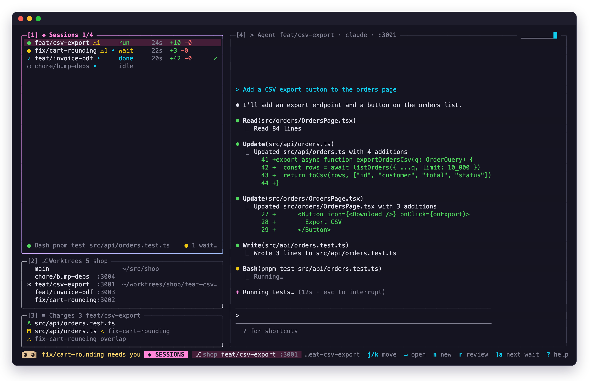
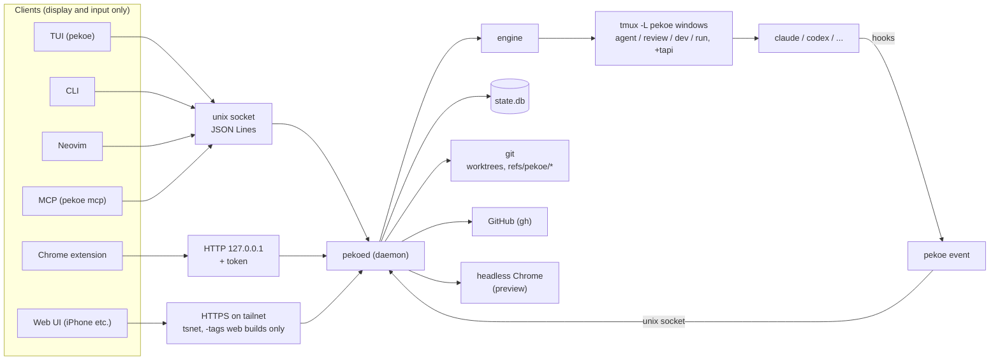

<p align="center"></p>

<p align="center">English | <a href="README.ja.md">日本語</a></p>

# pekoe

A cozy home for your coding agents. — with tapi, your little companion

[](LICENSE)
[](https://github.com/sakamosu/pekoe/releases/latest)
[](https://github.com/sakamosu/pekoe/actions/workflows/govulncheck.yml)

A terminal tool for running several coding agents in parallel, one per git worktree. pekoe takes care of the work around them: setting up worktrees, keeping track of which agent is waiting for you, reviewing their diffs, and getting them to a PR. It doesn't change how you use Claude Code: agents run as they are inside tmux, and pekoe learns their state from hooks.

- One task = one worktree = one agent. `pekoe new` creates the worktree, copies your config files, runs setup and assigns a port, then starts claude (or codex)
- The TUI lists your sessions and jumps to the next one that is waiting, asking for permission or ready for review. tapi, the mascot on the bottom line, shows the overall state
- Review changes hunk by hunk and send all your comments back to the agent as one message (in Neovim or the built-in review)
- Pick an element on a page with the Chrome extension and send it with an instruction. Screenshots of your dev server can be shown inside the TUI
- Answer permission prompts or send a quick message from an iPhone over Tailscale (optional build)

<p align="center"></p>

> [!WARNING]
> pekoe runs coding agents, and those agents execute commands and read and write files with your user's permissions. `pekoe hooks install` modifies `~/.claude/settings.json` (it keeps a backup; `pekoe hooks uninstall` removes only pekoe's hooks). If you let agents use pekoe itself, read [Letting agents use pekoe: permissions](#letting-agents-use-pekoe-permissions) first. To report a vulnerability, see [SECURITY.md](SECURITY.md).

## Status and requirements

- **A personal tool.** It is built for the author's daily use; configuration, API and commands may still change (no compatibility promises)
- **Developed and tested on macOS** (in Ghostty). Linux builds are published too, but parts of them are untested. Things that assume macOS:
  - APFS clones (`cp -c`) for `[worktree] clone`. On other file systems it falls back to a plain copy
  - `make install-launchd`, and `pekoe daemon restart` for a pekoed run by launchd (`launchctl`)
  - The default path of headless Chrome for the in-TUI preview, `/Applications/Google Chrome.app` (override with `PEKOE_CHROME`)
  - `b` in the TUI (open the port in Chrome) uses `open -a "Google Chrome"`
  - `pekoe adopt` looks up a process's cwd with `lsof`
- **Claude Code is the main target** (state comes from its hooks). codex, opencode and others work through `[agents.*]`, but their state is only inferred from the screen
- **Requirements:** tmux 3.3+, git. To build from source, Go 1.26.10+ (`make` uses only your local Go, via `GOTOOLCHAIN=local`). Optional: gh (issues, land, PR view, PR review), Neovim 0.10+ (review surface), Chrome (extension, in-TUI preview), Tailscale (Web UI)
- **The terminal layer is tmux.** A custom mux on libghostty-vt (phase 5 in [docs/design.md](docs/design.md)) has not been started and may never be. Kitty graphics passthrough can't work with the tmux engine, which redraws the right pane as text (the in-TUI preview images are drawn by pekoe itself with Kitty graphics)

## Architecture



All the smarts live in pekoed; the TUI, CLI, Neovim, Chrome extension, MCP and Web UI are display layers over the same API. Stopping pekoed doesn't stop the agents: they keep running inside tmux, and the next pekoed picks them up again.

## Documentation

Design docs are in Japanese.

| | |
| --- | --- |
| [docs/design.md](docs/design.md) | Design (state model, worktree flow, terminal layer, review, CLI and keys) |
| [docs/api.md](docs/api.md) | pekoed's API (unix socket, HTTP, HTTPS, MCP) |
| [docs/web.md](docs/web.md) | The iPhone Web UI: architecture, settings, threat model |
| [docs/mascot.md](docs/mascot.md) | The mascot tapi: shape, states, faces |
| [docs/tapi-chat.md](docs/tapi-chat.md) | tapi chat (the front-desk agent you talk to with `t` in the TUI) |
| [docs/ui-guidelines.md](docs/ui-guidelines.md) | TUI design principles (color tokens, layout, icons) |
| [nvim/README.md](nvim/README.md) / [extension/README.md](extension/README.md) | Neovim plugin / Chrome extension |

For developers: [CONTRIBUTING.md](CONTRIBUTING.md) (tests, sandbox, cutting a release) and [docs/verification.md](docs/verification.md) (how the implementation maps to the design, guidelines and mock).

## Install

See [Status and requirements](#status-and-requirements) for what you need. From source:

```sh
make install            # ~/.local/bin/pekoe (+ pekoed); links nvim/ and extension/ into ~/.local/share/pekoe
make install WEB=1      # also build in the iPhone Web UI (-tags web, links Tailscale's tsnet)
pekoe hooks install     # add hooks to ~/.claude/settings.json (asks first, keeps a backup)
make install-launchd    # optional: start pekoed at login
```

### From a release (prebuilt binaries)

GitHub Releases have builds for darwin / linux × arm64 / amd64. `pekoe_<ver>_<os>_<arch>.tar.gz` is the default build (no Web UI) and `pekoe_<ver>_<os>_<arch>_web.tar.gz` includes the Web UI (`-tags web`, [docs/web.md](docs/web.md)); both have the same layout. The repository is public, so you can download them with `gh` or curl without a token (for the Web UI build, add `_web` before `.tar.gz`):

```sh
ver=$(gh release view -R sakamosu/pekoe --json tagName -q .tagName | sed 's/^v//')   # the latest version (or ver=<version>)
gh release download "v$ver" -R sakamosu/pekoe -p "pekoe_${ver}_darwin_arm64.tar.gz" -p checksums.txt   # use your <os>_<arch>
# without gh, with curl:
#   ver=$(curl -fsSL https://api.github.com/repos/sakamosu/pekoe/releases/latest | sed -n 's/.*"tag_name": *"v\([^"]*\)".*/\1/p')
#   base="https://github.com/sakamosu/pekoe/releases/download/v$ver"
#   curl -fL -O "$base/pekoe_${ver}_darwin_arm64.tar.gz" -O "$base/checksums.txt"
shasum -a 256 --ignore-missing -c checksums.txt
gh attestation verify "pekoe_${ver}_darwin_arm64.tar.gz" -R sakamosu/pekoe   # built by this repository's workflow?
mkdir -p ~/.local/opt ~/.local/bin
tar -xzf "pekoe_${ver}_darwin_arm64.tar.gz" -C ~/.local/opt
ln -sfn ~/.local/opt/"pekoe_${ver}_darwin_arm64" ~/.local/opt/pekoe
ln -sf ~/.local/opt/pekoe/bin/pekoe ~/.local/bin/pekoe
ln -sf ~/.local/opt/pekoe/bin/pekoed ~/.local/bin/pekoed
pekoe version
```

`checksums.txt` sits in the same release, so it only tells you the archive isn't corrupted. `gh attestation verify` checks that the archive was built by this repository's `release.yml` (build provenance signed by GitHub Actions with Sigstore). Provenance is attached to releases made by `release.yml` while the repository is public; releases from before it went public don't have it, so `gh attestation verify` fails for those versions.

An archive contains `bin/pekoe`, `bin/pekoed` (→ pekoe), `share/pekoe/nvim/`, `share/pekoe/extension/`, `contrib/launchd/`, plus `README.md`, `README.ja.md`, `LICENSE` and `THIRD_PARTY_LICENSES` (licenses of the dependencies, see [License](#license)). `bin/pekoe` looks for `../share/pekoe/nvim` relative to its real location, so with the symlinks above the nvim plugin is found as is. To start it with launchd, run `sed -e "s|PEKOE_BIN|$HOME/.local/bin/pekoe|" -e "s|HOME|$HOME|g" ~/.local/opt/pekoe/contrib/launchd/dev.pekoe.pekoed.plist > ~/Library/LaunchAgents/dev.pekoe.pekoed.plist` and then `launchctl bootstrap gui/$(id -u) ~/Library/LaunchAgents/dev.pekoe.pekoed.plist`.

The default build contains no Tailscale code at all. After reinstalling, run `pekoe daemon restart` to switch pekoed to the new binary (agents keep running inside tmux; if launchd runs pekoed, it is restarted through launchd).

### Updating

```sh
pekoe update --check    # only check whether there is a newer release (anyone can run it)
pekoe update            # replace pekoe with the latest release
pekoe update --version vX.Y.Z --force   # a specific version (--force to go back)
```

`pekoe update` takes the latest GitHub release (`releases/latest`, excluding drafts and prereleases) and picks the archive for the current OS, architecture and build (the `_web` archive if the current pekoe has the Web UI).

- Nothing happens if the current version is the latest or newer. A `make install` version (`git describe`, e.g. `0.1.0-59-g3761d74`) counts as "59 commits after 0.1.0". Versions that can't be compared, such as `dev`, ask first
- The archive is checked against the SHA-256 in `checksums.txt`, and nothing is replaced if it doesn't match. If the release has provenance (an attestation), it is also checked with `gh attestation verify` (for old releases from before the repository went public, which have none, it only warns)
- Only the real file of the running pekoe (after following symlinks), the `pekoed` next to it, and `<prefix>/share/pekoe/nvim` and `extension` are replaced. Nothing else in `~/.local/share/pekoe` (such as `state.db`) is touched. Binaries are written next to the old ones and renamed; if something fails halfway, what was replaced is restored
- With a `make install`, `nvim` / `extension` are links into the repository, so they are replaced by directories with the release's contents (the repository isn't written to; it asks first; `make install` again brings the links back)
- If the current pekoe has the Web UI and the release has no `_web` archive, it refuses (install the default build with `--no-web`, or build from source with `make install WEB=1`)
- It refuses locations it can't write to and installs made by a package manager such as Homebrew
- At the end it prints the old and new versions and, if pekoed is running, asks whether to `pekoe daemon restart`. If the Chrome extension was replaced, reload it in `chrome://extensions`
- No token is needed. If `$GITHUB_TOKEN` / `$GH_TOKEN`, or else `gh auth token`, is available it is sent, which raises the GitHub API rate limit (without a token, 60 requests per hour; if you hit it, wait a while or `gh auth login`)
- Replacing is for humans only. Inside an agent's session (`$PEKOE_SESSION` is set) or where `human-token` can't be read, it refuses with `only a person can do this`. `--check` works for anyone

The hooks only call `pekoe event` on `SessionStart` `UserPromptSubmit` `Notification` `Stop` `PreToolUse` `PostToolUse` `SessionEnd`. The project's own `.claude/` is never touched. Check with `pekoe hooks status`; remove only pekoe's hooks with `pekoe hooks uninstall`.

## Quick start

```sh
cd ~/src/app
pekoe init                                            # draft ~/.config/pekoe/repos/<repo-id>.toml
pekoe new feat/csv --prompt "Add CSV export"          # worktree → copy → setup → port → start claude
pekoe new feat/invoice --from gh#128                  # the issue body becomes the first prompt
pekoe                                                 # TUI
```

`pekoe init` guesses setup and copy from lockfiles, `.envrc` and git's ignored files, lets you pick by number which ignored files to copy, and then writes the file. Agents you started by hand can be brought in with `pekoe adopt`, and existing worktrees with `pekoe open`.

## Commands

| Command | What it does |
| --- | --- |
| `pekoe` | TUI (starts the daemon if needed) |
| `pekoe init [<dir>] [--yes] [--overwrite] [--print]` | Detect the repository's settings and write a draft. `--print` only prints it |
| `pekoe new <branch> [--repo R] [--from gh#N] [--agent codex] [--base REF] [--prompt TEXT]` | Create a worktree + session. Shows setup progress and returns once the agent has started |
| `pekoe open [<worktree>] [--resume\|--new] [--agent NAME]` | Start in an existing worktree. Choose whether to resume a past Claude Code session (`--resume` to resume, `--new` for a new one) |
| `pekoe adopt [<path>] [--yes]` | Stop an agent running outside pekoe and resume the same session inside pekoe |
| `pekoe ls [--all\|--repo R]` | Sessions and their state. Inside a repository only that repository's, outside all of them |
| `pekoe issues [--repo R] [--all\|--label L] [--refresh]` | Open GitHub issues (assigned to you by default), with the state and branch of their session if there is one |
| `pekoe issues <N> [--repo R]` | An issue's body and comments |
| `pekoe conflicts [--repo R]` | Conflict forecast: pairs of sessions touching the same files, and whether they conflict (`git merge-tree`) |
| `pekoe send <slug> <text> [--no-enter]` | Type text into the pty (adds Enter by default; `-` reads stdin) |
| `pekoe review [<slug> \| gh#N [--repo R]]` | Review surface. Without arguments, the next session waiting for review. `gh#N` for someone else's PR |
| `pekoe land <slug>` | rebase → test → push → `gh pr create`. After the merge is detected, teardown and remove the worktree |
| `pekoe rm <slug> [--force] [--yes]` | teardown → remove the worktree (only under `~/worktrees`; for others pekoe only forgets the session) |
| `pekoe dev <slug>` | Start / stop `dev` on the session's port |
| `pekoe undo <slug> [n]` | Undo the changes of the last (or n-th) prompt |
| `pekoe answer <slug> allow\|deny\|always` | Answer a permission prompt |
| `pekoe attach <slug> [agent\|review\|dev]` | Attach to the tmux window directly (for debugging) |
| `pekoe hooks install\|uninstall\|status [--yes]` | Add / remove / check the Claude Code hooks |
| `pekoe ext` | The port and token for the Chrome extension |
| `pekoe web` | Web UI status, URL and first-time login URL |
| `pekoe mcp` | MCP server (stdio) for agents |
| `pekoe daemon start\|stop\|restart\|status` | Daemon control. `stop` waits until the process exits. `restart` waits for it to stop, starts it again and prints the versions before and after (use it after `make install`; if it isn't running, it just starts). Agents keep running inside tmux |
| `pekoe daemon stop --kill-agents [--yes]` | Also stop the tmux server (`$PEKOE_TMUX_SOCKET`). **On the default socket `pekoe` this stops every agent.** For cleaning up sandboxes |
| `pekoe tapi [reset [--yes]]` | tapi chat's state / stop it and forget the conversation (same as `T` in the TUI) |
| `pekoe tip [<id>] [--list] [--doc PATH]` | Introduce one pekoe feature (a tip not shown yet, see [Tips](#tips)). `<id>` for that tip, `--list` for all, `--doc` prints the doc a tip points to (bundled in the binary) |
| `pekoe update [--check] [--version vX.Y.Z] [--no-web] [--force] [--yes]` | Replace pekoe with the latest GitHub release ([Updating](#updating)). `--check` only looks for a newer version. Humans only |
| `pekoe version` | Version |

- `R` can be a repo-id, a short name (the name in `~/worktrees/<name>`) or a path. Commands that take a slug also accept `<repo>/<slug>`
- `--json` gives machine-readable output (`init` `new` `open` `ls` `issues` `conflicts` `land` `dev` `ext` `web` `tapi` `tip` `daemon status` `update --check`). It can go before or after the subcommand
- `--help` / `-h` only prints usage (exit code 0). Unknown flags or `--repo` without a value are errors (exit code 2). To pass a positional argument starting with `-`, put it after `--` (e.g. `pekoe send <slug> -- --verbose is not needed`)
- `pekoe event <Hook>` is internal, called by the hooks. It always exits 0, even on failure
- Of the commands that talk to pekoed, agents can use only `ls`, `new` and `send` (and `event`, for the hooks) without the token. The others (`answer`, `dev`, `init`, `open`, `review`, `rm`, `land`, `issues`, `conflicts`, `daemon`, …) and `update` (except `--check`) are human-only: they only work from a terminal that can read `human-token` (agents are refused, see [Letting agents use pekoe: permissions](#letting-agents-use-pekoe-permissions)). Anyone can `send`, but it is refused while the target shows a permission dialog (a human's `send` with Enter checks before typing and again right before Enter)

## TUI

Numbered panels on the left ([1] Sessions, [2] Worktrees ⇄ Browser ⇄ Issues, [3] Changes ⇄ Picks), [4] Agent on the right (the agent's screen itself; it switches to the preview, dev, run and PR windows), and a powerline status with key hints on the bottom line. Below 100 columns the left column becomes a single tab. Sessions from several repositories are grouped under a heading per repository.

Session state is shown with icons and colors (tokens in [docs/ui-guidelines.md](docs/ui-guidelines.md)). The mascot tapi at the left of the bottom line shows the most urgent state of all sessions with its face, and the line next to it says who is doing what:

| Face | State | Meaning |
| --- | --- | --- |
| `⨯ ⨯` | error | The agent exited abnormally or a command failed |
| `◕ ◕` | wait | Waiting for input or permission |
| `● ●` | work | Producing output or running a command |
| `^ ^` | done | The turn ended and you haven't looked yet |
| `• •` | idle | Idle at the prompt |
| `- -` | sleep | Every session has been idle for 3 minutes or more |

A toast appears when a session you aren't looking at goes to wait / error. tapi also reacts once to a PR being merged, CI failing and reviews (details in [docs/mascot.md](docs/mascot.md)).

| Key | Action |
| --- | --- |
| `j` `k` / `↵` | Select a session / enter the right pane and type (every key except `^q` goes to the agent) |
| `^q` | Leave input and go back to Sessions (change with `[keys] prefix`). Clicking a panel on the left also leaves |
| `i` / `h` `Esc` | Start typing in the Agent panel / go back left |
| `^q` `z` | Make the right pane (4) full width and hide the left / again to restore. Pressed while typing, you return to typing |
| `^q` `<` `>` / `^q` `=` | Narrow / widen the left pane by 4 columns / reset to the default (40%). Width and zoom are kept in `~/.local/share/pekoe/layout.json`, so the TUI after a restart and agents started from the CLI get the same width. Has no effect below 100 columns (stacked layout) |
| `n` | New worktree + session |
| `t` / `T` | Open tapi chat and talk to it ([tapi chat](#tapi-chat)) / reset tapi chat (asks first) |
| `w` | Choose a repository |
| `]a` `[a` | Next waiting session (including PRs with activity) / back to where you were |
| `]r` | Next session waiting for review |
| `r` | Review surface (the right pane becomes nvim; the agent keeps running behind it) |
| `p` | PR view (checks, reviews, threads; select with `space`, send to the agent with `s`) |
| `v` | Preview window (screenshots of the dev server inside the TUI; `m` mobile width, `c` before/after) → dev window → agent |
| `b` `l` `d` | Open the port in Chrome / land (confirmation with conflict forecast) / dev server |
| `!` | Run a command once in that worktree (run window). A `! <cmd>` or code on the agent's screen becomes the initial value. You can answer prompts and passwords directly; when it ends, `↵` goes back to the agent and `y` tells the agent the result (exit code, or interrupted on Ctrl-C). `x` closes without asking |
| `u` `R` | Undo the last prompt / restart the agent (resume) |
| `s` `i` `↵` | Send / ignore / show details of an error card (errors pekoed found in the dev server or browser). While a card is shown, typing is `a` |
| `x` `D` | End the session (keep the worktree) / delete the worktree (asks first) |
| `/` `?` `:` | Filter / key list (select and Enter to run) / command (`new` `send` `land` `rm` `dev` `undo` `review` `ext` `tutorial` `q`) |
| `H` | Tutorial again (also `:tutorial`, see [Tutorial](#tutorial)) |
| `.` | Next tip (only while a tip is shown in 4's empty view, see [Tips](#tips)) |
| `1`–`4` `Tab` `[` `]` | Move between panels / switch subtabs |
| `q` | Quit |

- Selecting a session waiting for permission opens the Permission modal (`y` allow, `n` deny, `A` always allow, `g` go to that session, `esc` later)
- In [2] Issues, `f` cycles assigned to me → all open → by label, and `n` creates a session from the issue
- [2] Browser ties localhost tabs open in Chrome to sessions by port. `E` sends the console errors
- When an element arrives from Chrome, a card appears in the Agent pane (`↵` send, `^s` another session, `^n` new session, `esc` discard). A pick with an instruction is sent right away to the session that owns the page's port (`[picks] auto_send`)
- Sessions touching the same files get `⚠N` in the list
- Passed through to the agent: OSC 52 (clipboard), OSC 8 (links), OSC 9/99/777 (notifications), mouse (SGR), Kitty keyboard protocol (so Shift+Enter and friends arrive; disable with `PEKOE_KITTY=0`)

All keys are listed in [docs/design.md](docs/design.md#cli-コマンドとキーバインド).

### tapi chat

Press `t` in any panel and [4] switches to a conversation with the mascot tapi (tapi chat), ready for typing. It is a front-desk agent that doesn't belong to any session: use it for one-off investigations and questions, research across repositories ("any dependabot alerts in my repositories?"), and handing out work (create a session with `pekoe new --repo R` and delegate, add instructions with `pekoe send`). You can talk to it while the main session is busy.

- `^q` (the prefix) closes it. The conversation stays; `t` again continues it. `Esc` goes to the agent (Claude Code's interrupt). `^q` `z` / `^q` `<` `>` `=` work as they do for agents and return you to typing in tapi chat (opened while zoomed it is full width, and the pty is sized to the pane)
- The agent starts the first time you open it (not when pekoed starts). It runs in `~/.local/share/pekoe/tapi/`, where pekoed puts a `CLAUDE.md` describing its role and the commands it uses. The first time, Claude Code asks you to trust the folder
- With Claude Code, the repositories pekoe knows and `~/worktrees` are passed with `--add-dir`, so reading across them doesn't ask for permission each time (added or removed repositories apply from the next start)
- tapi's face is in the title and changes while it thinks or waits for permission. If it starts waiting for permission or an answer while closed, the bottom line says `chat waits · t`
- `T` (or `pekoe tapi reset`) stops it and also deletes Claude Code's record of the conversation. pekoe itself saves nothing. It doesn't appear in the Web UI
- Change the agent with `[tapi] agent` ([Configuration](#configuration))

### Tutorial

The first time the TUI starts, a short tour walks through the screen: one part at a time is put in focus (Sessions, the state column, the agent, the new-session dialog, Changes and review, the PR view, land, Issues, tapi chat, the key list) with a card in which tapi explains it; the rest of the screen dims. `↵` / `→` / `l` / `space` next, `←` / `h` / `backspace` back, `esc` / `q` skip. The cards come in English and Japanese: Japanese when the first of `LC_ALL`, `LC_MESSAGES` and `LANG` that is set starts with `ja`, English otherwise. `tab` switches between them during the tour (staying on the step), and the language you pick is used from then on. It runs on sample sessions inside the TUI only: nothing is created in pekoed, and no key reaches an agent while it runs. Your sessions come back when it ends, including what changed meanwhile. That it was seen (or skipped), and the language you picked if you did, is recorded in `~/.local/share/pekoe/tutorial.json`; `H` or `:tutorial` shows it again.

### Tips

pekoe introduces its features one at a time ("this is handy when…"). They appear in two places:

- 4's empty view (no session selected, or a worktree being created). Under tapi's face and caption, it shows a `tip` heading, a one-line summary and a longer explanation. `.` shows the next tip. If there isn't enough height or width, the longer explanation goes first, and if it still doesn't fit nothing is shown
- tapi chat's greeting in its first reply. Ask "give me a tip" for the next one, or "tell me more" and tapi reads the doc the tip points to and explains (tapi uses `pekoe tip` and `pekoe tip --doc`)

Shown tips are recorded in `~/.local/share/pekoe/tips.json`, and none repeats until all have been shown (shared by the TUI and tapi chat). `[tips] enable = false` turns both off. List them with `pekoe tip --list`; the content is in `internal/tips/tips.toml`. Tip texts are in Japanese (the tutorial's cards in English or Japanese, everything else in the UI in English).

## Review

- A session that becomes `done` enters the review queue, and the Stop hook runs `test` automatically
- Approval is per hunk (identified by path + a hash of the change, so it survives shifted line numbers)
- `S` (`:PekoeSend` in nvim) sends all unsent comments as one message and records a review point `refs/pekoe/<slug>/review-<n>`. The next review shows only the diff from there
- Each hunk shows which prompt it came from (`← prompt #3: …`)
- `?` asks the agent about a hunk's intent; the answer is cut out by the Stop hook and shown
- `pekoe review gh#123` reviews someone else's PR in the same view. Comments go to a GitHub review through `gh api`
- Put a read-only agent command in `[review] gatekeeper`, and a list of risky spots shows up in the Comments panel and in nvim's `:PekoeRisks` (quickfix)

## Integrations

### Neovim

[nvim/README.md](nvim/README.md). Add `{ dir = "~/.local/share/pekoe/nvim" }` to lazy.nvim (the link `make install` creates; if you installed a release with the steps above, use `~/.local/opt/pekoe/share/pekoe/nvim`). The nvim that pekoe starts loads it automatically. Besides the review surface (`:PekoeReview` `:PekoeSend`): `<leader>bs` sends the selection, `<leader>bn` starts a new session from the selection, a floating window for permission prompts (it does not take the focus: `<leader>ba` enters it, and you answer from the agent's screen shown in it), and `:PekoeSessions` `:PekoeNew` `:PekoeAnswer` `:PekoeFollow` `:PekoeFixDiagnostics` `:PekoeRisks`.

### Chrome extension

[extension/README.md](extension/README.md). `chrome://extensions` → Developer mode → Load unpacked → enter the port and token from `pekoe ext` in the options. Pick an element with ⌘⇧E (Ctrl+Shift+E elsewhere) and send it with an instruction and a cropped screenshot. Errors from localhost pages and the open tabs also reach pekoed.

### MCP

Register with `claude mcp add pekoe -- pekoe mcp`. The tools are `open_in_editor(path, line, note?)` (nvim jumps to the line and shows the note) and `session_list()`.

### Claude Code skill

[skills/pekoe/SKILL.md](skills/pekoe/SKILL.md). A skill that makes the Claude Code running in your main checkout a hub: it hands change requests to another worktree and agent with `pekoe new`, and sends follow-up instructions from main with `pekoe send`. Install it from the repository root with `ln -s "$PWD/skills/pekoe" ~/.claude/skills/pekoe` (move or delete `~/.claude/skills/pekoe` first if it exists).

### Letting agents use pekoe: permissions

Agents run as the same user, so they can connect to pekoed's socket. pekoed runs outside the agents' sandbox, so without the `human-token` it allows only what agents need: `pekoe event` from the hooks, `pekoe ls`, `pekoe new` and `pekoe send` for the hub (the skill; `send` only into an agent's input box and not while it shows a permission dialog), and the MCP server's `session_list` and `open_in_editor`. Everything else (answering permission prompts, raw keys, typing into tapi chat, drafting and writing settings, running commands with `dev`, in the run window or the review surface, looking at other sessions' screens, diffs or error excerpts, stopping the daemon, …) needs the token. The token is in `~/.local/share/pekoe/human-token` (`$PEKOE_HOME/share/human-token` if `$PEKOE_HOME` is set; mode 0600), and the TUI, CLI and Neovim read it and send it. Neither the token nor its path is put in the environment of the agents' panes. Which method is which is listed under "人間だけの操作" (human-only operations) in [docs/api.md](docs/api.md).

But an agent running as the same user can read files. Use these two together:

1. **Make the token file unreadable to agents.** For Claude Code, enable the sandbox in `~/.claude/settings.json` and add the file to both `sandbox.filesystem.denyRead` (enforced at the OS level for Bash commands and their children) and a `Read(...)` rule in `permissions.deny` (for the Read tool). If you changed `$PEKOE_HOME` or `$XDG_DATA_HOME`, use that path

   ```json
   {
     "permissions": {
       "deny": ["Read(~/.local/share/pekoe/human-token)"]
     },
     "sandbox": {
       "enabled": true,
       "filesystem": {
         "denyRead": ["~/.local/share/pekoe/human-token"]
       }
     }
   }
   ```

   Then have an agent try `cat ~/.local/share/pekoe/human-token` and `pekoe answer no-such-session deny`, and check that the first can't read the file and the second is refused with `only a person can do this` (not `no such session`). Key names and behavior can change between Claude Code versions, so also see the [sandbox](https://code.claude.com/docs/en/sandboxing) and [permissions](https://code.claude.com/docs/en/permissions) docs. If pekoe can't reach the socket from inside the sandbox, review the sandbox's unix socket settings

2. **Don't allow pekoe wholesale, as in `Bash(pekoe *)`.** The hub (the skill) uses `ls`, `new` and `send`, so if you add pekoe to the allow list, limit it to those. Don't add `pekoe event` (for hooks), `answer`, `dev`, `init`, `rm`, `land` or `daemon`

   ```json
   {
     "permissions": {
       "allow": ["Bash(pekoe ls)", "Bash(pekoe --json ls)", "Bash(pekoe --json new *)", "Bash(pekoe send *)"]
     }
   }
   ```

**Commands from a worktree run in pekoe's own sandbox.** pekoed runs commands that come from code an agent can change: `[hooks] test` after every Stop, the `[review] gatekeeper`, `setup` on `pekoe new`, `dev`, `teardown` on rm / land, and the tests of `land`. Anyone can report a Stop, so an agent could otherwise put `cat ~/.local/share/pekoe/human-token` in a Makefile and have pekoed run it outside the agent's sandbox. pekoed runs these in a sandbox: `sandbox-exec` (Seatbelt) on macOS, bubblewrap (`bwrap`, from your distribution's package) on Linux. Everything is allowed (builds, tests and dev servers work as before) except reading `human-token`, `http-token`, the tsnet state and `config.toml`; writing pekoe's data and config directories and files that run later outside it (shell startup files, `~/.gitconfig`, `~/.claude/settings.json`, launch agents, the writable directories on `$PATH`, …); connecting to tmux servers; and, on macOS, opening apps or sending Apple events. Where no sandbox works, pekoe doesn't run them: the session shows `test not run: no sandbox`, the gatekeeper's reason shows up among the risks, and setup / dev / teardown / land fail saying why. `[sandbox] enable = false` in `config.toml` runs them without one. Not wrapped: the run window (`!`, a command you type yourself) and the agents (their own sandbox's job). The deny list is aimed at the secrets: a command can still write elsewhere in your home, so this doesn't replace reviewing what an agent changed. Details: [docs/api.md](docs/api.md) ("hooks の sandbox").

The Web UI and the Chrome extension are human entry points that don't go through the socket, so each works with its own authentication. Threat model: [docs/web.md](docs/web.md#脅威モデル).

### From an iPhone (Web UI)

Only in `make install WEB=1` builds. pekoed embeds Tailscale's tsnet and listens over HTTPS as a node of its own on your tailnet (`https://pekoe.<tailnet>.ts.net/`). All it can do is list sessions, allow / deny permission prompts (with confirmation; `always` isn't offered), `send`, and show the agent's screen (in color). No port is opened on localhost, and every connection is checked against `allow_users` with Tailscale's WhoIs.

1. Enable MagicDNS and HTTPS on your tailnet, write `[web]`, and restart pekoed
2. Open the login URL shown by `pekoe web` to join the tailnet (or use `TS_AUTHKEY`)
3. Open the URL from `pekoe web` in Safari on the iPhone and add it to the home screen

The certificate's hostname appears in Certificate Transparency logs. Design and threat model: [docs/web.md](docs/web.md).

## Configuration

`~/.config/pekoe/repos/<repo-id>.toml` (the repo-id is the normalized origin URL, so the same settings apply after a fresh clone; `pekoe init` can draft it):

```toml
agent = "claude"                  # default agent

[worktree]
copy  = [".env*", ".envrc"]
clone = ["node_modules"]          # APFS clone (cp -c)
base  = "main"                    # default: origin's HEAD or main

[hooks]
setup    = ["mise install", "pnpm install --offline", "createdb app_{{slug}}"]
dev      = "pnpm dev --port {{port}}"
test     = "pnpm test"
teardown = ["dropdb app_{{slug}}"]

[env]
PORT = "{{port}}"
DATABASE_URL = "postgres:///app_{{slug}}"

[review]
gatekeeper = "claude -p 'list risky spots as path:line: text'"   # gets the diff on stdin
```

Variables are `{{slug}}` `{{branch}}` `{{port}}` `{{path}}` `{{repo}}`. setup runs in order and stops at the first failure, shown in red in the left pane. When a value is put into a `[hooks]` command, values containing characters the shell treats specially (spaces, `$`, `` ` ``, `;` and so on) are single-quoted and passed as one word (ordinary values like `feat/x` are left as they are). pekoe adds the quotes when needed, so **do not put `{{…}}` inside quotes of your own** (`createdb app_{{branch}}`, not `createdb "app_{{branch}}"`: inside double quotes the single quotes do nothing). `pekoe new` refuses branch names with characters the shell treats specially (`$` `(` `)` `;` `|` `{` `}`, spaces and so on). Values in `[env]` are never quoted.

`~/.config/pekoe/config.toml` (global):

```toml
animate = true              # animate state icons
[http]
port = 47777                # for the Chrome extension (127.0.0.1)
[ports]
base = 3001                 # first port of the port ledger
[keys]
prefix = "ctrl+q"           # key to leave input
[review]
surface = "nvim"            # nvim | tui
[picks]
auto_send = true            # send picks with an instruction right away to the session that owns the page's port
[web]                       # Web UI (make install WEB=1 builds only, docs/web.md)
enable        = true
allow_users   = ["you@github"]      # Tailscale login names
allow_devices = ["iphone-15"]       # optional: only these devices
hostname      = "pekoe"             # machine name on the tailnet
[theme]
mode  = "auto"              # truecolor | ansi | none | auto
icons = "nerd"              # nerd | unicode | ascii
[theme.colors]              # override by role (tokens in docs/ui-guidelines.md)
primary = "#ff87da"
[mascot]                    # the mascot tapi (docs/mascot.md)
shape   = "auto"            # auto | round (sextant blocks) | block (quadrant blocks)
glyphs  = "auto"            # auto (measures the width of ●) | unicode | narrow (● as 🞄) | ascii
palette = "dark"            # dark (milky pearl, for dark backgrounds) | light (caramel pearl, for light backgrounds)
splash  = true              # splash screen at startup
[mascot.colors]             # override hi / bd / sh / eye
bd = "#e4c49a"
[agents.codex]              # agents other than Claude Code
command = "codex"
allow   = "y"
deny    = "n"
[tapi]                      # tapi chat (t in the TUI)
agent = "claude"            # a name from [agents.*]; agents other than claude get no --add-dir (cwd only)
[tips]                      # tips (4's empty view and tapi chat's greeting)
enable = true               # false hides both
[sandbox]                   # commands from worktrees ([hooks], gatekeeper) run in a sandbox
enable = true               # false runs them without one (where none works, they are not run)
```

`[agents.<name>]` takes `command` `resume` `prompt` (`arg` | `paste`) `allow` `always` `deny` `hooks`. `arg` puts the initial prompt on the command line after `--` (`claude -- '<prompt>'`), so a prompt starting with `-` is never read as an option; use `paste` for an agent that doesn't accept `--`. Answers to Claude Code's permission menu send `1` (allow) / `2` (always allow) / `Esc` (deny) by default; if its behavior changes, fix them in `[agents.claude]`.

## Where data lives (your repositories stay clean)

| Data | Location |
| --- | --- |
| Settings | `~/.config/pekoe/` |
| State DB, socket, logs, picks | `~/.local/share/pekoe/` |
| TUI pane width and zoom | `~/.local/share/pekoe/layout.json` (changed by `^q` `<` `>` `=` `z`) |
| Record of shown tips | `~/.local/share/pekoe/tips.json` (starts over after a full round) |
| Tutorial seen | `~/.local/share/pekoe/tutorial.json` (delete it to get the tour on the next start) |
| tapi chat's working directory | `~/.local/share/pekoe/tapi/` (the conversation record is on Claude Code's side, in `~/.claude/projects/`; `pekoe tapi reset` deletes it) |
| Human token (needed to answer permission prompts and the like; keep it from agents) | `~/.local/share/pekoe/human-token` |
| Keys of the Web UI's tsnet node | `~/.local/share/pekoe/tsnet/` (only when `[web]` is enabled) |
| Per-prompt snapshots / review points | `refs/pekoe/<slug>/prompt-<n>` / `review-<n>` (never pushed, not in `git log`) |
| Worktrees | `~/worktrees/<repo>/<slug>` (pekoe only deletes under here) |

## Development

```sh
make test               # go vet + go test (default and -tags web) + headless nvim tests
scripts/sandbox.sh      # start an isolated pekoed built from the current source in a subshell; cleaned up on exit
```

This lets you try things without touching your real pekoed or tmux server. More in [CONTRIBUTING.md](CONTRIBUTING.md).

## License

- The code (Go, the Neovim plugin, the Chrome extension, the Web UI, scripts) is [MIT](LICENSE)
- The logo image `docs/images/pekoe-logo.webp` was generated with ChatGPT (AI) and is not covered by the MIT license
- The JetBrains Mono font bundled in `docs/mock.html` is under the SIL Open Font License 1.1; the license text is in the file
- Release binaries statically link their dependencies (and Go's standard library). Their copyright notices and license texts are collected in `THIRD_PARTY_LICENSES` in each archive (the default and Web UI builds have different dependencies, so the contents differ)

## Contributing

Pull requests are not accepted. Please report bugs and send requests through [issues](https://github.com/sakamosu/pekoe/issues). For vulnerabilities, report privately as described in [SECURITY.md](SECURITY.md).
