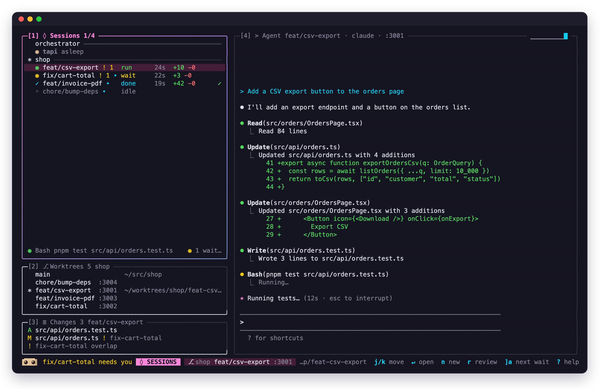
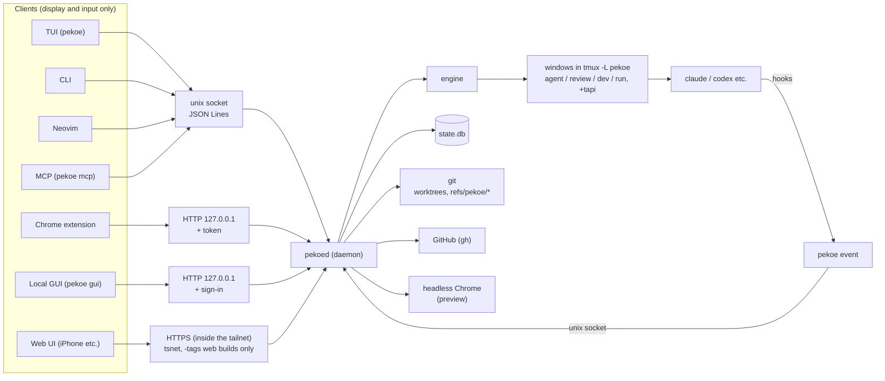

<p align="center"></p>

<p align="center">English | <a href="README.ja.md">日本語</a></p>

# pekoe

A cozy home for your coding agents. — with tapi, your little companion

[](LICENSE)
[](https://github.com/sakamosu/pekoe/releases/latest)
[](https://github.com/sakamosu/pekoe/actions/workflows/govulncheck.yml)

A terminal tool for running several coding agents in parallel, one per git worktree. pekoe takes care of the work around them: setting up worktrees, keeping track of which agent is waiting for you, reviewing their diffs, and getting them to a PR. It doesn't change how you use Claude Code: agents run as they are inside tmux, and pekoe learns their state from hooks.

- One task = one worktree = one agent. `pekoe new` creates the worktree, copies your config files, runs setup and assigns a port, then starts claude (or codex)
- The TUI lists your sessions and jumps to the next one that is waiting, asking for permission or ready for review. tapi, the mascot on the bottom line, shows the overall state
- Talk to tapi, the orchestrator: it starts sessions for your requests, waits for their reports, and brings you only what needs your decision (the inbox)
- Review changes hunk by hunk and send all your comments back to the agent as one message (in Neovim or the built-in review)
- Pick an element on a page with the Chrome extension and send it with an instruction. Screenshots of your dev server can be shown inside the TUI
- Answer permission prompts or send messages from an iPhone over Tailscale (optional build), or from this Mac's browser with the local GUI

<p align="center"></p>

> [!WARNING]
> pekoe runs coding agents, and those agents execute commands and read and write files with your user's permissions. `pekoe hooks install` modifies `~/.claude/settings.json` (it keeps a backup; `pekoe hooks uninstall` removes only pekoe's hooks). If you let agents use pekoe itself, read [Letting agents use pekoe: permissions](#letting-agents-use-pekoe-permissions) first. To report a vulnerability, see [SECURITY.md](SECURITY.md).

## Status and requirements

- **The author uses it for daily development.** Settings, the API and commands can change between versions (changes go in the release notes)
- **MIT licensed** ([License](#license)). Downloading a release (with curl) and `pekoe update` need no GitHub account
- **Developed and tested on macOS** (in Ghostty). Linux builds are published, but parts are untested there. macOS is assumed by the APFS clone of `[worktree] clone` (a plain copy elsewhere), `make install-launchd` and `pekoe daemon restart` of a launchd pekoed, the default headless Chrome path of the in-TUI preview (`PEKOE_CHROME` changes it), `open -a "Google Chrome"` of `b`, and `lsof` in `pekoe adopt`
- **Claude Code is the main target** (its state comes from hooks). codex, opencode and others work through `[agents.*]`, but their state is only guessed from the screen
- **Requirements:** tmux 3.3+, git, and the agent you run. On Linux, pekoe's own sandbox needs bubblewrap (`bwrap`), and Claude Code's sandbox needs bubblewrap and socat. Installing from source needs Go 1.27.4+ (`make` uses only your local Go, `GOTOOLCHAIN=local`). Optional: gh (issues, land, PR view, PR review), Neovim 0.10+ (review), Chrome (extension, in-TUI preview), Tailscale (Web UI)
- **The terminal layer is tmux.** A mux of its own on libghostty-vt (phase 5 in [docs/design.md](docs/design.md)) hasn't been started and may never be. The right pane is redrawn as text, so Kitty graphics can't pass through (pekoe draws the in-TUI preview images itself)

## Architecture



All the logic lives in pekoed. The TUI, CLI, Neovim, the Chrome extension, MCP, the local GUI and the Web UI are display layers over the same API. Agents keep running in tmux when pekoed stops, and the next pekoed picks them up again.

## Documentation

Using pekoe, in detail:

| | |
| --- | --- |
| [docs/install.en.md](docs/install.en.md) | Install and update in detail (Homebrew, checking and signing of releases, what `pekoe update` does, installing the skills) |
| [docs/commands.en.md](docs/commands.en.md) | Every command in detail, with its limits |
| [docs/tui.en.md](docs/tui.en.md) | The TUI in detail: keys, tapi chat and its dashboard, the tutorial, tips, review |
| [docs/agent-permissions.en.md](docs/agent-permissions.en.md) | Letting agents use pekoe (the sandbox settings, combining them with yours, allow lists, the hooks sandbox, pekoed's git) |
| [docs/config.en.md](docs/config.en.md) | Every setting (an annotated `config.toml`, the per-repository file, `dev` / `dev_stop`, pinning the model) |
| [nvim/README.md](nvim/README.md) / [extension/README.md](extension/README.md) | Neovim plugin / Chrome extension |

Design (in Japanese):

| | |
| --- | --- |
| [docs/design.md](docs/design.md) | Design (state model, worktree flow, terminal layer, review, CLI and keys) |
| [docs/api.md](docs/api.md) | pekoed's API (unix socket, HTTP, HTTPS, MCP) |
| [docs/web.md](docs/web.md) | The iPhone Web UI: architecture, settings, threat model |
| [docs/gui.md](docs/gui.md) / [docs/gui-design.md](docs/gui-design.md) | The local GUI (`pekoe gui`): authentication, threat model, stages / its design principles |
| [docs/mascot.md](docs/mascot.md) | The mascot tapi: shape, states, faces |
| [docs/tapi-chat.md](docs/tapi-chat.md) / [docs/orchestration.md](docs/orchestration.md) | tapi chat / tapi as the orchestrator, so you don't manage sessions by hand |
| [docs/voice.md](docs/voice.md) | pekoe voice (tapi speaks state changes aloud and reads replies; the backend contract) |
| [docs/project-layer.md](docs/project-layer.md) | Design record: a project layer above sessions (decided not to build it) |
| [docs/ui-guidelines.md](docs/ui-guidelines.md) / [docs/ambiguous-width.md](docs/ambiguous-width.md) | TUI design principles / ambiguous-width characters |

For developers: [CONTRIBUTING.md](CONTRIBUTING.md) (tests, sandbox, cutting a release) and [docs/verification.md](docs/verification.md) (how the implementation maps to the design, guidelines and mock).

## Install

See [Status and requirements](#status-and-requirements) for what you need. From source:

```sh
make install            # ~/.local/bin/pekoe (+ pekoed), links nvim/ and extension/ into ~/.local/share/pekoe
make install WEB=1      # also the iPhone Web UI (-tags web, links Tailscale's tsnet)
pekoe hooks install     # add hooks to ~/.claude/settings.json (asks before writing, keeps a backup)
pekoe skills install    # optional: link pekoe's skills into ~/.claude/skills (asks before writing)
make install-launchd    # optional: start pekoed at login
```

The hooks only call `pekoe event` on `SessionStart` `UserPromptSubmit` `Notification` `Stop` `PreToolUse` `PostToolUse` `SessionEnd`, and the project's own `.claude/` is left alone (check with `pekoe hooks status`). After reinstalling, `pekoe daemon restart` switches pekoed to the new binary (agents keep running).

### With Homebrew

On macOS and Linux (arm64 / amd64), the tap [sakamosu/homebrew-tap](https://github.com/sakamosu/homebrew-tap) installs the default build (no Web UI). tmux and git come along as dependencies:

```sh
brew install sakamosu/tap/pekoe
pekoe hooks install
brew upgrade pekoe      # to update (pekoe update refuses a Homebrew install), then pekoe daemon restart
```

For the Web UI, use a release's `_web` archive or `make install WEB=1`. What the cask installs, the quarantine attribute and launchd are in [docs/install.en.md](docs/install.en.md#with-homebrew).

### From a release (prebuilt binaries)

GitHub Releases have builds for darwin / linux × arm64 / amd64: `pekoe_<ver>_<os>_<arch>.tar.gz` is the default build, `…_web.tar.gz` the one with the Web UI. Download with `gh`, or with curl and no token:

```sh
ver=$(gh release view -R sakamosu/pekoe --json tagName -q .tagName | sed 's/^v//')   # the latest (or ver=<version>)
gh release download "v$ver" -R sakamosu/pekoe -p "pekoe_${ver}_darwin_arm64.tar.gz" -p checksums.txt   # darwin_arm64: your <os>_<arch>
# without gh, with curl:
#   ver=$(curl -fsSL https://api.github.com/repos/sakamosu/pekoe/releases/latest | sed -n 's/.*"tag_name": *"v\([^"]*\)".*/\1/p')
#   base="https://github.com/sakamosu/pekoe/releases/download/v$ver"
#   curl -fL -O "$base/pekoe_${ver}_darwin_arm64.tar.gz" -O "$base/checksums.txt"
shasum -a 256 --ignore-missing -c checksums.txt
gh attestation verify "pekoe_${ver}_darwin_arm64.tar.gz" -R sakamosu/pekoe \
  --signer-workflow sakamosu/pekoe/.github/workflows/release.yml --source-ref "refs/tags/v$ver"   # built by release.yml from this tag (v0.1.0–v0.3.0 have no provenance)
mkdir -p ~/.local/opt ~/.local/bin
tar -xzf "pekoe_${ver}_darwin_arm64.tar.gz" -C ~/.local/opt
ln -sfn ~/.local/opt/"pekoe_${ver}_darwin_arm64" ~/.local/opt/pekoe
ln -sf ~/.local/opt/pekoe/bin/pekoe ~/.local/bin/pekoe
ln -sf ~/.local/opt/pekoe/bin/pekoed ~/.local/bin/pekoed
pekoe version
```

For the Web UI build, add `_web` to the archive name and the unpacked directory name. `checksums.txt` only tells you the archive isn't broken; `gh attestation verify` (build provenance) tells you it's genuine. macOS binaries from v0.5.0 on are signed with a Developer ID and notarized. Provenance and signing in detail, what the archive holds, and starting it with launchd are in [docs/install.en.md](docs/install.en.md#from-a-release-prebuilt-binaries).

### Updating

```sh
pekoe update --check    # only check for a newer release (anyone can)
pekoe update            # replace with the latest release
pekoe update --version vX.Y.Z --force   # a given version (--force when it's older)
pekoe update --allow-unverified         # go on even if the provenance can't be checked
```

`pekoe update` picks the archive for the same OS, architecture and build (`_web` or not) as the running pekoe, checks its SHA-256 and build provenance, and replaces only pekoe, pekoed, the nvim plugin and the Chrome extension (`state.db` and the rest are left alone; a failure puts things back). From v0.4.0 on it stops if the provenance can't be checked. It refuses installs made by Homebrew and the like, and places it can't write to. Replacing is for humans only. At the end it offers to `pekoe daemon restart`. More in [docs/install.en.md](docs/install.en.md#updating).

## Quick start

```sh
cd ~/src/app
pekoe init                                            # draft ~/.config/pekoe/repos/<repo-id>.toml, start the main session
pekoe new feat/csv --prompt "Add CSV export"          # worktree → copy → setup → port → start claude
pekoe new feat/invoice --from gh#128                  # the issue body as the first prompt
pekoe                                                 # TUI
```

`pekoe init` guesses setup and copy from lockfiles, `.envrc` and git's ignored files (`test` is written only when it can run; otherwise it's commented out with the reason), lets you pick which ignored files to copy, and writes. Then it starts an agent in the repository's main checkout (the main session; `--no-open` skips it). Bring in an agent you started by hand with `pekoe adopt`, and an existing worktree with `pekoe open` ([more](docs/commands.en.md#what-pekoe-init-drafts)).

## Commands

The everyday ones and the ones agents use. Each command in detail, with its limits, is in [docs/commands.en.md](docs/commands.en.md).

| Command | What it does |
| --- | --- |
| `pekoe` | Open the TUI (starts the daemon if it isn't running) |
| `pekoe init [<dir>] [--yes] [--overwrite] [--print] [--no-open]` | Detect the repository's settings and write a draft, then start the main session in the main checkout if there is none |
| `pekoe new <branch> [--repo R] [--from gh#N] [--agent codex] [--model M] [--effort E] [--base REF] [--after SLUG]... [--hold] [--prompt TEXT] [--request ID]` | Create a worktree and a session. Without `--base`, it fetches the base from origin and starts from `origin/<base>` if yours is behind. `--after` records the sessions this one follows; with `--hold` it waits `queued` until they have landed. `--model` / `--effort` override for this session only |
| `pekoe open [<worktree>] [--resume\|--new] [--agent NAME]` | Start an agent in an existing worktree (choose whether to resume an earlier Claude Code session) |
| `pekoe adopt [<path>] [--yes]` | Stop an agent running outside pekoe and resume the same session inside pekoe |
| `pekoe ls [--all\|--repo R]` | List sessions and their state |
| `pekoe issues [<N>] [--repo R] [--all\|--label L] [--refresh]` | Your open GitHub issues (yours by default) with their sessions' state. `<N>`: the body and comments |
| `pekoe conflicts [--repo R]` | Conflict forecast: pairs of sessions changing the same files, and whether they conflict (`git merge-tree`) |
| `pekoe send <slug> <text> [--no-enter]` | Type text into the pty (Enter by default; `-` reads stdin) |
| `pekoe review [<slug> \| gh#N [--repo R]]` | Open the review (no argument: the next one waiting for review; `gh#N`: someone else's PR) |
| `pekoe land <slug>` | rebase → test → push → `gh pr create`. Once the merge is seen, teardown and the worktree are removed. Agents can run it too (merging is a person's call) |
| `pekoe cleanup [--all\|--repo R] [--stale 72h]` / `pekoe cleanup --rm <slug>… \| --rm --landed [--force] [--yes]` | What could be cleaned up (landed, merged, stopped for long), with the number of uncommitted files and unpushed commits; `--rm` removes. Nothing is removed on its own |
| `pekoe rm <slug> [--force] [--yes]` | Run teardown, then remove the worktree (only those pekoe made under `~/worktrees`) |
| `pekoe repo forget <name\|repo-id\|path> [--config] [--yes]` | Drop a repository you no longer use from what pekoe knows (`--config`: delete `repos/<repo-id>.toml` too) |
| `pekoe report <summary> --status done\|blocked\|progress\|review [--evidence E]... [--verdict pending\|pass\|fail --reviewed-sha SHA]` | A session's agent records the result of its work, or an independent review's verdict |
| `pekoe reports [<slug>] [--limit N]` | Reports, newest first |
| `pekoe wait [--mine] [--slug S,…] [--on KINDS] [--since CURSOR] [--timeout 30m]` | Wait until something happens to sessions (a report, `started`, `done`, `waiting`, `failed`, `pr`, `ci`, `landed`, `inbox` …). Pass the returned `cursor` to the next `--since` and nothing is missed |
| `pekoe ask-human <question> [--option O]... [--recommend N] [--decided N] [--kind decision\|approve\|login\|fyi] [--about SLUG] [--context TEXT\|-] [--link URL]... [--wait [--timeout 30m]]` / `pekoe ask-human --wait <id>` | An agent asks a person for a decision, an approval or a hand (the inbox). pekoed adds the session's facts (branch, diff, PR, CI …) |
| `pekoe inbox [<id>] [--all] [--mine]` / `pekoe inbox answer <id> [<n>] [--note …] [--rev N]` / `pekoe inbox dismiss\|withdraw <id> [--note …]` | List, read and answer the inbox. Only a person answers. When a landed PR has all it needs to merge, pekoed adds a merge item, and answering `merge` has pekoed merge it (the conditions are in [docs/commands.en.md](docs/commands.en.md)) |
| `pekoe ledger [<id>] [--all]` / `pekoe ledger done\|drop\|close\|link <id> …` / `pekoe ledger keep [<id>]` / `pekoe ledger reopen\|rm <id>` | The record of what you asked tapi chat for. tapi ties sessions to requests and closes them; chit-chat is closed as `chat` on its own |
| `pekoe stats [--days N] [--repo R] [--json]` | PRs merged and tokens used, by date and repository (the last 7 days by default) |
| `pekoe dev <slug>` / `pekoe dev --log [<slug>] [--lines N]` | Start or stop `dev` on the session's port / the end of the dev hook's log |
| `pekoe undo <slug> [n]` | Undo the changes of the last (or n-th) prompt |
| `pekoe answer <slug> allow\|deny\|always` | Answer a permission prompt |
| `pekoe attach <slug> [agent\|review\|dev]` | Attach to a tmux window directly (for debugging) |
| `pekoe hooks install\|uninstall\|status [--yes]` | Add / remove / check the Claude Code hooks |
| `pekoe skills install\|uninstall\|status [--yes]` | Link / unlink / check pekoe's Claude Code skills ([Claude Code skills](#claude-code-skills)) |
| `pekoe ext` | Print the port and token to enter in the Chrome extension |
| `pekoe web` | The Web UI's state, URL and first login URL |
| `pekoe gui [--no-open\|--status\|--revoke\|--stop]` | Open the local GUI with a one-time sign-in link ([From this Mac's browser](#from-this-macs-browser-local-gui)) |
| `pekoe mcp` | MCP server for agents (stdio) |
| `pekoe daemon start\|stop\|restart\|status` | Control the daemon. Agents keep running in tmux, and open TUIs reconnect |
| `pekoe daemon stop --kill-agents [--yes]` | Also stop the tmux server. **On the default socket this stops every agent** (for cleaning up an isolated setup) |
| `pekoe tapi [status\|reset [--yes]]` | tapi chat's state / end it and forget its conversation (the ledger and the inbox stay) |
| `pekoe tip [<id>] [--list] [--doc PATH]` | Show one pekoe feature ([Tips](#tips)) |
| `pekoe config edit\|check\|show\|path` | Open `config.toml` in `$EDITOR` and check it when it closes / check it / print the settings in use with defaults / print where it is |
| `pekoe voice [on\|off\|mute [--for 30m]\|unmute\|stop\|backends\|log [-n 50]]` | tapi speaks state changes aloud (macOS only; [docs/voice.md](docs/voice.md)). With no subcommand: its state |
| `pekoe voice mode <slug> read\|narrate\|mute\|auto` | How one session speaks (`auto`: back to the default) |
| `pekoe voice test "<sentence>" [--voice tapi\|reader] [--lang ja\|en]` | Say a sentence as it is, and print the backend and the wait |
| `pekoe update [--check] [--version vX.Y.Z] [--no-web] [--force] [--allow-unverified] [--yes]` | Replace pekoe with the latest GitHub release ([Updating](#updating)) |
| `pekoe version` | Print the version |

- `R` takes a repo-id, a short name (the name in `~/worktrees/<name>`) or a path. Commands that take a slug also take `<repo>/<slug>`
- `--json` gives machine-readable output (before or after the subcommand). `--help` / `-h` only prints usage. Put `--` before a positional argument that starts with `-`
- `pekoe event <Hook>` is internal, called by the hooks
- Without a token, agents can use only `ls`, `new`, `send`, `land`, `report`, `reports`, `wait`, `ask-human`, `inbox` (the list, and `withdraw` of their own questions), `ledger` (tapi chat only), `stats`, `conflicts`, `cleanup` (the list), `dev` of their own session and `rm` of a landed session, each with limits. Everything else is for humans ([Letting agents use pekoe: permissions](#letting-agents-use-pekoe-permissions))
- When a session goes away, pekoed also stops the processes its windows left in the background (how they're found, and what is left alone, in [docs/commands.en.md](docs/commands.en.md))

## TUI

Numbered panels on the left ([1] Sessions, [2] Worktrees ⇄ Browser ⇄ Issues, [3] Changes ⇄ Picks), [4] Agent on the right (the agent's own screen; it also switches to the preview, dev, run and PR windows), and a powerline status with key hints on the bottom line. Below 100 columns the left column becomes one tab. Sessions are grouped by repository, with the tapi row ([tapi chat](#tapi-chat)) always on top.

tapi, the mascot at the left end of the bottom line, shows the highest-priority state across all sessions with its face, and says who is doing what next to it:

| Face | State | Meaning |
| --- | --- | --- |
| `⨯ ⨯` | error | The agent died, or a command failed |
| `◕ ◕` | wait | Waiting for input or permission |
| `◉ ◉` | work | Printing output or running a command |
| `^ ^` | done | The turn ended and you haven't looked yet |
| `∙ ∙` | idle | Waiting at the prompt |
| `- -` | sleep | Every session has been idle for 3 minutes or more |

A toast appears when a session you aren't looking at goes wait or error. tapi also reacts once to a merged PR, a CI failure or a review ([docs/mascot.md](docs/mascot.md)).

| Key | Action |
| --- | --- |
| `j` `k` / `↵` | Select a session or the tapi row / enter the right pane and type (every key but `^q` goes to the agent) |
| `^q` / `^q` `h` `l` | Leave input and go back to Sessions (change with `[keys] prefix`) / focus the left panels / the right pane |
| `i` / `h` `Esc` | Start typing in the Agent panel / back to the left |
| `^q` `z` / `^q` `<` `>` `=` | Zoom the right pane (toggle) / narrow, widen or reset the left panels |
| `^q` `,` / `^q` `o` / `^q` `m` | Edit `config.toml` / go to tapi's dashboard / mute voice (toggle). All work while typing too |
| `n` | New worktree and session |
| `t` / `T` | Open tapi chat and talk / reset tapi chat (asks first) |
| `w` | Switch repository |
| `]a` `[a` / `]r` | Next waiting session (PR news and tapi's prompts included) / back / next one waiting for review |
| `r` / `p` | Open the review / the PR view (checks, reviews, threads; select with `space`, send to the agent with `s`) |
| `v` | Cycle the preview window (dev server screenshots; `m` mobile width, `c` before/after) → dev window → agent |
| `b` `l` `d` | Open the port in Chrome / land (asks first, with the conflict forecast) / dev server |
| `!` | Run a command once in the worktree (the run window; `y` tells the agent the result) |
| `u` `R` | Undo the last prompt / restart the agent (resume) |
| `s` `i` `↵` | Send / ignore / open an error card (dev server or browser errors) |
| `x` `D` | End the session (the worktree stays) / delete the worktree (asks first) |
| `/` `?` `:` | Filter / key list (Enter runs the selected one) / commands (`new` `send` `land` `rm` `dev` `undo` `restart` `review` `inbox` `voice` `cleanup` `config` `ext` `tutorial` `q`) |
| `:voice` / `:cleanup` | What voice said / the cleanup list (select with `space`, delete with `D`) |
| `H` / `.` | Replay the tutorial / next tip (while one shows in the empty view) |
| `1`–`4` `Tab` `[` `]` | Move between panels / switch sub-tabs |
| `q` | Quit |

- When anything asks for permission, a session or tapi chat, the Permission modal comes to the front (`y` allow, `n` deny, `A` always, `g` go to it, `esc` later). It never cuts in while you are typing
- When a new inbox question an agent is waiting on arrives, the answer screen comes forward once your hands stop (`]a` answers it later too)
- In [2] Issues, `n` starts a session from an issue. [2] Browser ties Chrome's localhost tabs to sessions. Elements picked in Chrome show up as a card in the Agent pane
- Sessions changing the same files get a warning icon and the number of others in the list

Each key in detail, and the terminal features passed through, are in [docs/tui.en.md](docs/tui.en.md); every key is in [docs/design.md](docs/design.md#cli-コマンドとキーバインド).

### tapi chat

Press `t` from any panel and [4] switches to a conversation with the mascot tapi (tapi chat), ready for you to type. tapi is the **orchestrator**: it doesn't write the changes you ask for itself, but starts sessions with `pekoe new`, waits for their reports with `pekoe wait`, and sends you one summary. It brings you only what needs a decision or an approval (the inbox). One-off questions, and ones across repositories, it answers itself. You can still skip tapi, start sessions and type to them directly.

- `^q` closes it. The conversation stays; `t` again picks up where you were. `Esc` goes to the agent (interrupts Claude Code)
- The agent starts the first time you open it. Its working directory is `~/.local/share/pekoe/tapi/`, where pekoed puts a `CLAUDE.md` describing its role. It can read the repositories pekoe knows and `~/worktrees`, but not write to them
- While the tapi row at the top of Sessions is selected, [4] is the **dashboard**: what needs you, the inbox, a pipeline per session (`impl → review → PR → CI → merge` and what's missing for the merge), requests, and today's and the last 7 days' numbers (`pekoe stats`), on one screen with no model tokens spent. `↵` answers the inbox, `o` opens a report's evidence (screenshots, logs, PRs). `^q` `o` gets you there from anywhere
- When tapi waits for permission or an answer, you're told like a waiting session (toast → blinking bottom line → OS notification; `[orchestrator] notify = "quiet"` tones it down)
- What you type to tapi is recorded as a request (`pekoe ledger`) and closed when done. `T` (or `pekoe tapi reset`) makes it forget the conversation; the ledger and the inbox stay
- You can also talk to tapi from the Web UI's tapi tab (iPhone). Change its agent with `[tapi] agent`

More in [docs/tui.en.md](docs/tui.en.md#tapi-chat), [docs/tapi-chat.md](docs/tapi-chat.md) and [docs/orchestration.md](docs/orchestration.md).

### Tutorial

The first time the TUI starts, a tour walks you through the screen. Part one is "ask tapi" (the tapi row, tapi chat, the dashboard, the inbox), part two "drive it yourself" (Sessions, the agent, new sessions, Changes and review, the PR view and land, the key list). `↵` / `→` goes on, `←` back, `esc` ends it. The cards are in English and Japanese (picked from your locale, `tab` switches), and the tour is a sample inside the TUI only: nothing is created in pekoed. Replay it with `H` or `:tutorial` ([docs/tui.en.md](docs/tui.en.md#tutorial)).

### Tips

pekoe introduces its features one at a time, as "handy ways to use it". They show in the empty view of [4] (`.` for the next) and in tapi chat's first greeting. Ask tapi for a tip and it gives you the next one; ask for more and it reads the docs the tip points to (`pekoe tip`, `pekoe tip --doc`). Tips shown are recorded in `~/.local/share/pekoe/tips.json`, and none repeats until all have been shown. `[tips] enable = false` turns them off; `pekoe tip --list` lists them. The tips' text is in Japanese only.

## Review

- A session that turns `done` goes into the review queue, and the Stop hook runs `test` (a test command that can't be found shows `test could not run`, not a failure)
- Approval is per hunk (hunks are identified by path and a hash of the change, so approvals survive shifted line numbers)
- `S` (`:PekoeSend` in nvim) sends your unsent comments as one message and records a review point `refs/pekoe/<slug>/review-<n>`. The next review shows only the diff since then
- Each hunk shows the prompt it came from (`← prompt #3: …`). `?` asks the agent what a hunk is for
- `pekoe review gh#123` reviews someone else's PR in the same view (comments go out as a GitHub review)
- Put a read-only agent command in `[review] gatekeeper` and a list of risky spots appears in the Comments panel and in nvim's `:PekoeRisks`

## Integrations

### Neovim

Add `{ dir = "~/.local/share/pekoe/nvim" }` to lazy.nvim (`~/.local/opt/pekoe/share/pekoe/nvim` if you installed a release). nvim started by pekoe loads it on its own. Besides the review (`:PekoeReview` `:PekoeSend`), there's `<leader>bs` to send the selection, `<leader>bn` to start a new session from it, a floating window for permission prompts (`<leader>ba`), and more. See [nvim/README.md](nvim/README.md).

### Chrome extension

At `chrome://extensions`, turn on Developer mode and "Load unpacked", then enter the port and token from `pekoe ext` in the options. ⌘⇧E (Ctrl+Shift+E off macOS) picks an element and sends it with an instruction and a cropped screenshot. Errors on localhost pages and the open tabs also reach pekoed. See [extension/README.md](extension/README.md).

### MCP

Register with `claude mcp add pekoe -- pekoe mcp`. The tools are `open_in_editor(path, line, note?)` (nvim jumps to the line and shows the note) and `session_list()`.

### Claude Code skills

The four in [skills/](skills/). Each works both in tapi chat and for the agent in the main checkout ([docs/orchestration.md](docs/orchestration.md)).

| Skill | Used by | What it covers |
| --- | --- | --- |
| [pekoe](skills/pekoe/SKILL.md) | main, tapi | hand change requests to another worktree and agent with `pekoe new`, and send follow-ups with `pekoe send` (the basics of a hub) |
| [pekoe-orchestrate](skills/pekoe-orchestrate/SKILL.md) | tapi, a hub | how to split requests, a prompt template, waiting with `pekoe wait`, what to bring to a person, how to report |
| [pekoe-work](skills/pekoe-work/SKILL.md) | a work session | plan → implement → test → independent review → `pekoe land` → `pekoe report` |
| [pekoe-review](skills/pekoe-review/SKILL.md) | an independent reviewer | an agent that didn't write the diff reads it and records a verdict with the SHA in `pekoe report --status review` |

`pekoe skills install` writes the skills' text, built into the binary, to the data directory and links `~/.claude/skills/<name>` to it (it asks before writing; after an update, pekoed writes them again when it starts). Links you made by hand, `status` and `uninstall` are in [docs/install.en.md](docs/install.en.md#installing-the-claude-code-skills).

### Letting agents use pekoe: permissions

Agents run as your user, so they can connect to pekoed's socket. So for calls without the `human-token`, pekoed allows only what agents need (a hub's `ls`, `new`, `send`, `wait` …, a work session's `report`, `ask-human` and its own `dev`, `land`, `rm` of a landed session), and keeps answering permission prompts, answering the inbox, writing settings, stopping the daemon and the like for humans. The token is in `~/.local/share/pekoe/human-token` (0600); the TUI, CLI and Neovim read it and send it along. Agents never get it.

An agent running as your user can still read files, so these protect the token and other secrets:

1. **Claude Code agents run in a Claude Code sandbox configured by pekoe (by default).** pekoe passes `--settings <data dir>/agent-settings/<slug>.json` at every start, so they can't read the token, `state.db`, pekoe's settings and the like, or write the repository's `.git/config` and `.git/hooks` (tapi chat can't write the repositories at all). Without a working sandbox Claude Code won't start. It applies to claude only; `[agents.claude] sandbox = false` turns it off. By default, writing outside the worktree and connecting to domains not allowed stop working, so loosen only what you need with `allowWrite` / `allowedDomains` in `~/.claude/settings.json`
2. **Don't allow all of pekoe, as in `Bash(pekoe *)`.** If you allow-list it, keep to the commands hubs and work sessions use. Leave out `answer`, `init`, `rm`, `daemon` and `event`
3. **Commands that come from a worktree run in pekoe's own sandbox.** `[hooks]` (test, setup, dev, teardown), `[review] gatekeeper` and land's test run in `sandbox-exec` on macOS and `bwrap` on Linux, which forbid reading the token and settings, and writing files that later run outside the sandbox (`[sandbox] enable = false` turns it off). Changes to the main `.git/hooks` and `.git/config` are reported to the inbox
4. **pekoed's own git doesn't run what agents wrote into git's config** (fsmonitor, hooks, credential helpers and the like are overridden with your own settings or git's defaults)

What the settings contain, how they combine with yours, examples of loosening them (Go, npm, `gh`), an allow list, and how to check it all are in [docs/agent-permissions.en.md](docs/agent-permissions.en.md). Which methods are for humans is in "人間だけの操作" in [docs/api.md](docs/api.md), with "hooks の sandbox" and "pekoed が動かす git". The Web UI, the local GUI and the Chrome extension are entrances for humans that don't go through the socket, each with its own authentication.

### From an iPhone (Web UI)

Only in `make install WEB=1` builds. pekoed embeds Tailscale's tsnet and listens over HTTPS as a node of its own on your tailnet (`https://pekoe.<tailnet>.ts.net/`). It has three tabs, Now (what needs you, how requests are going), Sessions and tapi, and all it can do is allow / deny permission prompts (`always` isn't offered), `send` (with up to 4 photos or screenshots), a keypad for an agent's questions, show an agent's screen, answer the inbox, show the pipeline, and talk to tapi (only with `allow_devices` set). It opens no port on localhost, and checks every connection against `allow_users` with Tailscale's WhoIs.

1. Turn on MagicDNS and HTTPS for your tailnet, write `[web]`, and restart pekoed
2. Open the login URL from `pekoe web` to join the tailnet (`TS_AUTHKEY` works too)
3. Open the URL from `pekoe web` in Safari on the iPhone and add it to the home screen

The certificate's hostname appears in Certificate Transparency logs. Design and threat model: [docs/web.md](docs/web.md).

### From this Mac's browser (local GUI)

`pekoe gui` serves the Web UI's API with a desktop layout to this Mac's own browser, on `127.0.0.1` only (any build; nothing listens until you run it). Unlike the Web UI, sending to tapi needs no `allow_devices` and no confirmation sheet, and a permission prompt can be answered `always`. Sign-in uses a one-time token (once, 60 seconds) that never goes on a command line or in a cookie. After a new tab or a restart of pekoed, when you haven't acted for `[gui] session_ttl`, or 24 hours after signing in, run `pekoe gui` again. `[gui] enable = false` refuses it.

**Open it in a browser (profile) no agent drives.** Whatever can drive that tab (Claude in Chrome, Playwright …) can answer permission prompts as you. Authentication and threat model: [docs/gui.md](docs/gui.md).

### Voice backends (VOICEVOX)

`pekoe voice` speaks with macOS's `say` out of the box. Other speech synthesis plugs in as an external **backend** (an executable that turns one sentence into a WAV file). pekoe runs only backends written with an absolute path in `[voice.backends]`, and never looks in `PATH`.

Example: [pekoe-voice-voicevox](https://github.com/sakamosu/pekoe-voice-voicevox) (Japanese only; not public yet, so the link and the steps below work once it is) speaks with [VOICEVOX](https://voicevox.hiroshiba.jp/) voices through a local VOICEVOX engine (`127.0.0.1:50021`). Build it and put it where agents can't write:

```sh
git clone https://github.com/sakamosu/pekoe-voice-voicevox.git
cd pekoe-voice-voicevox
go build -o pekoe-voice-voicevox .
install -m 755 pekoe-voice-voicevox /opt/homebrew/bin/
```

```toml
[voice]
enable = true               # while off, no backend runs
backend = "voicevox"
fallback = "say"            # while the VOICEVOX engine isn't running

[voice.backends]
voicevox = "/opt/homebrew/bin/pekoe-voice-voicevox"   # the absolute path where you put it
```

`pekoe voice backends` shows whether it works, `pekoe voice test "テストだよ"` plays a sentence. Each VOICEVOX character has its own terms of use: credit the character as its terms say when you publish audio made with it.

To write a backend: the contract (v1) is [section 10 of docs/voice.md](docs/voice.md#10-speech-backend-の約束事-v1). In a clone of this repository, `PEKOE_VOICE_CONTRACT=/absolute/path/your-backend go test ./internal/voice/backend -run TestContractExternal -v` checks a backend against it (the bundled `say` passes the same test).

## Configuration

There are two files. Every setting, with notes, is in [docs/config.en.md](docs/config.en.md).

`~/.config/pekoe/repos/<repo-id>.toml` (per repository; the repo-id is the normalized origin URL, so a fresh clone gets the same settings; `pekoe init` drafts it):

```toml
agent = "claude"                  # the default agent

[worktree]
copy  = [".env*", ".envrc"]
clone = ["node_modules"]          # APFS clone (cp -c)
base  = "main"                    # default: origin's HEAD or main

[hooks]
setup    = ["mise install", "pnpm install --offline", "createdb app_{{slug}}"]
dev      = "pnpm dev --port {{port}}"
dev_stop = "docker compose down"  # when dev is stopped, and when dev ends on its own
test     = "pnpm test"
teardown = ["dropdb app_{{slug}}"]

[env]
PORT = "{{port}}"
DATABASE_URL = "postgres:///app_{{slug}}"

[review]
gatekeeper = "claude -p 'list risky spots as path:line: text'"   # gets the diff on stdin

[merge]
method = "merge"                  # how pekoed merges when you answer merge in the inbox: merge | squash | rebase
```

The variables are `{{slug}}` `{{branch}}` `{{port}}` `{{path}}` `{{repo}}`. pekoe quotes them when needed, so **don't put quotes around `{{…}}` yourself**. setup runs in order and stops at the first failure.

`~/.config/pekoe/config.toml` (global; open it with `pekoe config edit` or `^q ,` in the TUI, and see the values in use with defaults with `pekoe config show`). The ones you'll most likely change:

```toml
[keys]
prefix = "ctrl+q"           # the key that leaves input
[theme]
icons = "nerd"              # nerd | unicode | ascii
[agents.claude]
model   = "claude-opus-5-5" # passed as --model at every start (set it; see below)
effort  = "medium"          # passed as --effort: low | medium | high | xhigh | max
[orchestrator]
max_running = 0             # how many sessions work at once (0: no limit)
[voice]
enable = false              # tapi speaks state changes aloud (macOS only)
```

The sections are `[http]` (the Chrome extension's port), `[ports]`, `[keys]`, `[review]`, `[picks]`, `[web]`, `[gui]`, `[theme]`, `[mascot]`, `[agents.*]`, `[tapi]`, `[orchestrator]`, `[notify]`, `[pr]`, `[cleanup]`, `[tips]`, `[sandbox]`, `[voice]`, and the top-level `animate`.

- Saved changes take effect without a restart, except `[http] port`, `[web]` and `[sandbox]`, which need `pekoe daemon restart`. `pekoe config check` shows mistakes
- `[agents.<name>]` takes `command` `resume` `prompt` `allow` `always` `deny` `hooks` `sandbox` `model` `effort`. Define an agent under another name (`[agents.claude-big]`) and pick it with a repository's `agent`
- **Set `model`.** Without it, Claude Code's default (`"model"` in `~/.claude/settings.json`) applies, but `/model` in any session rewrites that file, so switching one session spreads to every session started after it. `pekoe new --model` overrides it for one session

## Where data lives (your repositories stay clean)

| Data | Location |
| --- | --- |
| Settings | `~/.config/pekoe/` |
| State DB, socket, logs, picks | `~/.local/share/pekoe/` |
| TUI pane width and zoom | `~/.local/share/pekoe/layout.json` (changed by `^q` `<` `>` `=` `z`) |
| Record of shown tips | `~/.local/share/pekoe/tips.json` (starts over after a full round) |
| Tutorial seen | `~/.local/share/pekoe/tutorial.json` (delete it to get the tour on the next start) |
| tapi chat's working directory | `~/.local/share/pekoe/tapi/` (the conversation record is on Claude Code's side, in `~/.claude/projects/`; `pekoe tapi reset` deletes it) |
| Human token (needed to answer permission prompts and the like; keep it from agents) | `~/.local/share/pekoe/human-token` |
| Claude Code settings pekoe passes to each agent (its sandbox) | `~/.local/share/pekoe/agent-settings/<slug>.json` |
| The skills' text (`pekoe skills install`) | `~/.local/share/pekoe/skills/` |
| What voice said, and its WAV cache | `~/.local/share/pekoe/voice.log`, `voice/cache/` (only when `[voice]` is enabled) |
| Keys of the Web UI's tsnet node | `~/.local/share/pekoe/tsnet/` (only when `[web]` is enabled) |
| Per-prompt snapshots / review points | `refs/pekoe/<slug>/prompt-<n>` / `review-<n>` (never pushed, not in `git log`) |
| Worktrees | `~/worktrees/<repo>/<slug>` (pekoe only deletes under here) |

`$XDG_CONFIG_HOME` and `$XDG_DATA_HOME` move `~/.config/pekoe` and `~/.local/share/pekoe` (to `$XDG_CONFIG_HOME/pekoe` and `$XDG_DATA_HOME/pekoe`). `$PEKOE_HOME` puts settings in `$PEKOE_HOME/config`, data in `$PEKOE_HOME/share` and worktrees in `$PEKOE_HOME/worktrees`, and `$PEKOE_WORKTREES` moves the worktrees anywhere (as `scripts/sandbox.sh` does, below).

## Development

```sh
make test               # go vet + go test (default and -tags web) + headless nvim tests
scripts/sandbox.sh      # start an isolated pekoed built from the current source in a subshell; cleaned up on exit
```

This lets you try things without touching your real pekoed or tmux server. More in [CONTRIBUTING.md](CONTRIBUTING.md).

## License

- The code (Go, the Neovim plugin, the Chrome extension, the Web UI, scripts) is [MIT](LICENSE)
- The logo image `docs/images/pekoe-logo.webp` was generated with ChatGPT (AI) and is not covered by the MIT license
- Release binaries statically link their dependencies (and Go's standard library). Their copyright notices and license texts are collected in `THIRD_PARTY_LICENSES` in each archive (the default and Web UI builds have different dependencies, so the contents differ)

## Contributing

Pull requests are not accepted. Please report bugs and send requests through [issues](https://github.com/sakamosu/pekoe/issues). For vulnerabilities, report privately as described in [SECURITY.md](SECURITY.md).
