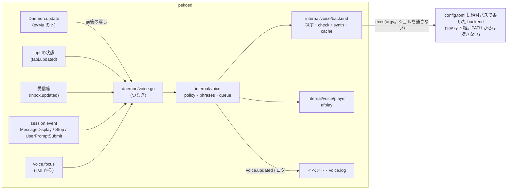

# pekoe voice — 仕様書

状態: 仕様(未実装)。今の pekoe のどこに乗せるかは「2. 今の pekoe への乗せ方」、調べて決めたことは「3」にある。「17. 決めたこと」の D1〜D9 は 2026-11-23 に利用者が決めた(どれも推奨の案。本文はそれに合わせてある)。実装したら、決まったことを docs/api.md・docs/design.md・README に移し、ここには決めた理由と残る論点を残す(docs/orchestration.md と同じやり方)。

## 1. 何を作るか

エージェントの状態が変わったら、tapi が音声で短く知らせる(**narrate**)。今見ているセッションは、アシスタントの本文も読み上げる(**read**)。合成は外部の実行ファイル(**backend**。`config.toml` に絶対パスで書いたものだけを動かす。macOS の `say` を使うものは同梱)に任せ、pekoed は文字を渡して WAV を受け取り、鳴らすだけにする。

**言葉の約束**: 今の docs は、ステータスバーの台詞(`▐◕ ◕▌ fix-ci needs you` の右の文)を「声」「バーの声」と呼んでいる(docs/mascot.md・docs/orchestration.md)。この機能はそれと混ざらないよう、**音声**・**発話**と呼ぶ。設定・コマンド・API の名前は `voice`。

### 1.1 なぜ作るか

pekoe ではエージェントを並行して動かすので、「どのセッションが確認待ちか」「どれが終わったか」を知るために画面を見に行く回数が増える。画面を見ていなくても様子がわかれば、確認待ちで放っておかれる時間が減り、レビューや別の作業に集中しながら並行のエージェントを回せる。

Claude Code の hook から `say` を呼ぶやり方は前からあるが、セッションが複数あると、声が重なる・どのセッションの話かわからない・見ていないセッションの長文まで読まれてうるさい、という問題が出る。解くには「今どのセッションを見ているか」と「各セッションの state」が要り、それを持っているのは pekoe なので、別の道具ではなく pekoe の機能にする。

目的:

1. **気づける**: 画面を見ていなくても、確認待ち・完了・エラーに気づける
2. **うるさくない**: 喋る量を、セッションへの注目の度合いで変える(モード。下)
3. **tapi の役**: セッションを見守る相棒という tapi の役(docs/mascot.md)を、音声でも感じられるようにする

### 1.2 モード

セッションごとに、次の 3 つのどれかで喋る(決め方は 7)。

| モード | すること | 使う場面 |
| --- | --- | --- |
| **narrate** | state の変化だけを tapi が短く喋る | 既定。裏で動いているセッション |
| **read** | アシスタントの本文を読み上げる(コードなどは読まない)。state の変化も narrate と同じく喋る | 今見ているセッション、`pekoe voice mode` で決めたセッション |
| **mute** | 喋らない | 集中したいとき、会議中など |

体験の決まり: 喋るのは同時に 1 つだけ(8)。state が変わってから 1 秒以内に喋り始める(先に合成してある文のとき。9)。止める・ミュートするのは 1 つのキー(14.1)。喋っている間はバーに札を出す(14.3)。喋ったことは文字でも見返せる(14.4)。

### 1.3 範囲

- 対応 OS は macOS だけ。ほかの OS では `[voice] enable = true` でも何もしない(`pekoe voice` が `unsupported` と言う)
- 既存の知らせ方(ステータスバーの台詞・トースト・許可モーダル・OS の通知。docs/mascot.md・docs/orchestration.md「知らせ方」)は置き換えない。音声はそれらと並ぶもう 1 つの知らせ方で、画面を見ていないときのためのもの
- やらないこと:
  - 音声入力(マイクは使わない)
  - 音声合成エンジンを pekoe に組み込むこと(合成は backend。同梱の say も macOS の `say` を呼ぶだけ)
  - コードブロック・diff・表の読み上げ
  - 喋る文をモデル(LLM)で作ること(定型文と、本文をそのまま読むことだけ。pekoed はモデルを呼ばない。docs/design.md「非目標」)
  - Mac 以外の場所で鳴らすこと(iPhone の Web UI・ブラウザ)と、macOS 以外の OS

## 2. 今の pekoe への乗せ方

voice が前提にするものが、今の pekoe ではどうなっていて、この仕様でどう使うか。

| 要るもの | 今の pekoe | この仕様での扱い |
| --- | --- | --- |
| state の種類 | `internal/state` の状態は 10 個(queued・creating・running・waiting・idle・done・reviewing・approved・landed・failed)。マスコットの表情(work / wait / done / error / idle / sleep)はそこからの写し(`internal/mascot/session.go` の `RowMood`) | narrate のきっかけは pekoed の state の遷移: → `waiting`(wait)・→ `done`(done)・→ `failed`(error)。「動いている」は `running`・`creating`・`queued`(5.4) |
| エラー | `failed` は setup の失敗・起動の失敗・デーモン再起動での中断・`--hold` の相手が消えたとき。エージェントのプロセスが落ちても state は変わらない(窓が死んだと TUI が出すだけ) | error は → `failed` だけ(17 の D7) |
| セッションの呼び方 | セッションに番号は無い。TUI の 1〜4 はパネルの番号(docs/ui-guidelines.md) | 呼び名は slug から作る(5.2。17 の D1) |
| hook を送ったセッションの特定 | エージェントの環境にあるのは `PEKOE_SESSION`(slug)・`PEKOE_SOCK`・`PEKOE=1`(`internal/daemon/session_spawn.go`)。pekoed は hook の送り主を `$PEKOE_SESSION` より先に呼び出し元の窓(tmux の pane)で決める(docs/api.md「呼び出し元の識別」、`hEventAs`) | 新しい環境変数は足さない。hook は今の `pekoe event` を使う。pekoe の外の Claude Code では `PEKOE_SESSION` も pekoed の窓もないので、今と同じく `{"ignored": true}` で終わる |
| hook の受け口 | もうある: `~/.claude/settings.json` に 7 つ(SessionStart・UserPromptSubmit・Notification・Stop・PreToolUse・PostToolUse・SessionEnd)を `pekoe hooks install` で入れ、すべて `pekoe event <名前>` → `session.event`(`internal/hooks`、`internal/daemon/hooks.go`) | 相乗りする。read が新しく要るのは `MessageDisplay` だけ(3.1) |
| hook の渡し方 | Claude Code のエージェントは起動のたびに `~/.local/share/pekoe/agent-settings/<slug>.json` を書いて `--settings` で渡している(sandbox。`internal/daemon/agentsandbox.go`) | `MessageDisplay` はこのファイルに入れる(3.1) |
| state の遷移の受け取り | 遷移はすべて `Daemon.update` を通り、`evMu` の下で変化の順に `sessionChanges`(`wait.go`)と `session.updated` / `session.waiting` / `session.done` のイベントが出る。tapi chat は別の道(`tapiEvent` → `tapi.updated`) | voice は `update` の同じ場所(`sessionChanges` の隣)で前後の写しを受け取る。tapi は `tapi.updated` を出す場所で受け取る(4.2) |
| 今どのセッションを見ているか | pekoed は知らない。持っているのは TUI だけ(選択・[4] の表示・端末のフォーカス。`session.seen` は未読の印を消すだけ) | TUI が pekoed に知らせる `voice.focus` を足す(13) |
| 喋っている間の表示 | ステータスバー左端の 1 行の顔。顔は画面に 1 か所だけ(docs/mascot.md「顔は1か所」) | 表情は増やさず、バーに札を出す(14.3。17 の D5) |
| 設定の書き方 | 真偽の設定は `enable`(`[web] enable`・`[tips] enable` など)で、未設定の既定を持つものは `*bool` | `[voice] enable`(11) |
| 有効・無効の切り替え | `config.toml` を書くのは人だけで、pekoed は読むだけ(docs/api.md「config.toml の再読み込み」) | `pekoe voice on` / `off` は CLI が `config.toml` の 1 行を直す(12。17 の D4) |
| 喋ったことの記録 | — | `~/.local/share/pekoe/voice.log` と `:voice`(14.4) |

## 3. 調べて決めたこと

### 3.1 hook の入れ方: 起動時の `--settings`

**決定**: read 用の `MessageDisplay` hook は、セッションの起動時に pekoe が書く `--settings` のファイル(`agent-settings/<slug>.json`)に入れる。`~/.claude/settings.json` には足さない。narrate には新しい hook が要らない(state の遷移を使う)。read の代わりの方式(`Stop` の `last_assistant_message`)も、今ある `Stop` hook で足りる。

根拠:

- `claude --help`(2.1.330): `--settings <file-or-json>  Settings file or JSON string to load more settings from`
- 公式の hooks の説明(https://code.claude.com/docs/en/hooks): 「Hook entries merge across settings levels rather than replacing each other」「If you define the same handler in more than one settings file, it runs once.」。settings の説明(https://code.claude.com/docs/en/settings)でも配列は合わさる。`--settings` の hook と `~/.claude/settings.json` の pekoe の hook は両方動く。changelog 2.1.327「Fixed `/hooks` leaving out hooks given by `--settings`」(表示の不具合で、動作は前から)
- 手元で確かめた: `claude --setting-sources local --settings <一時ファイル>` で渡した `UserPromptSubmit`・`MessageDisplay`・`Stop` が `claude -p` と対話モード(pty)の両方で発火した(3.2)。hook のプロセスは Claude Code の環境を受け継ぐ(渡した `PEKOE_SESSION_TEST=demo` が hook の中で読めた)
- pekoe はもう `--settings` を全セッション・tapi chat の起動に付けている(`withAgentSandbox`)。`~/.claude/settings.json` に出し入れする形は、pekoe の外の Claude Code にも hook のプロセスを起こさせ、表示を待たせる(3.2 のとおり `MessageDisplay` は表示を止める)うえ、ユーザーの設定ファイルを書き換える

決まりごと:

- `MessageDisplay` を入れるのは、エージェントを起動する時点で `[voice] enable = true` で、`focus_mode` か `background_mode` が `read` のとき(read を使わない設定なら入れない)。`[agents.*] sandbox = false` で sandbox の設定を書かないエージェントにも、hook だけのファイルを書いて `--settings` を付ける。Claude Code 以外のエージェントには付けない(`isClaude`)
- エントリは `{"type": "command", "command": "<pekoe の絶対パス> event MessageDisplay", "timeout": 2}`。Claude Code の既定(10 秒)より短くして、pekoed が詰まっても表示が 2 秒より長く止まらないようにする
- 起動の後で voice を有効にしたセッションには入らない(次の起動から)。そのセッションの read は `Stop` の方式で動く(6.1)
- `pekoe event MessageDisplay` は返事を待たない: 1 行を書いてすぐ閉じ、標準出力に何も書かず、exit 0。ソケットが無ければすぐ exit 0(今の `cmdEvent` は返事を 8 秒まで待つので、このイベントだけ分ける)。出力すると表示の差し替え(`displayContent`)とみなされるので、何も出さないことをテストで固定する
- `allowManagedHooksOnly`(管理者の設定)では `--settings` の hook も止まる。そのときは read が `Stop` の方式になるだけで、narrate は影響を受けない

### 3.2 `MessageDisplay` を試した結果

手元の Claude Code 2.1.330 で、pekoe の外の一時ディレクトリから、`--setting-sources local --settings <一時ファイル>` で hook を渡して試した(本物の `~/.claude/settings.json` も pekoe の hook も使わない。`PEKOE_*` を環境から外した)。hook は呼ばれた時刻・入力の JSON を記録するだけのスクリプト。

- **ある**: changelog 2.1.152「Added a `MessageDisplay` hook event that lets hooks transform or hide assistant message text as it is displayed」。**最低バージョンは 2.1.152**。`Stop` の `last_assistant_message` は 2.1.47 から(「Added `last_assistant_message` field to Stop and SubagentStop hook inputs」)
- **入力**: 共通の `session_id`・`prompt_id`・`transcript_path`・`cwd`・`hook_event_name` に、`turn_id`・`message_id`・`index`(0 から)・`final`(真偽)・`delta`(このバッチの文字)。matcher は無い(毎回発火)
- **発火の単位**: `claude -p` では 1 メッセージに 1 回(`index: 0, final: true`、本文がまるごと)。対話モード(`script` で作った pty)では、行がまとまるごとに 1 回で、段落 5 つの返事で 5 回(`index` 0〜4、1 回 490〜650 文字、約 0.9 秒おき、最後だけ `final: true`)
- **表示を止めるか**: 止める。hook の中で 1.5 秒眠り、その間に画面の記録(`script` の出力)を読んだ。どのバッチも自分の `delta` は hook が返るまで画面に出ず、前のバッチは前の hook が返った後に出ていた。次のバッチの hook は前の hook を待たずに並行して起動する(表示の順番は保たれる)
- **`Stop` との順序**: `Stop` は最後のバッチの `MessageDisplay` と同じ時刻に来て、最後のバッチの表示より先に返ることがある(read は `Stop` を「読み終わり」の合図にしない)
- **pekoe の pty(tmux の中)での体感**は試していない(エージェントの sandbox では tmux のソケットを作れない)。P3 の最初に、`scripts/sandbox.sh` の中で `pekoe event MessageDisplay` 1 回の所要時間(目安 20ms 以下)と体感を確かめる(16 の P3)

試し方(P3 でやり直すとき): hook は「時刻と入力の JSON をファイルに書き、`MessageDisplay` では 1.5 秒眠ってから `script` の出力に自分と前のバッチの `delta` が出ているかを調べる」シェルスクリプト。`script -q -t 0 <記録> claude --setting-sources local --settings <hook を書いた JSON> "<段落 5 つの返事を頼む文>"` で動かす。初めてのディレクトリでは信頼の確認が出るので、信頼済みの一時ディレクトリで動かす。

### 3.3 そのほか(推奨の案で決まった。17)

- **呼び名**: slug から種類の接頭辞を外し、`-` `_` を空白にしたもの(5.2)。番号は無いので作らない。理由: 一覧・トースト・バーの台詞がどれも slug で言っているので、耳で聞いた名前と画面の名前が一致する。並びの番号は、セッションが増減・landed で並び替わると同じ番号が別のセッションを指す。17 の D1
- **表情**: 増やさない。バーに `voice` の札を出す(14.3)。理由: 顔は目の 3 文字だけで状態を表していて、口が無い(docs/mascot.md)。「喋っている」を目で表すと、集約の状態(wait など)が読めなくなる。17 の D5
- **read の既定**: メッセージの先頭 5 文(`max_sentences = 5`)。段落単位にしない理由: Claude の返事は 1 段落が長いことも 1 行のこともあり、長さがそろわない。17 の D6
- **言語の既定**: `lang = "auto"`(チュートリアルと同じく `LC_ALL` → `LC_MESSAGES` → `LANG` で `ja` か `en`)。日本語の環境で英語の定型文が鳴るのを避ける。17 の D8
- **VOICEVOX のキャラクター**: P2 で、同じ定型文(wait / done / error / みんな手が空いた)を 2〜3 人で聞き比べて決める。決める観点は「小さくて静かな相棒」の人物像(docs/mascot.md「tapi の人物像」)に合うこと、短い文で聞き取りやすいこと、規約がクレジット表記だけで済むこと。P1 には影響しない
- **クライアントの受け持ち**: 発話の判断と再生はすべて pekoed にあり、クライアントが受け持つのは `voice.focus` を送ること(と、札・ログの表示)だけ。`voice.focus` を送るのは TUI だけ

## 4. 構成



### 4.1 パッケージの切り方

| 場所 | 中身 | 依存 |
| --- | --- | --- |
| `internal/voice` | 純粋な論理: モードの決め方(policy)、呼び名と文言(phrases)、発話キュー(queue)、read の整形(shape)。時計・合成・再生はインターフェースで受け取る | `internal/state` の型だけ。exec もファイルも触らない |
| `internal/voice/voicetest` | テスト用の偽の時計・合成・再生(`Advance` でだけ進む時計、テストが終わらせるまで戻らない `Synth` / `Play`)。daemon のテストでも使う | なし |
| `internal/voice/backend` | 設定のパスを確かめる(`PATH` からは探さない。10.2)・`version` / `check` / `voices` / `synth` を呼ぶ・時間切れ・フォールバック・WAV のキャッシュ | `os/exec`、`internal/paths` |
| `internal/voice/player` | 再生(`afplay`)と中断。darwin 以外は「使えない」を返す実装 | `os/exec` |
| `internal/daemon/voice.go` | つなぎ: 遷移・hook・フォーカスを `internal/voice` に渡す、RPC、イベント、設定の読み直し | 上の 3 つ |
| `cmd/pekoe/voice.go` | `pekoe voice …` | `internal/client`、`internal/config` |
| 同梱の say backend | pekoe 本体の隠しサブコマンド `pekoe voice-backend-say`(10.6) | — |

`internal/voice` に時計・合成・再生を差し込めるようにするのは、キューの規則(8)を、本物の音も時間も使わずに表のテストで固定するため。

### 4.2 状態の受け取り方

- セッション: `Daemon.update` が `sessionChanges(&before, c)` を呼ぶ所で、同じく `evMu` の下で `d.voice.Session(&before, c)` を呼ぶ。変化の順に届き、取りこぼさない。voice 側は受け取ったら自分の goroutine に渡してすぐ返す(`update` を待たせない)
- `session.removed`: そのセッションの項目をキューから消す
- tapi chat: `tapi.updated` を出す場所で `Tapi` の state の前後を渡す。tapi は slug `+tapi`(`TapiSlug`)のセッションとして扱う
- 受信箱: `inbox.updated` で、エージェントが待っている問い(`inboxHoldsUp` と同じ条件: open・`fyi` でない・`from` が `human` でない)が増えたら渡す(5.1 の ask。17 の D3)
- pekoed の起動時・voice を有効にしたときの状態は基準にするだけで、喋らない(PR の反応と同じ。docs/mascot.md「PR と CI への反応」)

## 5. narrate

### 5.1 いつ喋るか

| 種類 | 条件 | 文言のキー |
| --- | --- | --- |
| wait | state が `waiting` 以外 → `waiting`(`wait_kind` が permission でも question でも) | `wait` / `wait_many` |
| done | → `done` | `done` / `done_many` |
| error | → `failed` | `error` / `error_many` |
| ask | エージェントが待っている受信箱の問いが新しく来た(`ask-human --wait` で待つエージェントは state が `running` のままなので、wait では拾えない) | `ask` / `ask_many` |
| idle_all | 5.4 | `idle_all` |

- 見ているセッションは喋らない: TUI がそのセッションを [4] に出していて、端末にフォーカスがあるとき(`voice.focus` の `slug` と `term_focused`)は、そのセッションの wait / done / error を出さない。トーストの「表示中のセッションについては出さない」と同じ(17 の D2)。idle_all と ask はいつも出す
- `reviewing` → `done`(レビュー面を閉じた)は人の操作なので喋らない。done は前の state が `running` か `waiting` のときだけ
- `landed`・`approved`・`idle` への遷移は喋らない

### 5.2 呼び名

`{name}` に入る呼び名は、セッションの slug から作る:

1. 先頭の種類の接頭辞を外す: `feat-` `fix-` `docs-` `chore-` `refactor-` `test-` `perf-` `ci-` `build-` `style-` `review-`(外すと空になるなら外さない)
2. `-` `_` `/` `.` を空白にし、空白を 1 つにまとめる
3. tapi chat(`+tapi`)は `tapi`(`lang = "ja"` では `たぴ`。合成で「ティーエーピーアイ」と読まれないよう、かなで渡す)

例: `feat-csv-export` → `csv export`、`fix-ci` → `ci`、`docs-voice-spec` → `voice spec`。

同じ発話にまとめた中で呼び名が重なったら(別のリポジトリの同じ slug など)、重なったものだけ前にリポジトリの表示名を足す(`web csv export`)。

### 5.3 文言

既定の文言(`[voice.phrases]` で上書きできる。`{name}` は 1 つの呼び名、`{names}` はまとめた呼び名):

| キー | ja | en |
| --- | --- | --- |
| `wait` | `{name}、確認待ちだよ` | `{name} needs you` |
| `wait_many` | `{names}が確認待ちだよ` | `{names} need you` |
| `done` | `{name}、終わったよ` | `{name} is done` |
| `done_many` | `{names}が終わったよ` | `{names} are done` |
| `error` | `{name}でエラーが出たみたい` | `{name} hit an error` |
| `error_many` | `{names}でエラーが出たみたい` | `{names} hit errors` |
| `ask` | `{name}から質問が来てるよ` | `{name} has a question` |
| `ask_many` | `{names}から質問が来てるよ` | `{names} have questions` |
| `idle_all` | `みんな手が空いたよ` | `everyone's idle` |

- `{names}` のつなぎ方: ja は 2 つ `AとB`、3 つ `A、BとC`、4 つ以上 `A、Bほか2件`。en は `A and B`、`A, B and C`、`A, B and 2 more`
- 口調は tapi のもの(docs/mascot.md「tapi の人物像」: くだけた話し言葉、敬語なし、感嘆符なし)。ja は「ぼく・きみ」を文に入れない(短くするため)
- 上書きした文言に `{name}`(`_many` は `{names}`)が無ければ、その文言は使わずに既定に戻し、`pekoe config check` が警告する
- 喋った文と同じ文字を、ログ(14.4)と `voice.updated` に載せる

### 5.4 「みんな手が空いた」

- 動いているセッション = state が `running`・`creating`・`queued` のセッションと、`running` の tapi chat
- 動いている数が 1 以上から 0 になり、そのまま 5 秒たったときに 1 回だけ喋る(`running` と `waiting` の往復・次のセッションの起動で揺れないように)
- 5 秒たった時点で、`waiting` のセッションか、エージェントが待っている受信箱の問いがあれば喋らない(人の番のものがあるのに「手が空いた」とは言わない。それらは wait・ask が言っている)
- 一度喋ったら、動いている数がまた 1 以上になるまで喋らない

## 6. read

P3 で作る。P1 では `read` のモードは `narrate` と同じに動く。

### 6.1 本文の受け取り方

- そのセッションの起動時に `MessageDisplay` hook を入れていれば(3.1)、`delta` をバッチごとに受け取る。`turn_id`・`message_id`・`index`・`final` で並べる
- 入れていなければ(起動の後で voice を有効にした・`allowManagedHooksOnly`・Claude Code が 2.1.152 より古い)、今の `Stop` hook の `last_assistant_message` を、ターンの終わりにまとめて読む
- 同じターンで `MessageDisplay` を 1 回でも受け取っていたら、`Stop` の本文は読まない(同じ文を 2 回読まない)
- 受け取ったときにそのセッションのモードが `read` でなければ捨てる(後からフォーカスが来ても、さかのぼって読まない)

### 6.2 整形(読む範囲)

`internal/voice` の `Shape(text, skip) []string` が、Markdown の文字から読む文の列を作る。`skip` の既定は `["code", "table", "url", "path"]`。

| もの | 扱い |
| --- | --- |
| コードブロック(```` ``` ```` / `~~~` で囲んだもの、4 つ以上の空白で始まる行) | 読まない(`code`) |
| インラインコード | 中身が 24 文字以下で `/` を含まなければ中身を読む。それ以外は読まない(`code`) |
| 表(`\|` で始まる行) | 読まない(`table`) |
| URL(`http://` `https://` で始まる語) | 読まない(`url`)。リンク `[文字](URL)` は文字だけ読む |
| ファイルパス(`/` を含み拡張子で終わる語、`./` `../` `~/` `/` で始まる語) | 読まない(`path`) |
| 見出し・リストの項目 | 記号を外し、それぞれ 1 文として読む |
| 強調・取り消し線・引用の記号、画像、HTML のタグ、絵文字 | 記号・画像・タグ・絵文字を外す |

文への分け方: ja は `。` `!` `?` `!` `?` と改行、en は `.` `!` `?` の後の空白か行末、どちらも空行で区切る。1 文が 200 文字を超えたら `、` `,` で分ける。分けた後に空の文は捨てる。

1 メッセージ(`message_id`。`Stop` の方式では最後の返事)で読むのは先頭 `max_sentences` 文まで。

### 6.3 止める

- そのセッションに `UserPromptSubmit` が来たら、そのセッションの read を止めて捨てる(8 の Q8)
- 新しいターン(`turn_id` が変わった)が来たら、前のターンの残りを捨てる
- フォーカスが別のセッションに移ったら、read を止めて捨てる(narrate は残す)

## 7. voice policy(モードの決め方)

セッションのモード(`read` / `narrate` / `mute`)は、上から順に最初に当てはまったもので決める:

1. 全体のミュート中 → `mute`
2. そのセッションに `pekoe voice mode` で決めたモードがあればそれ(`auto` は「決めていない」)
3. フォーカス中のセッション → `focus_mode`(既定 `read`)
4. それ以外 → `background_mode`(既定 `narrate`)

- 「フォーカス中」= 最後に `voice.focus` を送ってきたクライアントが [4] に出しているセッション(tapi chat なら `+tapi`)。端末のフォーカスは問わない(画面から目を離して聞くことがあるため)。クライアントが切れたらフォーカスは無し
- モードは発話を積むときと、鳴らす直前の両方で決め直す(積んだ後にミュート・フォーカスの移動があれば鳴らさない)
- セッションごとのモードは state.db の kv(`voice.mode.<slug>`)に残し、`pekoe rm` で消す

## 8. 発話キュー

`internal/voice` の `Queue` が持つ規則。どれも偽の時計・偽の合成・偽の再生で表のテストにする。

- **Q1 直列**: 鳴っている発話は常に 1 つまで
- **Q2 優先**: 次に鳴らすのは、narrate があれば narrate(積んだ順)、無ければ read(積んだ順)。read が鳴っている途中に narrate が来たら、その read の文を最後まで鳴らしてから narrate を鳴らし、read の続きに戻る。鳴っている発話を、優先のために途中で切ることはない
- **Q3 寄せ集め**: narrate は積んでから 300ms たつまで鳴らさない(同じ種類の続けて来たものをまとめるため)
- **Q4 まとめ**: narrate を鳴らすと決めたとき、キューにある同じ種類(wait / done / error / ask)の narrate を全部 1 つの発話にまとめる(`_many` の文言、5.3)。まとめた分はログに `merged` と残す
- **Q5 鮮度**: narrate は、合成を始める前と鳴らす直前に、積んだときの state と `state_since` が今も同じかを確かめ、違えば捨てる(ログに `stale`)。ask は問いがまだ open か、idle_all は 5.4 の条件がまだ成り立つかを確かめる。セッションが消えていれば捨てる
- **Q6 古さ**: 積んでから 30 秒たった narrate は捨てる(古い知らせを遅れて言わない。PR のトーストの待ち行列と同じ)
- **Q7 繰り返し**: 同じセッションの同じ種類を、鳴らしてから 10 秒以内にまた積まない(`waiting` と `running` の往復で同じことを続けて言わないため)
- **Q8 中断**:
  - ミュート → 鳴っているものを止め、キューを全部空にする
  - あるセッションの `UserPromptSubmit` → そのセッションの read が鳴っていれば止め、そのセッションの read をキューから消す。narrate は消さない(Q5 で古くなったものは消える)
  - フォーカスの移動 → read が鳴っていれば止め、read をキューから全部消す
  - `pekoe voice` の「今の発話を止める」(`voice.stop`)→ 鳴っているものを止める。キューは残す
- **Q9 read の積み残し**: 新しいターンが始まったら前のターンの read を捨てる。1 メッセージで積むのは `max_sentences` 文まで
- **Q10 先読み**: 鳴っている間に、次に鳴らす予定の 1 つを合成しておく(`synth` の同時実行は 2 まで)。先読みしたものも鳴らす直前に Q5 を確かめる
- **Q11 失敗**: `synth` が失敗・時間切れ(3 秒)になったら、その発話は捨て、ログに理由(backend の標準エラーの 1 行)を残す。backend が 3 回続けて失敗したら fallback に切り替え(10.5)、fallback も失敗したら 60 秒は合成を試さない(`voice.updated` の `error` に出す)

実装(P1-1)で決めた細部:

- インターフェース: `Synth(ctx, text, voice, lang string) (wavPath string, err error)` と `Play(ctx, wavPath string) error`。どちらも終わるまで戻らず、`ctx` の取り消しで止まる。引数が素の文字なので、backend と player は `internal/voice` を import せずに満たせる。時計は `Now` と `AfterFunc`
- Q2・Q3: narrate が寄せ集めの 300ms の間にあるときは、read も鳴らし始めない(read の 1 文で narrate が遅れないように)
- Q7: 積まなかったものはログに残さない(積んだものだけを残す)
- モード(7): 積むときに mute なら、narrate はログに `muted` と残して積まない。read はモードが `read` でなければ黙って捨てる(6.1)
- Q8: 止めた発話は、プロセスが本当に終わってから次を鳴らす(Q1 を崩さない)。Q9 で捨てた read は `interrupted`
- Q10: 取り消した合成も、戻ってくるまでは同時実行の 2 に数える
- Q11: 続けての失敗は `FailLimit`(3)回ごとに数え直す。3 回目で `Failover`(daemon が backend の切り替えにつなぐ)を呼び、切り替えられなければ 60 秒止める。`Failover` は fallback の `check` を待つので数秒かかりうる: キューのロックの外で呼び、その間は新しい合成を始めない(`Push` や `Status` は止まらない)。止めている間に鳴らす番が来た発話は、待たせずに `failed`(理由 `synth paused after repeated failures`)で捨てる。取り消した合成の失敗は数えない
- ログの `spoken` は鳴らし始めたときに書く(待ち時間はそこまで)
- wav の後始末: キューは使い終えた wav(鳴らし終えた・合成した後に捨てた)を `Release` で知らせる(reader の声の一時ファイルを backend が消すため)
- `[voice.phrases]` の空(空白だけ)の上書きも、既定に戻して警告する(空の文の合成が Q11 の失敗に数えられないように)

ログ(14.4)には、積んだ発話それぞれについて、鳴らした(`spoken`)・まとめた(`merged`)・捨てた理由(`stale` `old` `muted` `interrupted` `failed`)と、積んでから鳴り始めるまでのミリ秒を残す。「状態が変わってから 1 秒以内」はこの数で確かめる。

## 9. 再生

- `/usr/bin/afplay <WAV のパス>` で鳴らす(絶対パス。`PATH` から探さない。15 の「実行ファイルの探し方」)。止めるときはプロセスに SIGTERM(1 秒で終わらなければ SIGKILL)
- 再生は `internal/voice/player` の `Player` インターフェース 1 か所にまとめる(テストで偽物に差し替えるため)
- 音量は持たない(システムの音量に従う)
- 1 秒以内に鳴り始めるために、合成を先にしておく:
  - voice を有効にしたとき・セッションができたとき・名前が変わったとき、そのセッションの wait / done / error(1 人分の文)と idle_all を、手が空いているときに 1 つずつ合成してキャッシュに入れる
  - まとめた文(`_many`)は先に作らない(組み合わせが多い)
  - 手元の `say`(macOS 15、Kyoko)で短い文の合成は 0.45〜0.9 秒かかった。キャッシュが無いと、寄せ集めの 300ms と合わせて 1 秒を超えることがある
- キャッシュ: `<データディレクトリ>/voice/cache/<sha256>.wav`(`$PEKOE_HOME` に従う。データディレクトリはエージェントの sandbox からも pekoe の sandbox からも書けないので、キャッシュの WAV を差し替えられない)。キーは backend の名前・`version` の出力・声の名前・言語・文。全体で 50MB を超えたら古いもの(更新時刻。キャッシュから使うたびに更新する)から消す。起動時と 1 時間ごとに見る
- read の文(声 `reader`)はキャッシュしない(15「残すもの」)。合成した WAV は `<データディレクトリ>/voice/tmp/` の一時ファイルで、鳴らし終えたら消す(`Engine.Release`。消し残しは古いものから `Engine.CleanTmp` で消す)

## 10. speech backend の約束事 v1

この節だけ読めば backend が書けるように書く。README からもここを指す。

### 10.1 役割

pekoe は文字を渡して WAV ファイルを受け取るだけ。再生・中断・いつ鳴らすか・何を喋るかは pekoe が決める。backend は合成だけをする。

### 10.2 見つけ方

pekoe は `PATH` から backend を探さない。動かすのは次の 2 つだけ:

- **同梱の say**: `backend = "say"`(と `fallback = "say"`)は常に同梱のもの(10.6)を指す。`PATH` に `pekoe-voice-say` があっても使わない
- **外部の backend**: `config.toml` の `[voice.backends]` に、名前と**絶対パス**を書いたもの。`[voice] backend` / `fallback` はその名前で指す

```toml
[voice]
backend = "voicevox"
fallback = "say"

[voice.backends]
voicevox = "/opt/homebrew/bin/pekoe-voice-voicevox"
```

- 名前は英小文字・数字・`-` だけ。`say` は同梱のための名前で、`[voice.backends]` に `say` を書いても使わない(`pekoe config check` が警告する)
- パスは絶対パスか、`~/` で始まるもの(ホームに展開する。`[web] state_dir` と同じ)。それ以外(相対パス・`~user/`・空)は使わず、`pekoe config check` が警告する
- 使う前に毎回(`version` / `check` / `synth` のたびに)、パスが通常のファイル(シンボリックリンクなら辿った先)で実行できることを確かめる。無い・実行できない・相対パス・`backend` の名前が `[voice.backends]` に無い、のどれでも、その backend は「使えない」になり、`fallback` に落ちる(10.5)。理由はログ(データディレクトリの `pekoed.log` と `voice.log`)と `voice.updated` の `error` に出す。`PATH` に同じ名前のものがあっても代わりに使わない
- パス(またはリンクの先)がホームの下にあると、`pekoe voice backends` と `pekoe config check` が「エージェントや pekoe の sandbox の中のコマンドが書き換えられる場所かもしれない」と警告する(動かすのは止めない。置き場を決めるのは人)。勧める置き場は Homebrew の prefix(`/opt/homebrew/bin`)や `/usr/local/bin`
- `pekoe voice backends` は `PATH` にある `pekoe-voice-*` を**候補として見せるだけ**で、動かさない(`version` も `check` も呼ばない)。それぞれに `config.toml` に書く行の例(`voicevox = "/opt/homebrew/bin/pekoe-voice-voicevox"`)を添える。`version` / `check` / `voices` を呼ぶのは、同梱の say と `[voice.backends]` に書いてあるものだけ

なぜ `PATH` から探さないか: pekoed は backend を sandbox の外で動かす。`PATH` の中のディレクトリ(`~/.local/bin` など)はエージェントや pekoe の sandbox の中のコマンドが書ける場合があり(pekoe の sandbox は起動時に書ける `PATH` のディレクトリへの書き込みを止めるが、まだ無いディレクトリを作って置かれる・後から `PATH` が変わる・sandbox の付かないエージェントは防げない。15)、そこに `pekoe-voice-say` などを置かれると、voice を有効にした pekoed がそれを sandbox の外で動かしてしまう。`config.toml` はエージェントの sandbox からも pekoe の sandbox からも書けない(読むこともできない)ので、動かすものは人が書いたパスだけになる

### 10.3 呼び方

pekoe は backend を、10.2 で決めたパスで、シェルを通さずに起動する(引数は argv で渡す)。作業ディレクトリは pekoe のデータディレクトリ。環境は pekoed のものに `PEKOE_VOICE_PROTOCOL=1` を足し、`PATH` を `/usr/bin:/bin:/usr/sbin:/sbin` と backend の実行ファイルのあるディレクトリだけにしたもの(backend がさらに動かすコマンドを、エージェントが書ける `PATH` のディレクトリから拾わないように)。ほかのコマンド(インタプリタを含む)が要る backend は、絶対パスで呼ぶこと(スクリプトなら `#!/usr/bin/env python3` ではなく `#!/opt/homebrew/bin/python3` のように)。

| コマンド | 入力 | 出力 | 時間切れ |
| --- | --- | --- | --- |
| `version` | なし | 対応する約束事のバージョンを標準出力に 1 行(`1`) | 2 秒 |
| `check` | なし | 使えれば exit 0、使えなければ 0 以外。理由を標準エラーに 1 行 | 5 秒 |
| `voices` | なし | 使える声の一覧を JSON で標準出力に(下) | 5 秒 |
| `synth --voice <名前> --lang <ja\|en> --out <パス>` | 文字(標準入力、UTF-8、改行なしの 1 文、2000 バイトまで) | WAV を `--out` に書き、exit 0 | 3 秒 |

- pekoe は使う前に `version` を呼び、出力(前後の空白を除く)が `1` でなければその backend を使わない。知らないサブコマンドには 0 以外で終わること(将来のバージョンの確かめに使う)
- `--voice` は pekoe 側の論理的な名前。v1 で使うのは `tapi`(narrate)と `reader`(read)。実際の声への割り当ては backend の設定で決め、言語ごとに持てるようにする。知らない名前が来たら、その言語の既定の声で合成する(エラーにしない。pekoe が後から名前を足しても壊れないように)
- `--lang` は `ja` か `en`。対応していない言語なら 0 以外で終わる
- `--out` は pekoe がデータディレクトリの下(`voice/tmp/`)に作った空のディレクトリの中の、まだ無いファイルのパス(`/tmp` は使わない)。backend はそこに書くだけで、ほかの場所に書かない(キャッシュは backend 自身の場所に持ってよい)
- 出力は WAV(RIFF)、リニア PCM 16 ビット、モノラルかステレオ、標本化周波数は自由(`afplay` が鳴らせるもの)。pekoe は exit 0 でも、ファイルが無い・空・先頭が `RIFF` でないものは失敗とみなす
- 失敗したら 0 以外で終わり、理由を標準エラーに 1 行で書く。pekoe はそれをログに残す。標準エラーは 1KB までしか読まない
- 時間切れになったら pekoe はプロセスグループごと止め(SIGTERM、1 秒後に SIGKILL)、その発話を捨てる
- pekoe は `synth` を同時に 2 つまで呼ぶ(先読み)。並行して呼ばれても壊れないこと
- 渡す文字はエージェントが書いた文を含みうる。backend は文字をシェル・URL・ファイル名に組み込むときに必ずエスケープすること。文字をログに残すなら、それがエージェントの出力であることを考えて置き場を決めること

`voices` の出力:

```json
[
  { "name": "tapi",   "lang": "ja", "label": "Kyoko" },
  { "name": "tapi",   "lang": "en", "label": "Samantha" },
  { "name": "reader", "lang": "ja", "label": "Kyoko" }
]
```

`name` は論理的な名前、`lang` は言語、`label` は backend 側の声の名前(人が読むためのもので、pekoe は表示するだけ)。

約束事のテスト: pekoe のリポジトリで `PEKOE_VOICE_CONTRACT=<backend の絶対パス> go test ./internal/voice/backend -run TestContractExternal -v` を回すと、この節の約束事(`version`・知らないサブコマンド・`check`・`voices`・言語ごとの `synth`・知らない声の名前・対応しない言語・並行 2 本)を、pekoed と同じ呼び方で確かめる。同梱の say も同じテストを通す。

### 10.4 pekoe が backend に期待しないこと

- 再生・音量・中断(pekoe がする)
- 文の分割・整形(pekoe が 1 文ずつ渡す)
- 常駐(呼ばれるたびに起動して終わる形でよい。速くしたければ backend が自分で常駐のサーバーにつなぐ。例: VOICEVOX のエンジン)

### 10.5 フォールバック

- pekoed は voice を有効にしたとき・設定が変わったとき・`pekoe voice backends` のときに、`backend` のパスを確かめて(10.2)`version` と `check` を呼ぶ。パスが使えない・失敗したら `fallback` を同じように確かめて使う。`fallback` も同梱の say か `[voice.backends]` の名前で、`PATH` からは探さない
- 使っている backend が `synth` に 3 回続けて失敗したら fallback に切り替え、5 分後に元の backend の `version` と `check` をもう一度呼ぶ。通れば元に戻す。失敗を数えるのは発話キュー(8 の Q11)で、3 回目にキューが backend 側の `Failover()` を呼ぶ(切り替えたら true。fallback に居る・fallback が無い・使えないなら false で、キューが 60 秒合成を止める)。5 分後の確かめ直しは backend 側が次の合成のときにする
- どちらも使えなければ何も鳴らさず、`pekoe voice` と `voice.updated` の `error` に理由を出す

### 10.6 同梱の backend: say

- macOS の `say` を使う。依存が無く、通信しない
- `/usr/bin/say -v <声> --file-format=WAVE --data-format=LEI16@24000 -o <out> -f -`(文字は標準入力から)
- 声の既定: ja は `Kyoko`、無ければ `/usr/bin/say -v '?'` の最初の `ja_JP` の声。en は `-v` を付けない(システムの既定の声)。`tapi` と `reader` は同じ声。声の割り当てを変えたいときは `[voice.say]` の `ja` / `en`(11)
- `check` は `/usr/bin/say` があり、`/usr/bin/say -v '?'` で声の一覧が読めることを見る。`check` は言語を受け取らない(10.3)ので、日本語の声が無いことは `check` では言わない: そのとき `voices` は ja の声を出さず、`synth --lang ja` が「日本語の声が無い(システム設定 › アクセシビリティ › 読み上げコンテンツで足す)」で失敗する(Q11 で fallback・停止に進む)
- `[voice.say]` の声は pekoed が渡すのではなく、`pekoe voice-backend-say` が自分で `config.toml` を読んで使う(P1-3 でつなぐ。P1-2 では既定の声だけ)
- 実装は pekoe 本体の隠しサブコマンド `pekoe voice-backend-say <version|check|voices|synth …>`。pekoed は名前が `say` なら、いつも自分の実行ファイル(`os.Executable` のリンクを辿ったもの。hook に書く pekoe と同じ)をこの形で呼ぶ。`PATH` の `pekoe-voice-say` は見ない。同梱の say も約束事どおりに呼ぶので、約束事のテスト(16 の P1-2)を同じように通す。別の実行ファイルにしないのは、リリース・Homebrew・`pekoe update` の配る物を増やさないため

### 10.7 P2 の外部 backend: pekoe-voice-voicevox

P2 で作る、約束事どおりの外部の backend。pekoe とは別のリポジトリで配る。日本語だけ。

- VOICEVOX のエンジン(`http://localhost:50021`。VOICEVOX のアプリか Docker で用意する)に、`/audio_query` → `/synthesis` の順に投げて合成する。エンジンにつながらなければ `check` が失敗し、pekoe は fallback(say)に落ちる(10.5)
- 入れ方: 実行ファイルを置き、`config.toml` の `[voice.backends]` に絶対パスで書き、`[voice] backend = "voicevox"`・`fallback = "say"` にする(10.2)。README の入れ方にこの行を載せる
- キャッシュ: 文・声・合成の値のハッシュをキーに WAV を backend 自身の場所に残す(pekoe のキャッシュ(9)とは別)
- ユーザー辞書: `pekoe` → ペコー、`tapi` → タピ、`worktree` → ワークツリー などを `/user_dict_word` で登録する。辞書の中身は backend の設定ファイルに出し、人が足せるようにする
- 合成の値: `speedScale` は 1.2〜1.4 ほど。`prePhonemeLength` / `postPhonemeLength` を短くして、文の前後の無音を詰める
- 声の割り当て: 論理的な名前(`tapi` / `reader`)を VOICEVOX のキャラクター(スタイル)に割り当てる設定を backend に持つ。tapi の既定の声は P2 の最初に聞き比べて決める(17 の D9)
- 規約: VOICEVOX の声はキャラクターごとに利用規約がある。backend の README に規約の場所を書き、音声を公開するとき(デモ動画など)は規約どおりにクレジットを書く(例: 「VOICEVOX:<キャラクター名>」の形が多い。正確な書き方はキャラクターごとの規約に従う)

## 11. 設定

`config.toml`(docs/api.md「config.toml の再読み込み」のとおり、pekoed は 1 秒ごとに読み直す)。`internal/config` の `Global` に `Voice Voice` を足し、`pekoe config show` の説明(`internal/config/docs.go`)と `pekoe config check` の値の確かめに入れる。

```toml
[voice]
enable = false             # 既定は無効。無効の間は何も鳴らさず、backend も呼ばず、hook も入れない
lang = "auto"              # auto | ja | en。auto は LC_ALL → LC_MESSAGES → LANG
backend = "say"            # "say"(同梱)か [voice.backends] の名前。PATH からは探さない(10.2)
fallback = "say"           # backend が使えないとき。同じく "say" か [voice.backends] の名前。"" でフォールバックしない
focus_mode = "read"        # フォーカス中のセッション: read | narrate | mute
background_mode = "narrate" # それ以外: read | narrate | mute

[voice.read]
max_sentences = 5          # 1 メッセージで読む文の数(1〜50)
skip = ["code", "table", "url", "path"]

[voice.phrases]            # 文言の上書き。書かなければ lang に合った既定(5.3)
# wait = "{name}、確認待ちだよ"
# wait_many = "{names}が確認待ちだよ"

[voice.backends]           # 外部の backend: 名前 = 絶対パス(か ~/ で始まるパス)。ここに書いたものだけを動かす
# voicevox = "/opt/homebrew/bin/pekoe-voice-voicevox"

[voice.say]                # 同梱の say backend の声
# ja = "Kyoko"
# en = ""                  # "" はシステムの既定の声
```

- すぐ効く: すべて。`enable` を `true` にすると backend を確かめて基準の状態を取り(喋らない)、`false` にすると鳴っているものを止めてキューを空にする
- read 用の hook(3.1)は、エージェントを次に起動するときから入る・外れる
- 値が違うとき(`lang = "fr"` など)は既定に戻し、`pekoe config check` が警告する(既存の節と同じ)
- `[voice.backends]` の確かめ(`pekoe config check`): 名前が英小文字・数字・`-` でない、`say` を書いた、パスが絶対パスでも `~/` でもない、ファイルが無い・実行できない、`backend` / `fallback` の名前が `say` でも `[voice.backends]` にも無い、はどれも警告。パスがホームの下なら注意(10.2)。`check` はパスの確かめだけで、backend を動かさない

## 12. CLI

| コマンド | すること |
| --- | --- |
| `pekoe voice` | 状態: 有効か、使っている backend と check の結果、ミュート(いつまで)、フォーカス中のセッション、キューの長さ、鳴っている文。`--json` |
| `pekoe voice on` / `off` | `config.toml` の `[voice] enable` を `true` / `false` に書き換える(下) |
| `pekoe voice mute [--for 30m]` / `unmute` | 全体のミュート。`--for` を付けなければ `unmute` まで。鳴っているものを止め、キューを空にする |
| `pekoe voice stop` | 今の発話を止める(キューは残す) |
| `pekoe voice test "<文>" [--voice tapi\|reader] [--lang ja\|en]` | 文をそのまま合成して鳴らす。ミュート中・無効のときも鳴らす(試すためのもの)。キューの先頭に積み、鳴っているものの後に鳴らす |
| `pekoe voice backends` | 設定済みの backend(同梱の say と `[voice.backends]`)の一覧と、それぞれのパス・`version`・`check`・`voices`。使っているもの・fallback に印。その下に、pekoed の `PATH` にある `pekoe-voice-*` を「候補」として出す(動かさない。`version` も `check` も呼ばない)。候補には `config.toml` に書く行の例(`[voice.backends]` の `voicevox = "/opt/homebrew/bin/pekoe-voice-voicevox"`)を添える。`--json` |
| `pekoe voice log [-n 50]` | 発話のログ(14.4)の新しい方から。`--json` |
| `pekoe voice mode <slug> read\|narrate\|mute\|auto` | セッションのモード(7)。P3 |

- どれも人間だけ(`voice.*` の RPC は token が要る。docs/api.md「人間だけの操作」の許可リストに足さない)。エージェントの窓から Mac を喋らせられないようにする
- `on` / `off` は `pekoe config edit` と同じく pekoed を通さない(エージェントの sandbox から `~/.config/pekoe` を書けないようにしてあり、RPC にすると抜け道になる)。`$PEKOE_SESSION` がある窓(エージェント)からは断る。ただしこれは誤操作よけで、環境変数を消せば通る。守りの本体は、エージェントの sandbox が `~/.config/pekoe` を書けない(読めない)ことと、pekoe の sandbox(hooks のコマンド)も同じく書けないこと(15)。書き換えは `[voice]` の表の `enable = …` の 1 行だけで、ほかの行・コメントは変えない(表が無ければファイルの末尾に足す)。書いた後に `config.ParseGlobal` で読めなければ元に戻して失敗にする。置き換えは同じディレクトリの一時ファイルからの rename 1 回(`config edit` と同じ)。pekoed は 1 秒以内に読み直す。17 の D4(決定)
- `mute` の期限は state.db の kv(`voice.mute_until`)に残し、pekoed を再起動しても続く
- 受け付けるフラグは `cmd/pekoe/flags.go` に宣言する(知らないフラグはエラー)

## 13. API(unix ソケット)

docs/api.md に足すもの。`voice.*` はすべて token が要る。

| メソッド | params | 返り値・すること |
| --- | --- | --- |
| `voice.status` | — | `VoiceStatus`(下) |
| `voice.mute` | `{"for": "30m"}` / `{"until": "<RFC3339>"}` / `{"off": true}` | ミュートを決める。`VoiceStatus` |
| `voice.stop` | — | 鳴っているものを止める |
| `voice.say` | `{"text", "voice", "lang"}` | `pekoe voice test`。text は 2000 バイトまで |
| `voice.focus` | `{"slug": "feat-x" \| "+tapi" \| "", "term_focused": true}` | クライアントが [4] に出しているもの。接続ごとに覚え、最後に送ってきた接続のものを使う。接続が切れたらその接続の分を消す |
| `voice.mode` | `{"slug", "mode"}` | セッションのモード(P3) |
| `voice.log` | `{"n": 50}` | ログの新しい方から |
| `voice.backends` | — | 設定済みの backend(同梱の say と `[voice.backends]`)のパスと `version`・`check`・`voices` の結果、パスの警告。加えて pekoed の `PATH` にある `pekoe-voice-*` の候補(名前とパスだけ。動かさない) |

`VoiceStatus`:

```jsonc
{
  "enabled": true,
  "supported": true,              // darwin だけ true
  "backend": "say", "using": "say", // 設定の名前 / 今使っているもの(fallback 中は fallback の名前)
  "error": "",                    // どちらも使えないときの理由
  "muted_until": "2026-11-23T15:30:00+09:00", // "" はミュートなし、"forever" は unmute まで
  "focus": "feat-x",
  "queue": 2,
  "speaking": {"slug": "feat-x", "kind": "wait", "text": "csv export、確認待ちだよ"} // 無ければ null
}
```

イベント:

- `voice.updated`(`VoiceStatus`): 鳴り始め・鳴り終わり・ミュート・backend の切り替え・エラーのたび
- `voice.logged`(ログの 1 件): ログに書くたび。TUI の `:voice` が開いている間に足していく

`session.event` は今までどおり token なしで、`hook: "MessageDisplay"` を受け付ける(返事を待たれないので、受けたら何も返さずに処理する)。

## 14. TUI

### 14.1 キー

| キー | すること |
| --- | --- |
| prefix + `m`(既定 `^q m`) | 全体のミュートの切り替え。ミュートすると鳴っているものもキューも止まる(「止める」と「ミュート」を 1 つのキーで)。入力中(pty への打ち込み・tapi chat)でも効く(prefix は入力中も効くので)。メッセージ行に `voice muted · ^q m` / `voice on · ^q m`。`[voice] enable = false` のときは `voice is off · pekoe voice on` とだけ出す |

- ぶつからないことを確かめた: prefix の後で使っているキーは `h` `l` `←` `→`(フォーカス)・`z` `<` `>` `=`(レイアウト、`layoutKey`)・`,`(設定)・`o`(ダッシュボード)だけ(`internal/tui/keys_route.go` の `onKeyAfterPrefix`)。`m` は空いている
- prefix にしたのは、どのパネルからでも、エージェントに打っている途中でも効かせるため。1 文字の全体キーは空きが少なく(`m` は preview 窓の mobile、`s` はパネルごとの送信)、入力中は pty に渡る
- ヘルプの全体のキー(`globalHelpKeys`)に `{p + " m", "mute voice (toggle)"}` を足す
- `:voice` は発話のログ(14.4)。`:voice mute` / `:voice unmute` も受け付ける

### 14.2 フォーカスを知らせる

- `[voice] enable = true` の間、[4] に出しているもの(セッション・tapi chat・何も無い)と端末のフォーカス(`tea.FocusMsg` / `tea.BlurMsg`)が変わったら、200ms 待ってから `voice.focus` を送る(`j` `k` で一覧を流しているときに送りすぎないため)
- TUI が 2 つ開いていれば、最後に送った方がフォーカスになる

### 14.3 ステータスバー

- 鳴っている間、ステータスバーに `voice` の札(`zoom` の札と同じ `pill`、surface の地に text)を出す。ミュート中は `muted ^q m`(`zoom ^q z` と同じ形)
- tapi の顔(目)は変えない(顔は 1 か所で、集約の状態を表すため。docs/mascot.md)。17 の D5
- 鳴っている文はバーに出さない(バーの台詞は英語の小文字の短い口語という決まりがあり、ja の発話と混ざる)。文は `:voice` で読む

### 14.4 発話のログ

- pekoed が `<データディレクトリ>/voice.log`(0600、JSON Lines)に書く。1MB を超えたら `voice.log.1` に回す(1 世代)
- 1 件: 時刻・slug・種類(wait / done / error / ask / idle_all / read / test)・文・結果(`spoken` `merged` `stale` `old` `muted` `interrupted` `failed`)・理由・積んでから鳴り始めるまでのミリ秒・backend の名前
- read の文は先頭 80 文字だけ残す(エージェントの出力をまるごと残さない)
- `:voice` のモーダル: 新しい方から 50 件。`j` `k` で動き、`esc` `q` で閉じる。開いている間も `voice.logged` で増える。試用(16)で「どの発話がうるさかったか」をここと `pekoe voice log` で拾う

### 14.5 TIPS

`internal/tips/tips.toml` に足す(CLAUDE.md「TIPS」):

- `voice`: `[voice] enable` と `pekoe voice on` で、状態が変わったら tapi が喋る。keys: `["pekoe voice", "[voice]"]`
- `voice-mute`: `^q m` で音声をすぐ止めてミュート。`:voice` で喋ったことを見返す。keys: `["^q m"]`

網羅テスト(`tipcover_test.go`・`TestTipsCoverSections`)が、ヘルプのキー・サブコマンド・設定の節と突き合わせる。隠しサブコマンド `voice-backend-say` は `internal/tips/cover.go` の `NoTip` に「backend の約束事の実装で、人が打たない」と理由を添えて入れる。

## 15. セキュリティ

- **既定は無効**。`enable = false` の間、pekoed は backend を探さず・呼ばず、`afplay` も呼ばず、`--settings` に hook を入れない。`voice.focus` を受けても覚えるだけ(TUI は無効の間は送らない)
- **マイクは使わない**
- **外に出るもの**: backend に渡すのは、narrate では呼び名(slug から作ったもの)と定型文、read ではエージェントの返事の文。同梱の `say` はローカルで完結し通信しない。外部の TTS API を使う backend を入れると、返事の文(コードは読まないが、文の中の識別子・説明は含みうる)が外に送られる。README の voice の節と `pekoe voice backends` の出力に書く。業務で使うときは「ローカルの backend(`say`、ローカルの VOICEVOX エンジン)だけを使う」運用ができる
- **呼び出しの経路**: backend はシェルを通さずに argv で起動し、文字は標準入力で渡す(エージェントが書いた文がコマンドラインに乗らない)。backend は pekoe の sandbox(`internal/sandbox`)では包まない(人が選んで入れたプログラムで、`gh` と同じ扱い)。だからこそ、何を動かすかはエージェントが触れない所だけで決める(次の項)
- **実行ファイルの探し方**: pekoed が sandbox の外で動かすものは、どれもエージェントが書けない所で決まったパスにする。`PATH` からは探さない。`PATH` の中のディレクトリは、エージェントや pekoe の sandbox の中のコマンド(hooks の `test`・`setup` など)が書けることがある: pekoe の sandbox は起動時に書ける `PATH` のディレクトリ(`writablePathDirs`)への書き込みを止めるが、まだ無いディレクトリ(`~/.local/bin` を作って置く)・後から変わる `PATH`・sandbox の付かないエージェントは防げない(`internal/sandbox/policy.go` も「This list cannot be complete」と書いている)。voice で動かすものと、その決め方:

  | 動かすもの | パスの決め方 |
  | --- | --- |
  | 外部の backend | `config.toml` の `[voice.backends]` に人が書いた絶対パスだけ(10.2)。`PATH` の `pekoe-voice-*` は候補として見せるだけで動かさない |
  | 同梱の say | pekoed 自身の実行ファイル(`os.Executable` のリンクを辿ったもの)の `voice-backend-say`。`PATH` の `pekoe-voice-say` は見ない |
  | `say`(同梱の say の中) | `/usr/bin/say` |
  | `afplay` | `/usr/bin/afplay` |
  | `MessageDisplay` の hook | `--settings` のファイルに pekoe の絶対パスを書く(今の `pekoe hooks install` と同じ)。ファイルはデータディレクトリの `agent-settings/` で、どちらの sandbox からも書けない |
  | backend がさらに動かすもの | backend の環境の `PATH` を `/usr/bin:/bin:/usr/sbin:/sbin` と backend のディレクトリだけにする(10.3)。それ以外は backend が絶対パスで呼ぶ(約束事に書いた) |

  backend の作業ディレクトリ・`--out` の一時ディレクトリ・WAV のキャッシュはどれもデータディレクトリの下に置く(`/tmp` やエージェントが書ける所に置かない。データディレクトリはどちらの sandbox からも書けない)。pekoe 自身の実行ファイルが書ける場所(`go install` の `~/go/bin` など)にあるときの危うさは、今の hooks・pekoed と同じで、voice で新しく増えるものではない
- **`config.toml` の守り**: `[voice] enable` と `[voice.backends]` を書けるのは人だけ。守りの本体は、エージェントの sandbox(Claude Code の `--settings`。`agentsandbox.go`)と pekoe の sandbox(`DenyRead` / `DenyWrite` に `config.toml` と設定のディレクトリ)が `~/.config/pekoe` を読めも書けもしないこと。`pekoe voice on|off` が `$PEKOE_SESSION` のある窓で断るのは誤操作よけで、環境変数を消せば通る(守りではない)。sandbox の付かないエージェント(`[agents.*] sandbox = false`、codex・opencode など)は今でも `config.toml` を直接書けるので、`on|off` を CLI にしても新しい穴は増えない(そのエージェントはもともと人と同じ権限で動いている)
- **誰が喋らせられるか**: `voice.*` は token が要る(人間だけ)。エージェントが Mac に任意の文を喋らせることはできない。エージェントが影響できるのは、自分の state(hook)と返事の文(read)と slug(呼び名)だけ
- **残すもの**: ログは 0600 で、read の文は先頭 80 文字だけ。WAV のキャッシュは定型文と呼び名(read の文はキャッシュしない)
- **hook の安全**: `pekoe event MessageDisplay` は何も出力しない(出力すると Claude Code の表示が差し替わる)。返事を待たず、時間切れは 2 秒

## 16. 段階と P1 の作業の分け方

| 段階 | 中身 | 終わりの条件 |
| --- | --- | --- |
| **P1** | narrate(wait / done / error / ask / idle_all)+ 同梱の say + 再生 + 発話キュー + ミュート + CLI + TUI(`^q m`・札・`:voice`・フォーカス) | 下の P1-1〜P1-5 の完了条件。確認待ち・完了・エラーを呼び名付きで、状態が変わってから 1 秒以内(キャッシュ済みの文)に喋ることを、`scripts/sandbox.sh` の中で実際に鳴らし、`voice.log` の待ち時間で確かめる |
| **P2** | backend の約束事を README から公開、`pekoe-voice-voicevox`(別のリポジトリ。入れ方の説明に `[voice.backends]` に書く行を載せる)、キャッシュとフォールバックの実地の確かめ | VOICEVOX の tapi の声で narrate が動く。エンジンを止めると say に切り替わる |
| **P3** | read: `MessageDisplay` の pty での確かめ → 整形・中断・フォーカス連動・`pekoe voice mode` | フォーカス中のセッションの本文を、コードを飛ばして読む。入力すると止まる |

### 試用の判定

P1 ができたら、1 週間ふだんの開発で使ってから続けるかを決める。P2 に進むのは「続ける」になってから。

- **続ける**: 1 週間、voice を有効のまま使い続けられた。確認待ちに気づくのが早くなった実感がある
- **見直す**: 途中で無効にした、またはミュートをよく使った。そのときは `pekoe voice log` と `:voice`(14.4)から、どの発話がうるさかったかを拾い、喋る条件を絞る(仕様を直してから続ける)

### P1 の PR の分け方

P1 は 5 本に分ける。どれも別のセッションにそのまま頼める単位にしてある。順番は 1 → 2 → 3 → 4 → 5(1 と 2 は並行してよい)。

#### P1-1 `internal/voice`: policy・文言・キュー(純粋な論理)

- 作るもの: 7 のモードの決め方、5.2 の呼び名、5.3 の文言(既定・上書き・`{names}` のつなぎ方)、5.4 の判定、8 の Q1〜Q11 を持つ `Queue`。時計・合成(`Synth`)・再生(`Player`)はインターフェース
- 完了条件: Q1〜Q11 と 5.1・5.4・7 の各規則に、偽の時計・偽の合成・偽の再生を使った表のテストがある(規則の番号をテストの名前に入れる)。`go test ./internal/voice/...` が sandbox の中で通る。exec・ファイル・ネットワークを使わない
- やらないこと: daemon へのつなぎ、backend の起動、read の整形(P3)

#### P1-2 `internal/voice/backend` と同梱の say

- 作るもの: 10 の約束事を呼ぶ側(10.2 のパスの決め方と確かめ・`version`・`check`・`voices`・`synth`・時間切れ・プロセスグループの停止・WAV の確かめ・フォールバック・キャッシュ)、`pekoe voice-backend-say`、約束事のテスト(どの backend にも当てられる形。P2 の VOICEVOX でも使う)
- 完了条件: 偽の backend(テストのバイナリ自身を backend として起動するなど。`/tmp` を直書きしない)で、成功・0 以外の終了・時間切れ・空のファイル・RIFF でない出力・`version` が `1` でない・並行 2 本の各場合のテストがある。本物の `say` を使うテストは darwin で `/usr/bin/say` があるときだけ動き、無ければ理由を添えて飛ぶ。`NoTip` に `voice-backend-say` を入れる。**`PATH` から勝手に動かさないことのテスト**: テスト用の `PATH` に、呼ばれたら印のファイルを書く `pekoe-voice-say` と `pekoe-voice-voicevox` を置き、(1) `backend = "say"` で同梱のものが動き `PATH` のものが呼ばれない (2) `backend = "voicevox"` で `[voice.backends]` に無いとき、`PATH` のものは呼ばれず fallback に落ち、理由が残る (3) 相対パス・`~user/`・無いファイル・実行できないファイルのとき同じく fallback に落ちる (4) `~/` は展開されて動く (5) 候補の列挙(`voice.backends` の候補)が `PATH` のものを一度も起動しない、を確かめる。backend の子の環境の `PATH` が 10.3 のとおりであることも確かめる
- やらないこと: 再生、daemon へのつなぎ

#### P1-3 daemon へのつなぎ・再生・設定・API

- 作るもの: `internal/voice/player`(`/usr/bin/afplay`)、`internal/daemon/voice.go`(4.2 の受け取り、13 の RPC とイベント、kv のミュート、`session.removed` の片付け、先の合成)、`config` の `[voice]`(11。`docs.go`・`check.go`)、`session.event` の `MessageDisplay` を受け付けるだけ(捨てる。P3 で使う)、`pekoe voice-backend-say` に `[voice.say]` を渡す(`backend.SayOptions`)
- 完了条件: daemon のテストで、偽の合成・偽の再生を差し込んだ pekoed に `update` で state を変えると、期待した発話がキューに積まれ・まとまり・古いものが捨てられることを確かめる(偽エンジン `fakeEngine` は変えない。`engine.Engine` にメソッドを足さない)。`enable = false` のときは backend も player も一度も呼ばれないことをテストで固定する。`voice.*` が token なしで断られることをテストする。`[voice.backends]` の `pekoe config check` の警告(11)のテストがある。docs/api.md・docs/design.md(データの置き場の表に `voice.log`・`voice/cache`)・README の設定の節を直す
- やらないこと: CLI、TUI

#### P1-4 CLI `pekoe voice`

- 作るもの: 12 のコマンド(`mode` を除く)、`on` / `off` の `config.toml` の 1 行の書き換え、`flags.go` の宣言
- 完了条件: `on` / `off` の書き換えのテスト(表が無い・`enable` が無い・コメントがある・ほかの節が後ろにある・書いた後に読めない場合)。`$PEKOE_SESSION` があると `on` / `off` を断るテスト。`pekoe voice backends` が、テスト用の `PATH` に置いた `pekoe-voice-*`(呼ばれたら印を書くもの)を候補として出し、書く行の例を添え、一度も起動しないテスト。`scripts/sandbox.sh sh -c 'pekoe voice on; pekoe voice test "テスト"; pekoe voice backends; pekoe voice log'` の出力を証拠に付ける(音が鳴ったかは人の耳で。鳴らせない環境なら報告にそう書く)。`cmd/pekoe/tipcover_test.go` が通るよう tip を足す
- やらないこと: TUI

#### P1-5 TUI

- 作るもの: 14.1 の `^q m`、14.2 の `voice.focus`、14.3 の札、14.4 の `:voice`、14.5 の TIPS、ヘルプ
- 完了条件: キーの順番のテスト(`keyorder_test.go`)で `^q m` が入力中・各パネルで効くこと、既存の prefix のキーが変わらないこと。`internal/tui/tipcover_test.go` が通る。札と `:voice` のスクショ(`pekoe dev` は使えないので、`scripts/sandbox.sh` の中で TUI を開いて撮る)。最後に、`scripts/sandbox.sh` で 2〜3 のセッションを偽のエージェントで wait / done にして、喋る・まとまる・見ているセッションは喋らない・`^q m` で止まる、を人が聞いて確かめる手順を報告に書く
- やらないこと: GUI・Web UI

### テストの方針(P1 共通)

- 音を出すもの(`afplay`・`say`)は、`internal/voice` と daemon のテストでは使わない(インターフェースの偽物)。本物を使うテストは darwin で、その実行ファイルがあるときだけ動き、無ければ理由を添えて飛ぶ
- 時間の規則(300ms・5 秒・10 秒・30 秒)は偽の時計で進める。`time.Sleep` で待たない
- `/tmp` を直書きしない(CLAUDE.md「テスト」)。偽のデーモンは `internal/testenv` の `Listen` と `client.DialSocket`
- 最後の確かめは `scripts/sandbox.sh` の隔離環境で、本物のデーモンに触らない

## 17. 決めたこと

2026-11-23 に利用者が決めた。どれも推奨の案で、本文はそれに合わせてある。D4 は決めるときに、守りの本体と脅威の整理(15「`config.toml` の守り」)を書き足すことになった。

| | 問い | 選択肢 | 決定と理由 |
| --- | --- | --- | --- |
| D1 | セッションの呼び名(番号で呼ぶか) | (a) slug から種類の接頭辞を外したもの(`csv export`) (b) ブランチ名そのまま(`feat/csv-export`) (c) TUI の一覧に番号を新しく出し、その番号で呼ぶ (d) (a) に加えて、あだ名を付けられるようにする(`pekoe voice name <slug> <呼び名>`) | **(a)**。画面の名前と一致し、番号のように並び替えで指すものが変わらない。(c) は一覧の列を 1 つ増やし、landed で並びが変わると同じ番号が別のセッションになる。(d) は作らない |
| D2 | 見ているセッションの narrate | (a) 喋らない(TUI が [4] に出していて端末にフォーカスがあるとき。トーストと同じ) (b) 喋る(read でも状態の変化を言う) | **(a)**。目の前にあるものを言うのはうるさく、試用で「見直す」になりやすい。端末から目を離していれば(フォーカスが無ければ)喋る |
| D3 | narrate の対象に、受信箱の問い(ask)と tapi chat を入れるか | (a) 両方入れる (b) セッションだけ | **(a)**。`ask-human --wait` で待つエージェントは state が `running` のままで、wait では気づけない。tapi の許可待ちも統括役の作業を止める(docs/orchestration.md「知らせ方」で同じ理由でエスカレーションに乗せた) |
| D4 | `pekoe voice on\|off` の仕組み | (a) `config.toml` の `[voice] enable` の 1 行を CLI が書き換える (b) pekoed の実行時のスイッチ(state.db に残す)にし、`config.toml` には書かない (c) `on` / `off` は作らず、`pekoe config edit` で書く | **(a)**。設定の正を `config.toml` 1 つにでき、「config.toml を書くのは人だけ・pekoed は読むだけ」を崩さない。(b) は設定ファイルと実際の状態が食い違う |
| D5 | 「喋っている」の見せ方 | (a) 表情は増やさず、バーに `voice` の札 (b) tapi に新しい表情(例: 目を `◉ ◉` と `∙ ∙` で交互)を足す (c) 何も出さない | **(a)**。顔は目だけで集約の状態を表しているので、喋っている間に wait が読めなくなるのを避ける。札は `zoom` と同じ形で、新しい色も字も要らない |
| D6 | read で読む範囲の既定 | (a) 先頭 5 文 (b) 最初の段落 (c) 先頭 6 文 | **(a)**。段落は長さがそろわない。5 文で ja はおよそ 20〜30 秒。6 との差は小さいので好みで |
| D7 | error の範囲 | (a) → `failed` だけ (b) Stop の後のテストの失敗(`test` が fail)も (c) PR の CI の失敗も | **(a)**。テストと CI の失敗はトースト・PR の反応で出ていて、done の直後に続けて喋ることになる |
| D8 | 既定の言語 | (a) `auto`(ロケールから) (b) `en` | **(a)**。チュートリアルと同じ決め方。日本語の環境で英語の定型文が鳴るのを避ける |
| D9 | VOICEVOX の tapi の声 | P2 で 2〜3 人を同じ定型文で聞き比べて決める(観点は 3.3) | P2 の最初に聞き比べ用の WAV を作って人が選ぶ。P1 には影響しない |
